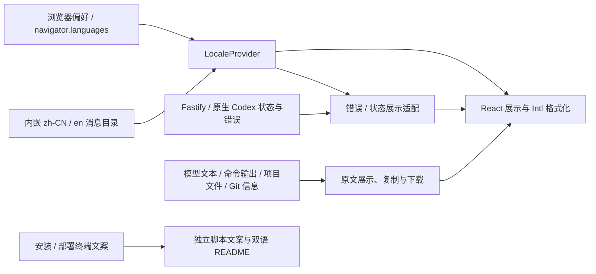
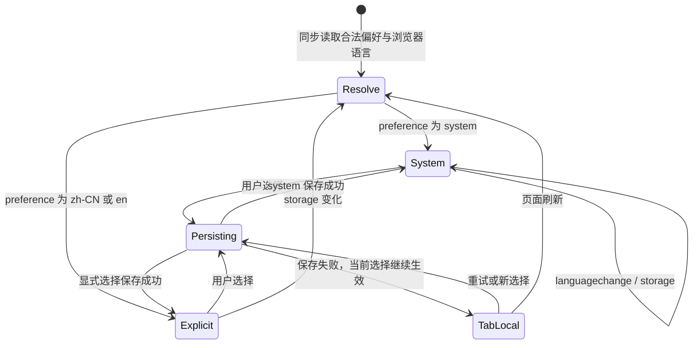

# Codex Web 国际化架构方案

> **Created At**: 2026-10-14 13:56:20 (Asia/Shanghai, UTC+08:00)
> **Active Codex Edition**: 当前会话 Codex；采用 codex-architecture 技能（仓库未声明独立 edition）
> **Status**: IMPLEMENTED
> **Architecture Pattern**: 客户端展示适配层、类型安全消息目录、React Context
> **Scope**: 本轮已按推荐选项实现简体中文／英文 UI、浏览器语言偏好和错误展示层；未新增依赖。原 error／status 保留，通用错误响应追加窄 code；当前运行后端未重启。

## 1. 目标、假设与当前证据

初期支持简体中文 `zh-CN` 与英语 `en`，让用户在浏览器内切换界面语言，统一日期、数量和可访问名称。语言选择属于浏览器展示偏好，不改变 Codex 模型回复语言、原生配置、项目内容、请求成功状态或写入权限。第三种语言、服务端账户同步、服务端渲染与翻译平台暂不进入首期。

这是基于当前源码的有限范围检查，不是全仓文案覆盖统计。先使用 `codex_web` 项目的代码索引发现符号，再读取源码和检查索引覆盖。覆盖工具报告被检查路径的元数据有变化，`Settings.tsx` 第 37 行还存在部分解析缺口，因此以直接源码为准，不据索引作“无遗漏”结论。

| 当前位置 | 已观察到的行为 | 设计影响 |
| --- | --- | --- |
| [`package.json`](../../package.json) | React 19、TypeScript、Vite；当前依赖清单没有 i18n 运行库 | 可以直接接入 Context；本设计不需要切换应用框架 |
| [`src/web/main.tsx`](../../src/web/main.tsx) | `App` 包含登录、侧栏、最近会话文案；文件末尾直接渲染 `<App/>` | 在根入口包 Provider，覆盖登录前后与设置页面 |
| [`src/web/Settings.tsx`](../../src/web/Settings.tsx)、[`WebSettings.tsx`](../../src/web/WebSettings.tsx) | 分类名、保存离开对话框、浏览器偏好、维护状态均含中文文案 | 语言控件放在 Codex Web 的“浏览器偏好”；本地展示选择不进入原生配置保存流程 |
| [`src/web/preferences.ts`](../../src/web/preferences.ts) | 本地偏好采用版本化 storage key、校验写入、部分同标签事件；主入口监听 `storage` | 新建独立语言 key，复用行为约定，避免复用布局或会话排序数据 |
| [`src/web/api.ts`](../../src/web/api.ts) | 保留 `data`、`status`；读取失败与提交结果待核实有不同消息 | 错误显示翻译必须保留读写语义和原始错误字段 |
| [`src/server/app.ts`](../../src/server/app.ts) | 已知错误返回 `{error, code, partial}`；认证、验证等分支还有无 code 的英文错误 | 首期不假设所有响应已有可翻译 code；未来补齐稳定 code 要做兼容迁移 |
| [`src/server/shared-client-state.ts`](../../src/server/shared-client-state.ts) | `publicError` 返回 `{message, code?}`，共享快照缓存展示数据 | locale 不进入共享缓存 key；客户端翻译结构化状态 |
| [`src/web/SessionView.tsx`](../../src/web/SessionView.tsx)、[`turnActivity.ts`](../../src/web/turnActivity.ts) | 历史加载、发出消息状态、`serverOverloaded` 专用提示与错误原文 | 历史/发送状态不因切换语言重置；专用提示与诊断原文同时保留 |
| [`src/web/Conversation.tsx`](../../src/web/Conversation.tsx) | 消息标题日期依赖浏览器默认 locale，运行时长拼接“小时/分/秒”；消息组件使用 memo | 翻译消费方必须订阅 Context；不能只改变父级而留下 memo 子树旧文案 |
| [`src/web/GitHistory.tsx`](../../src/web/GitHistory.tsx)、[`accountUsage.ts`](../../src/web/accountUsage.ts)、[`InstalledPlugins.tsx`](../../src/web/InstalledPlugins.tsx)、`WebSettings.tsx` | 日期常用无显式 locale 的 `toLocaleString`；额度周期、倒计时含数量插值 | 集中定义格式化展示；原时间戳与额度值不变 |
| [`src/web/GitPanel.tsx`](../../src/web/GitPanel.tsx) | 文件名排序使用固定 `Intl.Collator('zh-CN', {numeric:true,sensitivity:'base'})` | 首期保持排序语义；locale 控制文案与格式，不默默改变文件排列 |
| [`index.html`](../../index.html) | `html lang="zh-CN"`，标题 `Codex Web` | 首次 React 渲染前解析 locale、更新 lang；品牌标题可以保持原名 |
| [`README.md`](../../README.md)、[`README_CN.md`](../../README_CN.md) | 两份文档已有互相语言链接 | 继续独立双语维护，界面字典不能代替部署文档翻译 |

## 2. 方案选择

| 方案 | 优势 | 本仓库需要承担的代价 | 结论 |
| --- | --- | --- | --- |
| 小型 TypeScript 字典 + React Context + `Intl` | 两种语言一起打包、无异步加载；键和参数可编译校验；与现有客户端入口吻合 | 维护一个小型键解析和格式化边界，限制它的功能规模；翻译协作初期由仓库完成 | **推荐首期采用** |
| i18next + react-i18next | 成熟的 fallback、复数、命名空间和类型支持，适合更多语言及翻译流程 | 引入运行依赖与初始化约定；异步资源还需要处理加载和 Suspense，若采用需显式选择同步内嵌资源 | 扩展条件出现时再迁移，当前不引入 |
| 迁移到带 locale 路由/SSR 的完整应用框架 | 多语言路由和服务端页面能力可纳入整体框架 | 本项目现有 Vite SPA + Fastify 不因双语展示产生框架迁移需求；会扩大路由、部署和验证范围 | 不推荐为本需求迁移 |

i18next 的能力比较参照官方 [TypeScript](https://www.i18next.com/overview/typescript)、[Fallback](https://www.i18next.com/principles/fallback)、[Plurals](https://www.i18next.com/translation-function/plurals) 和 [react-i18next useTranslation](https://react.i18next.com/latest/usetranslation-hook) 文档。其存在成熟能力并不意味着首期必须引入；这里的取舍依据是本仓库当前双语范围与同步客户端展示需求，没有声称体积或性能收益已经测量。

若需要三种以上且复数规则复杂的语言、非开发者翻译平台、按需加载的多个语言包、复杂 ICU/富文本消息，重新评估 i18next/FormatJS。保留语义 key 和统一调用边界可降低迁移成本；不要继续给小型字典增加自制 ICU、模板解析器、网络后端和插件系统。

## 3. 有界上下文与数据流

- **界面展示域**：按钮、导航、字段标题、提示、操作结果、时间与计数、`aria-label`、`title`、placeholder。
- **运行与协议域**：HTTP status、错误 code、枚举值、会话 ID、phase、时间戳、幂等键、审批决策不翻译。locale 不参与原生 thread 读写、SSE 重连或缓存身份。
- **用户与工具内容域**：用户输入、模型 Markdown、推理文本、工具返回、命令 stdout/stderr、文件、diff、Git commit message、插件原生名称/描述保持原文。状态标签可以翻译，数据本体不改写。切换 UI 语言不会向模型补发系统指令。
- **安装与文档域**：独立于浏览器生命周期；本轮安装/Tailscale 文案工作可继续，其功能不依赖此方案实施。终端若以后双语化，应另行确定显式 CLI 参数/环境变量和稳定输出边界。

## 4. 模型与不变量

使用轻量展示模型，无数据库实体或服务端语言 aggregate：

| 模型 | 定义 |
| --- | --- |
| `Locale` | `'zh-CN' | 'en'`；仅接受这两个规范值 |
| `LocalePreference` | `'system' | Locale`；`system` 表示跟随浏览器 |
| `LocaleState` | preference、effective locale、是否持久化、可选保存失败状态 |
| `MessageKey` | 语义命名，如 `common.cancel`、`session.history.loading`、`api.submit.timeoutUnknown` |
| `MessageArgs` | 每个动态 key 的明确参数类型；次数是数值、路径/服务错误是原字符串，禁止把完整译文当 key |
| `DisplayError` | 展示 descriptor（key+args）或 raw message，以及原 code、status、data；仅用于展示，不决定重试 |

不变量：

1. 两种语言具有相同的消息 key 和参数契约。英文用 `satisfies MessageSchema` 检查；中文字面量不能使英文被约束为相同字面值，schema 的静态文本类型应为 `string`。
2. 译文采用完整句子。动态消息可使用同签名纯函数完成语序调整；静态文本返回 string。`t` 的调用签名按 key 限制参数，纯函数不能访问 React、storage 或业务副作用。
3. 文本由 React 安全渲染。禁止字典里的任意 HTML、`dangerouslySetInnerHTML` 或把动态原文解释为翻译模板。需要链接时由组件用固定 JSX 组合完整句段，禁止依赖拆词拼接。
4. 已迁移 key 缺失时依次查 effective locale、`zh-CN` 基线；两者都缺失视为开发错误。开发环境标记缺失 key，测试/类型检查阻止发布；生产保留可辨认兜底并记录一次诊断，不抛错破坏页面。此防御不能替代双语完整性验收。
5. 切换语言只更新展示 Context；不重挂载 `App`、`SessionView` 或 Provider 子树，不改变组件业务 key、不丢草稿、不重发请求、不释放会话。
6. 参数、原始错误和模型输出不写入持久化翻译目录。服务端日志仍保存原错误，浏览器复制原文功能仍返回原文。

## 5. Locale 解析、持久化与生命周期

语言控件显示 `跟随浏览器 / 简体中文 / English`，英文界面对应 `Browser language / 简体中文 / English`。采用本国语言名称，用户在陌生界面也能切回。

**优先级**：本标签页正在使用的显式选择 → 合法持久化 preference → 浏览器语言列表中的首个支持项 → `zh-CN` 产品基线。`system` 是跟随浏览器的选择，不将当次探测结果固化成显式语言。首期不从 URL、服务端配置、模型设置或 Accept-Language 读取用户覆盖项。

- key：`codex-web:locale:v1`，值只接受 `system`、`zh-CN`、`en`。读失败、无值或非法值按 `system`；不在读取阶段强制写 storage。
- 浏览器探测按 `navigator.languages` 顺序，缺失时用 `navigator.language`。`en-*` 归一为 `en`；`zh`、`zh-CN`、`zh-SG` 和显式 `zh-Hans` 家族归一为 `zh-CN`。`zh-TW`、`zh-HK`、`zh-MO`、`zh-Hant` 不宣称已有繁体翻译，继续找下一个支持项；没有支持项才回基线。
- 显式选择立即在当前标签页生效。写入后读回核对；失败则保留本标签页临时选择，并显示当前语言的“未保存，仅当前标签页有效”状态。刷新后重新解析存储，不能声称跨设备已保存。
- 成功写入后发出 `locale-changed` 同标签事件；其他标签页监听 `storage`，只处理此 key 或 clear 事件。同步读取不会再次写入/广播，避免循环。清除/非法新值回到 system。
- 保存失败产生的临时选择优先于其他标签页 storage 更新，直到此标签页成功保存新选择、选回 system 并成功保存，或刷新。UI 保留重试保存入口，解释其临时性质。正常已持久化标签页接受新 storage 值。
- 跟随浏览器模式监听 `languagechange` 重新解析；显式选择不被覆盖。监听器挂在单个 Provider，卸载时全部移除。
- 在首次 `createRoot` 前用同步纯解析入口得到初始 effective locale、设置 `document.documentElement.lang` 与 `dir='ltr'`；Provider 使用相同初始状态，避免首次界面与文档 lang 分歧。切换时同步更新 lang；初期两种语言都是 LTR，不宣称 RTL 支持完成。

## 6. 错误、动态状态和格式化合同

### 6.1 错误语义

首期在客户端展示边界解析错误，不要求服务端按 locale 生成响应。`api.ts` 保留 Error 的 `message`、`data`、`status` 兼容性；新增客户端传输错误 descriptor，并由 `formatDisplayError(error, locale)` 展示。`READ_TIMEOUT` 与 `SUBMIT_TIMEOUT_UNKNOWN` 等展示类别不可合并；提交断线仍强调结果待核实、不自动重试。不要用译文匹配替代原有 code/status 判断。

已经有窄语义 code 的响应按显式 allowlist 翻译；例如 `RUNTIME_THREAD_BUSY` 可以给出对应说明。`PROJECT_ERROR`、`RUNTIME_ERROR`、`PUSH_ERROR` 等宽类别不能被假设为单一具体原因：无更窄 code 时保留原 message，必要时加通用本地化前缀。未知 code、第三方异常、已有服务端文字不做全文词典替换。HTTP status 只能生成通用兜底，不能凭一个 409 推断冲突类别或凭一个 401 推断具体登录失败原因。

`serverOverloaded` 仍只按 `codexErrorInfo` 精确识别；翻译“模型服务过载，本轮曾中断”这个展示描述，保留原始 message 作为详情。locale 不更改本轮状态为完成，也不清空失败记录。

逐步迁移现有 `setError(e.message)`、拼接“同步失败：”等路径为 descriptor/raw union，在渲染时才翻译。纯内部状态可以存 key+args，长生命周期错误不能预先生成译文存入业务 state。尚未迁移的错误显示原文，明确保留此兼容边界。

后续若补齐无 code 的认证/验证/NotFound 分支或快照 warning，采用新增稳定 code/参数的兼容字段，保留旧 `error` 或 `message`；不改变 status、partial、诊断日志或共享缓存 key。服务端详细参数只能暴露现有允许的公开信息，不能把内部堆栈/凭据变成插值参数。

### 6.2 时间、计数、复数与排序

- 集中使用 `Intl.DateTimeFormat(locale, options)`，显式 effective locale；时间仍用浏览器所在时区，界面语言不改变时区。消息保留 ISO `dateTime`，tooltip 展示已本地化的时间说明与可识别时区。
- `Conversation.tsx` 的消息毫秒与 turn 秒单位保持现有规则；`accountUsage.ts` 的秒转毫秒、未知值校验保持现有规则。无效/未知时间显示翻译后的未知提示，不显示 epoch 0。
- 用 `Intl.NumberFormat` 格式化真正的显示数值/百分比；业务运算和 API payload 继续原值。`balanceText` 与 `creditCount` 接受十进制字符串，不经 `Number` 强转导致大整数/小数精度损失；首期保留精确数字表达，只翻译旁边标签，后续有独立精度安全格式化需求再设计。
- 动态消息在整句 formatter 内用 `Intl.PluralRules` 选择 `one/other`（英语）与 `other`（中文），0/1/2 都有明确测试。日/小时/分钟组合由独立 duration formatter 完成，不翻译散落的单位字符串后继续沿用中文语序。
- 倒计时仍是原逻辑的预计恢复时间，不将“预计/等待更新”译成“已恢复”；复数和格式不改变舍入、周期判断或计时频率。
- 文件名排序首期保留固定 collator，避免界面切换造成文件顺序变化。会话排序继续按当前时间/收藏等数据字段；若将来开放语言相关排序，作为独立行为需求设计和测试。
- formatter 可按 `(locale,固定 options)` 缓存；不为每条 streaming token 新建 formatter。语言改变只需重新渲染文案，不能借此全量请求历史或重新解析原始内容。

## 7. 可访问性与安全展示

可见标签与 `aria-label`、title、placeholder、空态、loading、错误对话框同步迁移。保留 DOM id、role、`aria-labelledby`/`describedby` 关系、焦点返回和当前设置的未保存导航保护。语言切换不把焦点移动到页面顶部，不关闭审批/维护对话框；语言控件具有关联 label，保存失败沿用 alert/status 的清楚反馈。

屏幕阅读器依赖正确的 html lang；语言切换后名称同步更新。无法可靠识别模型原文的语言时不要猜测并标记为所选 UI 语言；已知原文 locale 才设置局部 lang。UI 语言不授权翻译用户输入，也不能改写代码或破坏复制内容。

在英文长度和 200% 缩放下检查菜单、按钮、设置、移动端抽屉及对话框。沿用当前 responsive 布局，必要的布局修复要在实际截图证据后做，不预设固定按钮宽度。语言目录不接受远程任意 HTML，也不增加网络翻译调用。

## 8. 文件边界与分阶段迁移

下列新增路径是**待实施建议**，并非当前已有文件；现有路径来自上面的源码检查。

| 阶段 | 建议修改/新增位置 | 完成边界 |
| --- | --- | --- |
| 0：设计确认 | 本文 | 明确 zh-CN/en、system 默认策略、客户端翻译与原文边界；本轮到此交付 |
| 1：基础与试点 | 新增 `src/web/i18n/{types,locale,messages,format,LocaleProvider}.ts/tsx`（按内容选择扩展名），根入口 `main.tsx`；`WebSettings.tsx` 浏览器偏好，`Settings.tsx` 导航和通用按钮 | 同步资源、类型契约、语言解析/保存/跨标签/lang；试点两个语言完整，其他区域仍按原文运行，不能宣布全界面双语 |
| 2：日常主路径 | `main.tsx` 登录与侧栏、`SessionView.tsx`、`Conversation.tsx`、`turnActivity.ts`、`api.ts`，新增 `src/web/i18n/errors.ts` | 核心任务流与错误 descriptor 迁移；不重置历史/草稿/发送状态，不触发额外业务请求 |
| 3：设置与项目面板 | 从 `Settings.tsx`/`WebSettings.tsx` 的导入树逐组件登记；`GitPanel.tsx`、`GitHistory.tsx`、`InstalledPlugins.tsx`、`accountUsage.ts` 的展示路径 | 每个纳入发布范围的区域建立文案清单及双语验收；无遗漏结论必须来自逐区域复核 |
| 4：协议与发布完善 | `src/server/app.ts`、`shared-client-state.ts` 等确实缺少窄错误 code 的响应；双语 README 与部署文档 | 新 code 兼容旧字段，补齐机器可读错误；与 UI locale 无关的脚本/原始日志继续独立维护 |

消息目录按域组织，key 使用稳定语义，不使用中文原句作为索引。两种语言一起静态打包，由 Vite 正常产物分发，不新增运行时语言 HTTP 请求，也不单独改变 PWA cache 策略。若将来拆语言 chunk，再评估资源失败兜底与旧壳/新语言包版本混用。

模块边界建议：`locale.ts` 是可注入 Storage/navigator 的纯解析与持久化逻辑；`messages.ts` 导出双语目录；`format.ts` 放显式 locale 的纯函数；`LocaleProvider.tsx` 管理 state/listener/lang；组件只调用 `useLocale()`；非 React helper 接收显式 locale/translator，不读取可变全局单例。避免在 `turnActivity.ts` 的流程分组算法中引入 React hook，展示标签与语义识别分离。

## 9. 验证与验收

当前 `package.json` 的 `npm test` 只匹配 `tests/*.test.ts`；Playwright 配置匹配 `tests/*.spec.ts`，在 4178 端口启动独立 Vite dev server。实施时沿用这两个入口；本设计未运行应用或创建真实 Codex 会话。

| 验证层 | 当前关联位置与新增建议 | 必须验证 |
| --- | --- | --- |
| 类型/目录 | `npm run build` 的 tsc + Vite；新增 `tests/i18n.test.ts` | 双语 key/参数一致，静态/动态调用正确，缺失和额外 key 阻止发布；所有约定 key 有有效译文 |
| locale 偏好 | 当前 `tests/preferences.test.ts`；新增 `tests/locale.test.ts` | 明确优先级、语言列表顺序、繁体不假装已支持、非法值、读写异常、读回失败、临时选择、clear 与跨标签无循环 |
| 格式化 | 当前 `tests/account-usage-helpers.test.ts`；新增 `tests/i18n-format.test.ts` | 两种语言、0/1/2 复数、冻结时间/指定测试时区、单位边界、未知时间、精确十进制字符串，不用开发机本地格式作为通用期望 |
| 传输错误 | 当前 `tests/web-api.test.ts` | 读超时/提交待核实/断线/无效 JSON 两种语言展示不同，status/data/partial 原样，提交不重复发送 |
| 状态语义 | 当前 `tests/turn-activity.test.ts`、`tests/session-sync.test.ts` | 只翻译标签，分组/失败/历史合并算法不受 locale 影响；overload 仍精确匹配原字段 |
| 浏览器核心 | 新增 `tests/internationalization.spec.ts`；复用 `tests/codex-settings.spec.ts`、`settings-ux.spec.ts`、`session-history-recovery.spec.ts` 的 mock/route 方法 | 登录前后、settings、会话、历史分页、发出消息、原文复制，两种 locale；storage 实际双页面事件；切换 lang/aria 同步，焦点/草稿/已载历史保留，业务请求计数不因切换增长 |
| API 兼容 | 若实施阶段 4：当前 `tests/api-error-logging.test.ts` 与有关路由测试 | 新 code 与旧字段并存，status/partial 原样，日志仍原 message；无凭据/堆栈新增暴露 |

保留现有中文回归作为 `zh-CN` 基线，在需要的测试初始化中明确 locale；新增英文用例也应明确 locale。行为测试优先稳定 `data-testid`、id、协议值，名称本地化测试明确使用该 locale 译文。不能为了消除失败，把全部中文名称断言改成宽泛正则而失去无障碍名称验证。

正式宣称“支持 zh-CN/en”需完成约定发布范围的逐区域清单、相同操作的双语回归、移动/桌面和缩放可视检查、关键原文不变及请求次数验证。阶段 1/2 的通过只能称试点/主路径完成；未知服务端原文作为兼容边界记录，不能算完整翻译。设计验收不代表这些实现检查已经通过。

## 10. 主要风险与实施决策

1. **陈旧错误文案**：当前许多组件把 `e.message` 存成字符串，切换后可能仍是旧语言。按 descriptor 逐路径迁移；未迁移原文保留，不能全局正则替换。
2. **错误宽 code 混用**：按 `PROJECT_ERROR` 等宽类别强行翻译会丢具体原因。只有窄 code allowlist 可映射具体提示；新增协议字段需要兼容验证。
3. **语言触发副作用**：将 translator 放进 fetch effect 依赖或把 locale 用作 React key 会重读历史/破坏草稿。展示变化不触发业务请求，验收必须检查调用次数和保留状态。
4. **时间/数量语义变化**：日期单位、额度字符串精度、未知值和“预计恢复”不能在格式化中被重新定义。纯 formatter 明确输入合同并复用原计算逻辑。
5. **半迁移发布**：文案散在根入口、会话、设置与面板，索引还存在缺口。按区域清单验收，不以 key 数量或一次字符串搜索推断全仓完成。
6. **安装与 UI 耦合**：PowerShell/bash 自启脚本拥有独立运行环境；浏览器 language preference 不能控制服务启动、Tailscale 路由或命令输出格式。README 与 README_EN 的命令/版本/参数必须保持对应，文本可独立翻译。

建议下一步先将阶段 1/2 转成具体实施计划并获得相应实施授权，再按阶段迁移。本文不构成 UI/runtime 改动已经实施或验证成功的声明。

## 11. 实施落地（2026-10-14）

推荐方案已按[实施计划](../../docs/superpowers/plans/2026-10-14-internationalization.md)落地，实际范围、失败分母、浏览器状态保持、原文边界及本机静态更新见[验收记录](../../docs/verification/2026-10-14-internationalization.md)。本文件前述源码观察保留为设计时基线，当前实现以 src/web/i18n/ 和验收记录为准。
