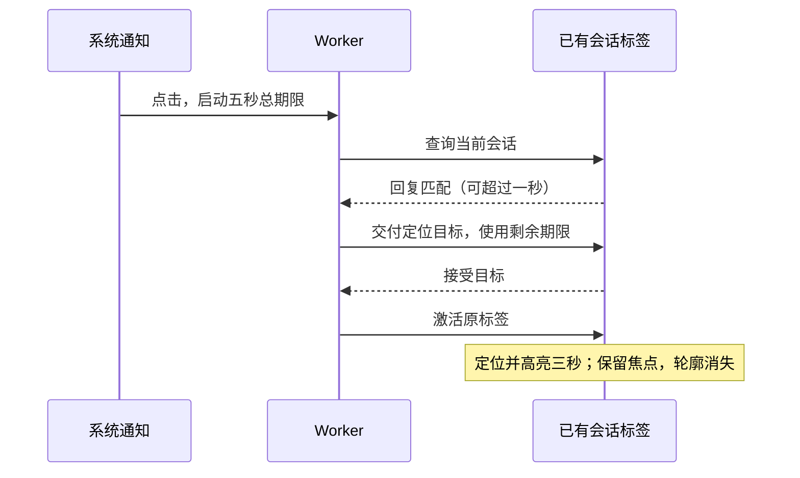

# 通知后台标签与高亮修正

2026-10-09。用户反馈：Chrome 同一窗口已有目标会话时，点击系统通知偶尔新开标签页；定位正确后绿色边框超过三秒，点击空白才消失。用户本次明确授权修复，并允许修复完成后安排一次重启。该重启授权只适用于本次。

## 已确认的原因与证据边界

当前发布构建在隔离真实 Chrome、React 页面复现高亮问题：三秒定时器正常删除 `notification-target`，但定位调用的 `focus()` 仍使消息容器匹配全局 `*:focus-visible`，又显示同色绿色轮廓。点击空白移走焦点才消失。不是后端未重启造成定时器未执行。

当前 SW 只给路由查询一秒，确认目标页后又单独给目标接受五秒。使用未改动的 `public/sw.js` 模拟实际客户端回复延迟：已有目标标签在 1.5 秒回复时，SW 在约 1.01 秒新开目标标签。能复现该回退机制；尚未捕获用户那次 Windows 点击时的页面回复，不能断言是真正冻结、旧页面或代理导致。

隔离 Chrome 的后台/冻结探测没有实际触发页面隐藏或冻结：计时器仍推进，页面仍可回答。因此该探测不能证明休眠标签可及时唤醒，也不能用于排除现场冻结。

只读检查受管服务 PID 38492 返回的 HTML、JS、CSS、SW 与当前 dist 一致；未知用户每个既有标签实际加载的版本。这两项前端修正需要页面和 Worker 更新；本次服务重启另按用户当次授权执行。

原始证据：`.local/notification-click-audit-20261009/probe-result.json`、`served-current.json`，以及 `.local/notification-highlight-audit-20261009/evidence.json`、`sw-lifecycle-evidence.json`。保留失败和未能冻结的记录。

## 最小修正方案

1. 路由探测和目标接受共享从本次点击开始的五秒期限，保留并行探测。立即答复会话不匹配或没有可选标签时立即回退；慢回复只消耗剩余期限，不再因超过一秒就重复开页。期限届满仍无可信目标或接受确认时，允许安全新页回退。
2. 继续以页面真实路由回复识别目标，并在目标接受后聚焦。`WindowClient.url` 只校验同源，不用它推断当前 SPA 会话。保留最新点击优先、加载中 ready 补交付、顶层页面限制、目标字段校验和端口/计时器清理。不导航其他会话。
3. CSS 仅排除 `[data-item-id]`、`[data-turn-id]`、`[data-request-id]` 且 `tabindex="-1"` 的通知定位容器，在没有 `notification-target` 时显示的全局焦点轮廓。保留真实焦点和三秒通知高亮，不调用 blur；按钮、输入框的键盘焦点样式继续显示。

五秒是路由探测与目标接受共用的握手期限，`matchAll` 和激活排队耗时也消耗该期限；它不能中断尚未返回的 `matchAll` 或已启动的 `focus` / `openWindow`，不承诺整个点击在五秒内完成。真正冻结、关闭或未更新页面不保证始终复用。新增永久页面索引会引入过期 SPA 路由，本次不增加这种状态层。

## 界面预览

只修正边框生命周期，不改变消息布局。以下是实际当前 dist 隔离夹具注入建议 CSS 的设计预览，不能当成产品已修复的验收。

预览确认三点五秒后容器仍为 activeElement、仍匹配 focus-visible，outline 为 none；实际按 Tab 到“复制 Markdown”按钮仍显示绿色两像素轮廓。

## 实施和验收范围

修改限定 `public/sw.js`、`src/web/style.css` 与通知测试/夹具，不改推送订阅、会话占用、后端刷新或代理配置。

- 保留旧代码路由慢回复失败回归；修正后验证 1.5 秒回复复用已有页、共享剩余期限、明确不匹配快速回退、真正无响应安全回退。
- 回归 SPA 创建地址错位、探测后切走、多标签同源边界、ready 重发、最新点击、计时器和端口清理。
- 当前最终 dist 在隔离真实 Chrome、React、SW 中验证慢回复选页、定位三秒后无残留轮廓、按钮和输入框键盘焦点、参数消费后刷新不重复定位。
- 执行构建和相关测试；真实 Windows 通知点击、实际后台休眠仍需用户现场验收，不能用 VM 或 headless 结果代替。
- 全部完成后只安排本次授权的受管服务空闲重启，使用 `restart-server.ps1 -RequireIdle`。有活动任务则取消；安排成功后告知时间并结束本轮。后续读取结果文件 `success` 才能确认重启成功。

## 实施结果

SW 与 CSS 已按上述范围实施。使用 Worker 同一 realm 的单调时钟 `performance.now()`；入口、回包、ready 重发和激活排队后的交付均核验剩余期限。浏览器夹具的两个内部函数调用同步适配共享 deadline。

- 未改动的旧 SW 在新增七项回归中六项失败、一项通过，失败证据保留于 `regression-before.txt`；修正后的五个通知相关测试文件共 45 项全部通过、零取消、零跳过，证据为 `regression-after.txt`。
- 回归覆盖一秒五后的路由答复、剩余接受预算、客户端枚举耗时、静默与迟到回复、明确不匹配、激活排队，以及 timeout 已到但计时器尚排队时 ready 不得重发。
- `npm run build` 与 `git diff --check` 成功。独立源码审查未发现必修问题。旧版浏览器 API 的已开始激活仍不能取消，保留最新点击最终激活的串行约束。
- 只读 HTTP 核验线上 HTML、JS、CSS、SW 均为 200 且 SHA256 与最终 dist 一致，旧服务 PID 38492 保持不变。更新证据 `served-after.json` 与原 `served-current.json` 分开保存。

本轮证据目录：`.local/notification-click-audit-20261009/`。首次测试因系统 TEMP 沙箱权限出现 Push 测试 EPERM，使用工作区隔离 TEMP 后通过；还修正了 VM 的 performance 注入前提。这些测试环境问题不算产品回归通过，未据此更改产品行为。

最终发布构建在隔离真实 Chrome、React、HTTP/SSE、Service Worker 验证通过，退出 0，未注入提案 CSS，零 pageerror：

- 精确消息的通知类三秒后删除，目标仍保留真实焦点，computed outline 为 none；实际 Tab 到复制按钮与输入框仍显示正常键盘轮廓。
- 创建地址 `/sessions/other`、当前 SPA 会话 `/sessions/target` 的原标签，在真实 React 路由消息延迟后于 1517ms 被实际 SW 选择并接受目标；非目标页面仍在原会话，通知探测前后 POST 数为 19→19。
- 原有 URL 一次性消费、刷新不重定位、历史分页、登录保留、失败与输入目标、加载中补交付回归继续通过。

最终证据：[result.json](../../.local/notification-url-20261009/browser-1791517209173/result.json)。实际产品界面截图：

两次浏览器夹具前提失败保留在 `browser-1791517092203` 和 `browser-1791517142556`：后注册的 capture 监听未能先于 React 延迟消息；原 MessageEvent 被停止传播后不能可靠重新交付。仅修正隔离夹具为应用启动前注册、使用原始 data/source/ports 创建等价 MessageEvent 转发给真实 React。没有伪造路由回复或 ACK，未放宽延迟、选页、POST 和定位断言。三轮日志分别保留为 `browser-attempt-1/2/3.log`，`browser-final.log` 指向最终通过结果。

本次不重跑无关全量测试，不发送新的 OS 通知。Windows 实际点击与真正休眠标签尚未现场复测。修复已完成，本次授权的空闲重启待安排；安排后只以结果文件的 `success` 判定实际重启成功。
