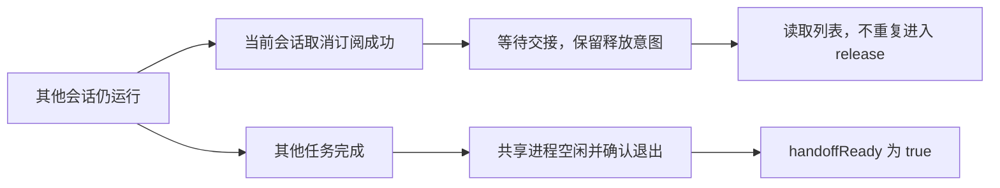
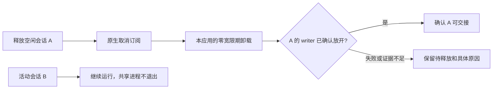

# 会话列表失败、释放等待与项目归属修复

## 现场证据与归因边界

2026-10-09 01:27 启动的 Web 进程记录到 `/api/sessions` 连续 HTTP 500，首个失败在 01:28:36，耗时 1264ms。后续多次失败不到一秒。已有 RPC 记录未出现原生请求失败，采样仍显示 `thread/list` 在读取；成功且不足一秒的 RPC 本来不会记录 `rpc_end`，不能据此说没有原生读取。

旧 HTTP 日志只保存状态和耗时，未保存异常 message/stack，因此无法从旧现场记录确定具体异常类型。只读检查 Web metadata 数据库的 `quick_check` 为 ok，已登记分支头部 JSON 有效。以下是已复现的代码缺陷，而非补造旧现场堆栈。

用户随后提供 `dualview` 会话截图：取消订阅后等待其他运行时工作，页头却显示“已释放”。该截图直接证明 pending handoff 状态存在；它不证明 writer 锁已经释放。

## 本轮已授权修复

1. 释放等待中的会话不再在每次原生读取结束后重复进入 release。已有订阅取消后，只尝试在共享进程空闲时完成交接，保留活动任务保护。
2. 手动释放在原生取消订阅成功后保留等待交接的意图；其他任务完成时能够继续交接。未确认取消订阅、活动冲突和释放失败不得隐式排队。
3. 列表重试期间两次版本变化产生的可用性失败写入当前版本的失败缓存；普通旧版本异常不得污染新版本。非周期后台刷新尊重失败缓存，真实失效、手动刷新及 60 秒周期刷新仍能读取新状态。
4. 普通模式将 API 未预期异常与 5xx 的 name/code/message/stack、UTC 时间、PID、请求 ID 和模板路由写入现有 stderr/server.log。诊断模式额外关联 `http_error` 与 `http_end`；不附加请求 body、cookie、header、query 或异常的其他属性。客户端不接收堆栈。共享状态 503 保留其错误码，不再转换成通用 500。
5. 诊断采样包含已取消订阅但等待交接的会话及 requested/released/handoffReady 布尔状态。前端在交接未确认时显示“等待释放占用”。
6. 项目比较键规范 Windows 扩展 drive/UNC 路径；空目录及工作根目录归“无项目”。Desktop 默认任务目录只有在来源、空原生项目/Git 字段、服务器提供的专用根目录及日期/任务目录结构同时匹配时归“无项目”。真实注册与未注册项目继续保留分组，不新增原生请求或会话正文读取。
7. Git 远程刷新成功提示显示 5 秒后清除；失败或结果不确定的提示保留。下一次刷新及上下文切换取消旧提示计时，旧计时不能删除后来的失败提示。

离线验证使用真实 Runtime、API、HTTP/SSE 和受控原生协议夹具，涵盖一会话运行、另一会话释放、分支头部文件读取以及多标签列表同步。失败基线、沙箱环境失败与通过结果分别保存。本轮不通过杀进程或修改真实会话来制造释放成功。

## 验证与交付边界

- 六个修复包独立审查通过。审查额外发现交接完成后中文等待提示未消失，已补齐 handoffReady 条件并做真实浏览器 RED→GREEN；成功释放返回的静态等待 warning 已改由快照中的等待状态承载，避免塞入通用错误后永久残留。真实异常与释放失败原因仍保留。
- 完整 Node 回归 521 项：516 通过、0 失败、5 个平台跳过。该全套基于释放界面 v2；之后仅删除静态等待 warning 的成功分支，采用真实浏览器及类型检查增量验证。完整测试实际使用默认 reporter，不声称严格串行或 TAP。
- 首次沙箱全套因路径/本地夹具权限出现环境失败并提前终止，保留部分输出，不能当成完整分母；获准运行隔离夹具后全套通过。
- 真实 Chrome 三标签使用实际 React、Runtime、HTTP/SSE 及独立协议夹具，目标直接手动释放，另一会话自然完成，再确认子进程退出、关闭目标页并从最近入口恢复；没有额外导航释放或直接赋值 handoffReady。
- 同时启动两个会话的一个浏览器试跑产生 2 次受控 SHARED_STATE_UNAVAILABLE 503，随后自行恢复 200；证据保留。这是双版本变化的有界读取冲突，与原先无限释放/读取循环不同，不能将该试跑描述为零失败。稳态释放回归在会话连接后检查，没有放松 5xx 断言。
- 项目归属及 Git 提示分别通过 1280px/390px 新增和既有浏览器回归；类型检查、构建及 diff 检查通过。原型验证不表示折叠/通知的新产品行为已经实现。

主目录更新和构建完成后，已经运行的 Node 模块仍需按用户约定手动重启才会加载新后端。本轮不自行重启活动服务，也未修改用户所指真实会话来验证恢复；因此不能宣称旧生产 500 和该真实会话已在线恢复。旧现场异常没有堆栈，准确归因仍需新普通错误日志支撑。

## 并发会话即时交接：已实施，待统一部署

上一阶段将 handoffReady 定义为所属 AppServer 进程确认退出。本阶段在取得可靠的线程 writer 正向证据后，允许单个线程交接，同时保留无法证明时的共享进程空闲退出兜底。

精确版本证据：已安装 Codex 0.160.1 的默认 `thread_unload_delay_secs` 为 60 秒；当前在线文档描述 30 分钟，不能套用来解释该安装版本。原生 `thread/unsubscribe` 不是即时卸载成功回执。正常 shutdown 按线程释放 writer，但持久化 shutdown 失败后仍可能发完成事件，不能无条件将 `thread/closed` 当作锁释放证明。

实现保持一个共享 AppServer，只对本应用拥有的 Windows 默认子进程设置 `thread_unload_delay_secs=0`，不修改用户全局配置。释放空闲会话后等待原生卸载完成，再通过针对该线程的只读占用证据确认本应用 writer 已放开；原生清理失败或证据不足继续标记待释放，并记录具体原因。其他活动会话继续运行。

Windows 检查先在原生协调锁内确认 writer 真正持锁（error 33），保留原文件句柄及卷/文件身份；收到 `thread/closed` 后，在协调锁内确认原句柄可独占锁定，且当前路径未换成新 writer。只读打开已有文件，不写入、创建或删除锁文件。文件缺失和完成事件都不能单独作为成功条件。检查辅助进程只在释放期间短暂存在，不为每个会话新建 AppServer 或 MCP；关闭失败、恢复/重新获得占用、超时和无法检查均保持安全兜底并记录有界原异常信息。

隔离 Codex 0.160.1 的真实 Runtime 回归通过：A 返回 handoffReady=true、runtimeStopped=false，B 在同一 PID 保持加载和真实 writer 锁；恢复 A 后重新持锁。没有复制认证信息或发送模型请求。真实 B 为已加载的空闲会话，持续运行的 B 由真实 Node 协议夹具覆盖，不能把它写成原生忙推理实测。首次 Runtime 因卸载回执顺序而停止共享进程的失败记录保留，已用有界等待修复。原生重获新文件身份会被拒绝；清理异常和竞争路径由离线回归覆盖，未注入真实 ACL 拒绝或持久化 shutdown 故障。

最终定向测试 10/10，相关 Runtime 回归 116/116、标题和来源回归 32/32；独立审查额外发现 Runtime.close 异常跳过辅助清理，已用外层 finally 修复并复验。最终包 `.local/native-handoff-final-20261009-v2`，独立审查 `.local/native-handoff-independent-review-v2.md` 通过。本段是本次已确认实施内容，主目录构建及空闲检查重启在统一整合后完成。

来源：[本版本默认等待](https://github.com/openai/codex/blob/rust-v0.160.1/codex-rs/core/src/config/mod.rs#L3912)、[取消订阅官方语义](https://learn.chatgpt.com/docs/app-server#unsubscribe-from-a-loaded-thread)、[线程 writer 清理](https://github.com/openai/codex/blob/rust-v0.160.1/codex-rs/thread-store/src/local/live_writer.rs#L153)、[writer 锁释放](https://github.com/openai/codex/blob/rust-v0.160.1/codex-rs/rollout/src/writer_lock.rs#L163)、[清理失败仍产生完成事件](https://github.com/openai/codex/blob/rust-v0.160.1/codex-rs/core/src/session/handlers.rs#L354)。
