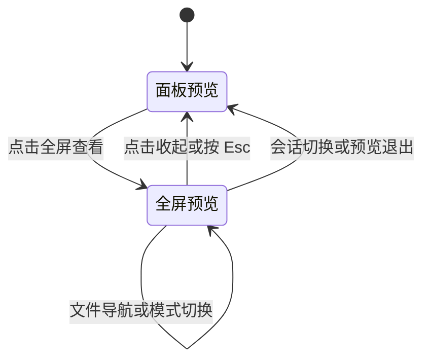

# 文件预览全屏查看设计

日期：2026-10-11。状态：已按用户授权实施并完成浏览器验收，主目录 `dist` 已更新。

用户希望现有文件预览能够通过浮层铺满网页，展开和收起快速切换，阅读体验顺畅，避免额外加载和渲染开销。本设计与 [项目归属融合设计](2026-10-11-native-project-integration.md) 共同实施；具体证据见[持久验收记录](../superpowers/reports/2026-10-11-preview-project-recovery.md)。

## 1. 命名和范围

入口名称为 **全屏查看**，展开后同一按钮变为 **收起**，提示文字为“返回面板预览”。使用四角展开/收拢图标，按钮有完整的中文可访问名称。

覆盖当前三处入口：项目面板的“文件”“变更”，以及“Git 日志”中的提交文件差异。Markdown、源码、图片、文本差异和图片差异共用同一种展开操作；目录列表和提交列表留在后台。

这里的全屏范围是网页可用区域。使用页面浮层，浏览器工具栏仍然可见。

## 2. 界面

普通面板：按钮位于文件标题栏最右侧，和前进、后退、最近文件一起排列。桌面按钮统一为 28×28px、垂直居中，与导航组间隔 8px；普通面板的按钮距边缘至少 6px，全屏时跟随桌面 24px、手机 12px 的工具栏内边距。窄面板显示图标，悬停或键盘聚焦时显示名称；手机和粗指针触屏按钮点击区域至少 44×44px，包括手机横屏。

全屏浮层：占满网页可用区域，沿用当前背景、文字和边框风格。固定顶部工具栏，正文独立滚动；桌面内边距约 24px，手机约 12px，并处理安全区和动态视口高度。

```text
┌─────────────────────────────────────────────────────────────┐
│ ← → 最近文件   报告.md · docs/reports   预览 / 源码   ↙ 收起 │
├─────────────────────────────────────────────────────────────┤
│                                                             │
│                    文件预览正文                             │
│                                                             │
└─────────────────────────────────────────────────────────────┘
```

工具栏复用当前入口已有的操作：文件预览保留文件导航和 Markdown 模式切换，差异预览保留对应的差异视图操作。小屏时路径截断，完整路径可查看，收起按钮始终可见；现有模式切换可以占第二行。

Markdown 文档容器居中，宽度上限按视口保留 960 / 1440 / 1920px 档位。正文采用第一版的 960px 上限，窄屏随可用区域收缩，标题、段落、列表、引用及文末操作保持同列；顶层表格可以扩展到容器宽度，小表格跟随阅读列，超宽内容只在表格内部横向滚动。具体规则和实测见[正文阅读列与宽表格](2026-10-11-preview-reading-width.md)。普通面板沿用原布局。源码和差异视图使用全部剩余宽度，横向滚动沿用现有行为。图片按浮层可用空间适配，继续使用现有预览资源和大小限制。

## 3. 状态和交互



- 展开仅改变当前预览容器的展示方式，当前文件、模式和内容不变。
- 收起后回到原面板，保留在全屏中最终阅读的位置。焦点返回同一个展开按钮，使用 `preventScroll`，避免背景跟随滚动。鼠标、触屏激活或 Esc 收起均不留下焦点边框；Tab、Enter、空格以及再次用键盘进入按钮时恢复可见焦点，不通过取消焦点规避边框。
- 展开后焦点落在收起按钮，Tab 操作限制在浮层内；背景不接受点击或键盘输入。浮层以当前文件标题提供可访问名称，按钮同步更新 `aria-expanded`；普通状态使用区域语义，展开后使用模态对话框语义。
- `Esc` 先关闭最上层的最近文件菜单，再关闭全屏预览；一次按键不能同时关闭菜单、全屏和手机抽屉。收起全屏后，手机右侧抽屉仍保持原来的打开状态。
- 文件链接、前进/后退和最近文件操作继续使用现有导航，保持全屏。文件加载或读取失败时，浮层内显示原来的加载/错误状态，收起始终可用。
- 会话或项目切换、面板隐藏、标签切换、文件预览消失或组件卸载时，结束全屏并清理所有临时状态。真实文件导航可以改变内容；展开和收起本身不改变内容身份。
- 展开状态不持久化，刷新页面从普通预览开始。现有文件历史、阅读模式和阅读位置继续按原规则保存。

切换立即生效，首版不做宽高伸缩动画或背景模糊。按钮本身提供悬停、键盘聚焦和按压反馈。首版不增加全局快捷键、独立设置项或新窗口。

## 4. 阅读位置

普通预览变宽后，Markdown 会重新排版；仅复制 `scrollTop` 不能保证仍在同一段落。因此在切换前记录当前可见正文块及其相对滚动视口的偏移，在布局完成后校正该块的位置。锚点来自现有 DOM，并限制在当前视口附近，不遍历或重新解析整篇文档。

源码和文本差异继续保持横向、纵向滚动位置；图片视图保留可恢复的滚动位置。接近文件末尾或正文短于新视口时，以浏览器允许的最大滚动范围为准，保持在对应正文附近。

切换造成的临时滚动事件不能覆盖已保存的阅读位置；位置校正完成后再恢复正常记录。继续遵守现有 `previewReady` 保护，读取中的占位布局不能覆盖历史位置。用户在全屏中主动滚动后，收起应回到新的阅读位置，而非展开前的旧位置。

## 5. 最小实现和性能

增加一个小型共享预览外壳，只负责展示状态、容器和焦点生命周期。展开状态放在外壳本地，内容作为稳定的子节点传入，避免切换操作触发 `GitPanel` 文件列表更新或再次遍历源码高亮结果。

使用同一个原生 `dialog` 容器：普通状态为参与面板布局的非模态预览，全屏状态通过 `showModal()` 提升到浏览器顶层。保留同一 DOM 子树和 React 组件身份，不在普通与全屏之间条件渲染两份内容或更换 Portal 容器。React 按组件类型和树位置保留状态。[React 官方文档](https://react.dev/learn/preserving-and-resetting-state)

原生模态对话框会进入顶层并使同文档的背景元素不可交互。已打开的非模态 `dialog` 不能直接调用 `showModal()`：应在同一次同步状态切换中先退出非模态，再进入模态，并处理关闭事件，避免把中间事件误认为用户收起。[MDN：showModal](https://developer.mozilla.org/en-US/docs/Web/API/HTMLDialogElement/showModal)

已修正 `PaneLayout` 的抽屉键盘判断：只在实际 `dialog:modal` 存在时让位。全屏内的最近文件 popover 保持在对话框子树中，明确验证关闭层级。

性能约束：

- 展开/收起不改变内容请求依赖、图片 URL 或内容组件 key。
- 不增加文件请求、Markdown 解析任务或源码高亮 Worker；不复制一份隐藏正文。
- 保留现有 Markdown 和差异视图 memo、源码大文件纯文本降级、滚动保存节流。
- 只在模式切换时进行有限的几何读取和位置校正；滚动期间不增加 React 状态更新或连续布局测量。
- 不引入依赖，不更改服务端读取接口。

## 6. 影响面

| 位置 | 必要变化 |
| --- | --- |
| `src/web/GitPanel.tsx` | 文件/工作区变更预览接入共享外壳，保留导航、滚动记录和读取逻辑 |
| `src/web/GitHistory.tsx` | 提交文件差异接入同一外壳，保留滚动和版本身份 |
| 新的共享预览外壳 | 本地展开状态、原生对话框生命周期、焦点、阅读位置校正 |
| `src/web/PaneLayout.tsx` | 抽屉仅对实际模态对话框让出键盘处理 |
| `src/web/style.css` | 面板/全屏布局、工具栏、正文宽度、图片尺寸、小屏安全区 |
| `tests/preview-performance.html` | 复用现有性能 fixture，增加切换过程的节点、请求和任务计数 |
| 文件浏览、源码、图片、面板浏览器 fixture | 补充完整交互回归，沿用现有测试入口 |

预期无需修改 `panelState.ts` 的持久化结构、文件服务端 API 或现有内容渲染器。若无法保证内容子节点稳定，再依据测量结果调整对应渲染器；不预先做无关重构。

## 7. 验收

1. 在 1280px 桌面和 390px 手机检查长文件名、工具栏、滚动、图片、源码及并排差异；横竖屏变化后收起按钮仍可见。
2. 验证鼠标、触摸、键盘、焦点约束与恢复；最近文件菜单、全屏预览和手机抽屉每次 `Esc` 只关闭一层。
3. 在长 Markdown 中从段落中间展开、继续滚动再收起，保持对应阅读位置；源码保留横向位置，文件末尾遵守可用滚动范围。
4. 在已加载内容上连续切换 20 次：由切换引起的文件请求、图片请求和高亮任务均为 0，正文节点身份不变，长文档切换不重建内容子树。
5. 记录点击到界面可操作的时间和长任务；目标为预热后切换响应 p95 不超过 100ms，并检查切换新增的主线程长任务。结果必须注明设备、文件规模和预热条件，首次读取不混入切换计时。
6. 保留当前预览滚动性能检查，验证切换时的滚动校正不污染持久化位置，后续文件导航和链接锚点仍正常。
7. 实施后运行相关浏览器回归、类型检查、构建和 diff 检查；本次已完成受影响浏览器、类型和构建检查，具体原始日志与边界见持久验收记录。

## 8. 当前检查与边界

Task1 已实现稳定 dialog 外壳并完成 1280×900 / 390×900 浏览器验收与独立复核。Windows / HeadlessChrome155 / Vite开发构建、120节预热 Markdown，每尺寸40次操作，最终修复轮 p95 为33.7/33.5ms；正文节点、文件/图片请求、Worker任务增量及采样长任务均0。中间并行轮出现过1次来源未确定的长任务，原3秒冷启动链接等待也曾超时；保留全部记录。真实手机、Safari/Firefox、线上服务尚未验收，未部署。

### Whole-branch fix wave 实施状态

真实cwd改变清旧预览和文件/Git workspace；只membership改变保留原全屏/正文DOM，wholefix-browser-cwd-green.log exit0。 当时ff55240产品代码focused Node166/166、两组fake browser、tsc/build通过；该阶段最终完整suite待运行，现已完成下方最终验收。旧full #2 704/699属于此前6c1a96d代码。尚未部署/重启，真实App/手机/model与跨浏览器边界保持。详见持久报告whole-branch final fix wave。

### 最终验收状态

全部Task1..4及whole-branch/scoped review已CLEAN，所有原Important已处理，无新breakage/OutOfScope。最终冻结HEAD `91ebe81f88f7cb84043bdc59caa9d24a7ebe1d2f` / tree `dcdb411b3c119171f12cd3cb9ddec27eb8832179` 完整Node **714 total /709 pass /0 fail /0 cancelled /5 skipped，439191.3749ms，EXIT_CODE=0**。日志 `wholefix-node-final-frozen.log`，这是第三轮完整suite、此最终产品树首次完整复验；没有把先前full #2当成最终代码证据。产品未部署、重启或推送；feature本地squash已实际完成，保留12个原完整提交消息；main FF真实结果以后续主目录integration-result.json为准。

本次最终验收后仅更新design/plan/report文字；产品与测试源树保持冻结标识。跨浏览器/真实手机/官方App双端UI/真实model与部署运行边界仍未检，不以fake fixture代替。

### 宽屏表格响应式修正（2026-10-11）

按实际宽表格阅读反馈，在原 960px 基础档上增加 1440px、1920px 两档，仅调整全屏 Markdown 的 CSS 上限。普通面板、源码、差异、图片及展开/收起逻辑保持原行为。

Windows / HeadlessChrome155 / Vite fixture 已验证 390、1280、1439、1440、1600、1919、1920、2048、2560、3440px 共 10 个视口：两个断点前后宽度符合规则，5041px 的 12 列表格可横向滚动，页面与正文滚动区均无整体横向溢出；2048px 视口正文实际宽度为 1920px。页面身份、正文非空、错误覆盖层、控制台、截图与展开/收起交互检查通过。临时测试页面初次装载失败、随后默认 favicon 404 属于 fixture 装载问题，修正测试入口和 favicon 响应后完成上述验证，未为此修改产品逻辑。

原有全屏浏览器回归在 1280/390px 通过，另复用同一回归检查 1600/2048px 新档位：120 节预热 Markdown、每尺寸 40 次切换，p95 分别为 33.6/33.7ms；正文节点、文件/图片请求、Worker 任务与采样长任务增量均为 0，长文阅读位置和焦点/Esc 行为通过。TypeScript 与生产构建通过，主目录 `dist` 已更新；保留既有大于 500kB 的分块警告。本次未重启服务，真实手机和 Safari/Firefox 尚未验收。

### 按钮焦点与布局修正（2026-10-11）

新增回归先复现旧版失败：桌面展开按钮为 44px，与 28px 导航按钮不一致；触屏切换后仍有 2px 绿色焦点边框。共享外壳在鼠标或触屏激活后保留实际焦点、隐藏键盘边框，键盘操作或重新聚焦时恢复可见提示；桌面统一为 28px、导航组间隔 8px，手机与粗指针触屏保持 44px。普通面板边距 6px，全屏边距与工具栏一致（桌面 24px、手机 12px），为键盘轮廓保留空间。

Windows / HeadlessChrome155 / Vite fixture 浏览器回归通过，覆盖文件、工作区差异、提交差异三个入口，以及鼠标、真实触摸事件模拟、Tab/Shift+Tab、Enter、空格、Esc 和键盘重新进入。1280/390px、120 节预热 Markdown、每尺寸 40 次切换，p95 为 33.8/33.7ms；正文节点、文件/图片请求、Worker 任务与采样长任务增量均为 0，阅读位置保持。另在 1280、390、844（触屏横屏）、2048px 检查展开、收起、键盘聚焦共 12 个状态并查看截图，未发现控制台错误或按钮裁切。日志与截图位于本次临时目录 `codex-preview-focus-433f766367ce4688a0394b7b994b642f`。

TypeScript 与生产构建通过，主目录 `dist` 已更新并核对 HTML 引用、焦点样式、按钮尺寸和原有宽屏档位，保留既有大于 500kB 的分块警告。本次未重启服务，未验真实手机、Safari/Firefox 或已登录的完整 App 流程。

### Esc 收起焦点补充修正（2026-10-11）

上一轮将 Esc 收起视为需要显示键盘焦点框，用户反馈仍会残留绿框；本轮改为保留实际焦点并隐藏该次恢复的边框，再次 Tab、Enter 或空格操作时恢复提示。新增浏览器断言先在 1280/390px 复现了 2px 绿色边框；连续 Esc 的补充断言又复现了收起后重新出现绿框，原因是原键盘处理会清除抑制标记，本轮仅在非 Esc 操作时清除。最终验证文件、工作区差异、提交差异三个入口，以及鼠标/触屏/键盘展开后 Esc 收起、连续 Esc、键盘重新进入和菜单/全屏/手机抽屉关闭层级。

Windows / HeadlessChrome155 / Vite fixture 回归、TypeScript、生产构建及产物核对通过，主目录 `dist` 已更新。120 节预热 Markdown、每尺寸 40 次切换，p95 为 33.6/33.7ms；正文节点、文件/图片请求、Worker 任务与采样长任务增量均为 0。日志保存在 `.local/qa-temp/preview-esc-20261011/`，Esc 收起后的按钮截图已查看。本轮没有实施正文与表格分宽方案，未重启服务；真实手机和 Safari/Firefox 尚未验证。

### 正文阅读列与宽表格实施（2026-10-11）

用户确认后已实施独立正文阅读列和顶层宽表格布局，复用现有 Markdown 与滚动节点；同时调整居中正文的阅读位置采样，补齐预览表格的键盘入口。390、844、1280、1440、1920、2048、3440px 浏览器回归覆盖正文 / 表格宽度、嵌套块、阅读与横向滚动位置、Esc、代码 / 图片 / Mermaid。正文实测最大 520px，宽表格保留最大 1920px，页面无整体横向溢出。原有全屏及普通面板回归、11 个相关 Node 测试、TypeScript、生产构建和 dist 产物核对通过；预热切换 p95 为 33.6 / 34.0ms，节点、请求和高亮任务增量为 0。详细证据与验证限制见[分宽设计验收](2026-10-11-preview-reading-width.md#本次实施验收)。

### 正文宽度按反馈恢复（2026-10-11）

用户反馈 520px 正文列太窄，要求至少达到第一版宽度，现已恢复为 960px 上限，窄屏随可用区域收缩，宽表格仍保留最大 1920px。仅修改正文列与小表格最小宽度两条 CSS，复用原有交互逻辑；七视口布局、阅读与滚动位置、Esc 和原有三个预览入口回归通过，预热切换 p95 为 33.5 / 33.6ms。TypeScript、生产构建和产物核对通过，主目录 `dist` 已更新。详细数据见[最新分宽验收](2026-10-11-preview-reading-width.md#本次实施验收)。
