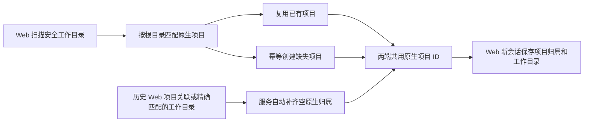

# 官方项目与 Web 工作目录融合设计

日期：2026-10-11；2026-10-12 修订。状态：统一目录来源的“按项目”，目录与历史会话归属由服务全自动维护，取消手动移入/移除。第 13 节记录自动维护和菜单修复；此前隔离验收及一次性同步记录保留为历史证据。

与 [文件预览全屏设计](2026-10-11-file-preview-fullscreen.md) 一起评审。用户补充的真实场景是：原来官方 App 没有添加 `codex_web`，旧会话在官方端没有项目归属；在官方端添加 `codex_web` 后，返回 Web 看到了“502”分组。目标是解释这条变化，并融合官方手动添加项目和 Web 自动发现工作目录的体验。

后续用户报告新建会话出现历史读取及侧栏同步报错，调查与创建交接设计见 [新任务同步与恢复](2026-10-11-new-task-startup-recovery.md)。两项共享原生项目身份和创建响应，实施时一并核对。

用户最终决定：**保留 Web 原来的按目录分项目，直接把这些项目及会话归属同步到官方项目；只有一个“按项目”，不再区分“按项目”和“按目录”。** 自动注册与持久幂等映射已接入；2026-10-12 本机只读确认，扫描范围内七个目录均已有对应官方项目，没有 `502` 项目。

## 1. 调查结论

**“502”没有成为官方正式项目。** 截图标题对应旧会话 `3e5fa27e-1469-40df-a78a-7f53e89c5ed9`，其最初工作目录为 `C:\Users\Developer\work\codex_web`。新增官方项目后，它仍没有原生项目归属，随后当前工作目录变为 `C:\Users\Developer\Documents\Codex\2026-10-11\502`；Web 按当前目录名回退显示出“502”。这是同步前的状态；该会话现已按用户授权关联到 `codex_web`，执行结果见第 10 节。

同步前的本机只读证据（2026-10-11 核对）：

| 来源 | 事实 |
| --- | --- |
| `~/.codex/state_5.sqlite` 的 `projects` / `project_roots` | 正式项目为 `sample-project`、`SampleSDK`、`codex_web`，没有 `502`；`codex_web` 根目录为 `C:\Users\Developer\work\codex_web` |
| 同库 `threads` 的目标行 | `project_id = NULL`；当前 `cwd` 为日期任务目录 `...\2026-10-11\502`；`originator = codex_remote_web` |
| `~/.codex/.codex-global-state.json` | 目标会话仍在 `projectless-thread-ids` 中；已创建的项目和该历史会话的项目归属不是同一份记录 |
| `.local/web/metadata.sqlite` 的 `session_meta` | 仍保留原 `project_path = C:\Users\Developer\work\codex_web` |
| 目标 rollout 的 `session_meta` | 2026-10-08 创建时工作目录为 `C:\Users\Developer\work\codex_web` |
| 同一 rollout 的设置事件和 `turn_context` | 2026-10-11 恢复时，工作目录从原工程目录切换为日期任务目录；下一轮使用新目录 |

关键时间线，统一使用北京时间：

| 时间 | 事件 |
| --- | --- |
| 2026-10-08 14:23:46.104 | 会话记录的初始目录为 `work\codex_web` |
| 2026-10-11 07:31:05.166 | 原生 `codex_web` 项目创建 |
| 2026-10-11 07:31:18.419 | `thread_settings_applied` 仍使用 `work\codex_web` |
| 2026-10-11 07:31:42.835 | 后续设置事件改为 `Documents\Codex\2026-10-11\502` |
| 2026-10-11 07:31:44.526 | 下一轮 `turn_context` 确认使用日期任务目录 |

这与用户描述的“添加项目后返回 Web”顺序吻合。能确认的是正式项目新增、历史会话仍无归属、工作目录发生变化；本次没有捕获发起设置 RPC 的客户端调用栈，因此不能仅凭数据库证明官方端内部哪段代码选择了 `502`，或把项目创建本身认定为直接改目录的操作。

Web 的确定路径位于 `src/web/sessionGroups.ts`：优先取原生 `cwd`，无法匹配注册工作目录时取末级目录名；`desktopProjectless` 又同时要求 `originator === 'Codex Desktop'`、空项目/Git 信息和无 Web 项目元数据。目标会话保留 Web 创建来源，且存在旧 `project_path`，因此该启发式识别失败。

修复前创建链路存在身份缺口：`src/server/api.ts` 旧实现把 Web 的目录 ID 解析为 `cwd`，`Runtime.create` 调用 `thread/start` 时没有传原生 `projectId`。Web 选择一个目录并不等于创建或关联官方项目。官方新增同路径项目也不会由旧 Web 代码自动关联历史会话。新建链路已传原生 projectId，并在首轮前核对有效 cwd/projectId；用户随后要求全自动维护，历史补同步见第 13 节。

## 2. 明确两个概念

| 概念 | 含义 | 权威来源 |
| --- | --- | --- |
| 项目 | Web 按项目目录组织会话，并同步到对应官方项目 | Web 保存或发现的目录归属；原生 ID 用于持久同步 |
| 工作目录 | 本轮实际执行、Git 默认上下文和相对路径解析的位置 | 会话当前 `cwd` 和运行时工作目录设置 |
| 发现的目录 | Web 在 `WORK_ROOT` 下扫描到、将自动关联或注册官方项目的安全目录 | 现有 `Projects` 扫描与路径检查 |

项目归属变化和工作目录变化是独立操作。官方文档也区分项目、主目录和附加目录：项目可以关联多个目录，主目录作为新会话的默认工作目录。[OpenAI Docs：Projects and chats](https://learn.chatgpt.com/docs/projects)

`metadata.project_path` 是 Web 保存的项目目录归属来源，原生 `projectId` 是同步结果，两者不能与执行 `cwd` 混用。打开会话始终保留已有项目目录归属；没有保存来源时才尝试从当前目录补齐。文件/Git 能力仍只由当前实际目录的安全解析决定。`originator` 表示创建来源，不能用来推断后续在哪个客户端恢复会话。

## 3. 方案比较与推荐

| 方案 | 优点 | 问题 |
| --- | --- | --- |
| 继续按目录当项目，仅放宽 Desktop 判断 | 改动少 | 仍无统一项目身份，多目录项目和跨客户端迁移仍不一致 |
| Web 完全改为手动项目，取消目录发现 | 概念统一 | 丢失当前快速选择工作目录的便利，历史行为改变过大 |
| **原生项目共用，Web 扫描后自动注册** | 保留目录发现便利，官方 App 和 Web 可见同一批项目 | 需要接入原生项目接口、幂等注册并区分目录 ID 和项目 ID |

按用户建议选择第三种，默认启用，不增加开关或逐目录确认。服务初始化扫描、显式刷新目录、新建目录或 clone 完成后，自动把安全目录关联到已有同根项目；没有匹配时创建官方项目。读取页面只展示共享快照，GET 本身不发起原生写入。

自动同步只补齐项目身份，不重命名用户已有项目，不覆盖原生根目录顺序，不删除官方项目或文件。历史会话按同一目录规则自动补齐空原生归属，工作目录切换仍是独立操作。

### 3.1 自动注册规则

1. 复用现有 `Projects.refresh` 的范围和检查：只处理 `WORK_ROOT` 下扫描到的一级安全目录，继续排除隐藏目录和不安全链接，不递归把每个子目录注册为项目。
2. 先取得完整的原生项目目录，以规范化根目录匹配。任一项目已包含同一路径时直接复用，保留其名称和全部 roots；同名但不同根目录不能视为同一项目。
3. 未匹配目录按目录名注册，roots 为该目录，使用原生 `project/create` 的持久幂等键。重试复用同一次创建的键，响应丢失后核对原生结果，不重复创建。
4. 同步任务由后端持有，按工作区去重，最多两项并发；浏览器开多少标签页都共用一次同步。候选结果先显示，注册状态为“同步中 / 已同步 / 添加失败”，不阻塞已有会话阅读。
5. 注册失败保留目录与已成功项目，正常刷新或用户重试仅处理失败项；不因一次失败删除目录，不连续快速重试。没有完成原生目录读取时不猜测“未注册”并批量创建。
6. 已同步项目被官方端明确删除时，记录“已从官方移除”，停止自动重建该目录对应项目；目录选择器提供“重新添加”。只有完整成功的项目目录和对已知 ID 的缺失核对才能确认删除，读取失败不能当删除。

Web 只保存当前原生数据目录下的同步映射：工作区 ID、关联原生 ID、创建幂等键和停止自动重建的标记，存入现有元数据库。这是同步记录，不另存一套项目名称和 roots。用户对官方项目的手动删除不会被下一次后台扫描立即抵消。

目录从磁盘消失后不自动删除官方项目；目录改名或移动后，不按名称猜测旧项目身份。原生目录可以继续显示失效路径，用户明确修正根目录后恢复匹配。跨客户端在同一时刻手动创建同根项目仍可能形成多个原生身份，显示时允许选择，不擅自删除任何一个。



## 4. 用户流程

### 4.1 新建会话

项目选择器列出原生正式项目和 Web 发现的目录，同一路径已经匹配的对象合并展示，另有“无项目”入口。注册完成后直接使用原生项目身份；注册中的目录显示“同步中”，失败目录显示可重试的“添加失败”。官方注册但 Web 无权使用的目录单独注明“工作目录未开放”。

2026-10-14 显示调整：正式项目选项只显示项目名称，取消名称后的 UUID；已选项目暂时不在目录中时只显示「项目待确认」。原生 ID 仍用于选项值、身份匹配和创建请求，同名项目不合并，工作目录及同步状态的显示规则保持。

既有项目选择器隔离浏览器回归（桌面／窄屏、同名项目、多根目录、目录恢复及重试）通过，类型检查与生产构建通过；dist 已更新并保留旧资源，后端未重启。见[浏览器日志](../../.local/project-picker-name-browser.log)、[部署核对](../../.local/web/project-picker-name-deployment-result.json)。

已被一个项目关联的目录直接定位该项目；同一路径关联多个原生项目时要求选择，不能随意合并。在尚未完成同步的目录上点击开始，后端等待或复用该目录的在途注册，再创建带原生项目 ID 的会话；注册失败则明确反馈，尚未发送任务，不悄悄降级成无项目会话。

现有“新建项目目录 / 克隆仓库”流程保留，文件操作完成后自动注册原生项目；某一步失败时保留已创建目录和已确认的原生对象，复用幂等键重试，不重复建目录、项目或会话。注册一个已有目录不会重新初始化 Git 或重做 clone。

单目录项目直接使用该目录。多目录项目默认采用原生根目录顺序中的主目录；必要时显示已有根目录供本次任务选择。只有通过现有 Web 文件访问边界检查的根目录才能作为 Web 任务工作目录。

### 4.2 会话列表

保留一个“按项目”分组和原有“平铺”，删除新增的“按目录”选项：

- 按项目：沿用 Web 项目目录及目录名，规范化路径作为稳定组键；按这些目录映射并同步原生项目身份。
- 平铺：沿用现有行为。

项目目录按以下顺序解析：已有 Web `project_path`；当前 `cwd` 精确匹配已扫描项目目录；原生项目唯一匹配的已扫描根目录（用于恢复被旧版本清空的 Web 归属）；原有外部目录回退。没有目录来源、执行目录为 `WORK_ROOT` 本身或满足既有 Desktop 无项目规则时，仍进入“无项目”。缺少原生项目 ID 不会把有目录归属的会话移入“无项目”。多根目录且没有唯一来源时不猜测，不通过标题或项目名称匹配。

旧 v1 “按项目”和误引入的 v2 “按目录”均迁移为统一“按项目”；平铺偏好保持。路径折叠状态保留并去掉旧 `directory:` 前缀，原生 ID 专属折叠键不再用于目录组。沿用搜索、排序、收藏、隐藏、归档、每组三条、更多、折叠和已加载分页；不扫描历史填满项目，也不逐会话查询 header 或 transcript。

### 4.3 历史会话关联

按 Web 保存的项目目录优先、缺失时按当前已扫描目录匹配原生根目录，自动补齐历史归属。没有 Web 元数据的 VSCode/CLI 历史会话及归档会话也纳入；只关联普通持久会话，排除子 Agent 和临时会话，不覆盖已有其它非空原生归属。会话菜单、详情和 API 均取消手动移入/移除，用户无需逐条处理。

历史补同步使用官方 `thread/metadata/update`，只传 `{threadId, projectId}`；服务启动及每分钟共享维护时检查空归属历史，写入前核对最新来源、归属、目录和空闲状态，写入后重新读取验证。有活动任务、待处理交互、状态未知或跨客户端变化时延后，不打开会话、不读取消息或发送任务。

项目归属和当前目录不一致时，在会话详情清楚显示，例如：

```text
项目：codex_web
当前工作目录：Documents/Codex/2026-10-11/502
```

需要恢复工程上下文时，使用独立的“切换工作目录”操作，只能从当前项目中已通过安全检查的根目录选择。会话有活动任务或其它客户端占用时不执行，待空闲后为后续轮次设置并核对；不能把移动项目或打开会话隐式变成切换执行目录。

本案例已通过第 10 节的一次性同步移入 `codex_web`。当前目录仍为 `502`；如需恢复工程执行上下文，应使用独立的目录切换操作。本次未切换工作目录。

## 5. 原生协议已经具备的能力

本机 Web 使用的 `codex.exe --version` 为 `codex-cli 0.160.1`。通过下列命令导出本地协议，仅生成设计核对用文件，没有启动 App Server、推理或项目写入：

```powershell
& 'C:\Users\Developer\AppData\Local\Programs\OpenAI\Codex\bin\codex.exe' app-server generate-json-schema --experimental --out '.local/design-project-integration/schema-0.160.1'
```

| 方法或字段 | 核对到的契约 |
| --- | --- |
| `project/list` / `project/read` | 读取原生项目及有序根目录，列表支持分页 |
| `project/create` | 必需 `idempotencyKey`、`name`、`roots` |
| `project/import` | 可带历史线程 ID；首版不自动批量导入 |
| `thread/start.projectId` | 持久会话可以直接保存原生项目归属 |
| `thread/metadata/update.projectId` | 省略表示不变，已有项目 ID 表示关联，**空字符串表示清除**；不能把 `null` 当成明确的移出命令 |
| `thread/list.projectId` | 省略表示全部项目，显式 `null` 筛选未关联会话，字符串筛选对应项目 |
| `thread/settings/update.cwd` | 为后续轮次覆盖工作目录，与项目归属修改分开 |
| `project/changed`、`thread/project/updated` | 可以驱动 Web 共享项目/列表缓存失效 |

这些字段位于实验协议输出中。随后的一次性同步已通过实验能力协商，对本机受控 App Server 实际调用 `project/list` 和 `thread/metadata/update`，并确认原生归属落盘；Task2 临时 home 探针进一步验证 project/create、幂等注册、thread/start 与 thread/settings/update；空线程 metadata/update 返回 no rollout found，首次 settings 物化丢失 projectId 已记录并保留 fresh identity 防护。隔离 fixture 已验证产品连接与通知、安全边界；独立探针不等于官方 App 与 Web 的真实双端 UI 验收。方法不可用时明确显示同步能力不可用，不直接写官方 SQLite 或 Electron 全局状态文件补功能。

## 6. 数据和接口设计

保留现有 `Projects` 作为文件系统工作区解析和安全检查组件。其路径散列 ID 继续作为工作区身份；原生 UUID 是逻辑项目身份，两者不能混用。首版不重写全部已有文件、Git、设置或上传接口。

新增项目目录响应 `GET /api/project-catalog`，包含原生项目 ID、名称、有序 roots、各 root 匹配的 Web 工作区 ID 及是否可用，以及原生读取、自动注册和归属维护状态。现有 `GET /api/projects` 继续返回发现的目录，兼容旧调用方。服务初始化与共享维护自动注册、补齐归属，显式目录重试由后端校验工作区 ID；浏览器不传可直接执行的任意绝对 cwd。旧 `POST /api/sessions/:threadId/project` 已移除。

新建会话携带独立的 `nativeProjectId` 和经过服务端解析的工作区身份：前者传给 `thread/start.projectId`，后者决定 `cwd`。旧调用方只传现有目录 ID 时，后端从自动同步映射解析对应原生项目；有多个匹配项目时返回需要选择的信息。仍沿用当前创建请求幂等和上传绑定逻辑，原生会话归属随创建保存，避免先创建线程再追加关联的竞态。目录创建后，原生项目注册成功但线程创建失败时，保留项目并明确反馈，不回滚删除用户文件。

会话列表继续保留原生 `projectId`；统一项目分组使用规范化目录路径作为组键，恢复原有 Web 语义和路径折叠偏好。同名不同目录保持独立，不引入第二套分组视图。

自动补齐使用 `thread/metadata/update`，写入前读取最新归属，在 RPC 派发前再次检查已观察到的身份、活动和未知状态，写入后回读验证。这个协议没有归属字段的 CAS 版本，本设计不声称跨客户端原子条件更新。失败保留未同步状态，后续周期重新核对，不把乐观归属当成已确认结果。

工作目录切换继续使用原有会话活动/占用检查。成功设置后核对原生 `cwd`，使当前会话的项目解析、文件/Git 读取和设置上下文一起失效重读；不会改写过去轮次，也不会在活动任务中途变更环境。

## 7. 性能、安全和兼容

- 原生项目目录由后端共享缓存，与现有共享刷新和 SSE 机制融合；首次读取合并在途请求，后续按通知和现有后台刷新节奏更新。项目页数有界，完整读取失败时显式返回不完整/待更新状态。
- 用项目 ID Map 和根目录路径 Map 一次性匹配已加载会话，复杂度随项目根目录数量与已加载会话数量增长。项目分组不逐会话读取完整 transcript 或查询 thread header。
- 目录扫描和映射核对发生在服务初始化、每分钟共享维护、现有显式刷新及新建目录/clone 完成时，不增加目录树监听或随消息 token、每次分组重复扫描。自动注册只处理未关联且未被停止重建的目录。路径规范化只用于身份比较，实际访问仍逐次做安全检查。
- 当前官方目录可能在 `WORK_ROOT` 外，也可能指向不可访问路径。可以显示名称、归属和历史，但显示“工作目录未开放”，禁止通过原生注册绕过 Web 的文件访问范围；扩大范围须单独明确配置。
- 多根目录、同名项目、同路径多个项目、Windows 扩展路径前缀、大小写与 UNC 都保留明确身份。目录链接和 reparse point 继续由现有规则控制。
- 原生项目目录读取失败保留标明成功时间的旧快照；未经确认的归属标记为待更新。不会根据不完整目录猜测或自动移动会话。
- 官方删除项目后，同步映射记录停止重建；文件夹仍作为可发现目录存在，Web 目录分组保持。不提供项目删除或第二套项目设置，不扫描 `WORK_ROOT` 外的目录进行自动注册。后台仅分页读取未关联普通历史 header，收齐后最多两项并发写入，不读取 transcript。

## 8. 影响面与验收

| 位置 | 必要变化 |
| --- | --- |
| `src/codex/runtime.ts` | 原生项目读取/创建、会话归属修改、创建时传项目 ID、相关通知；核对工作目录更新既有路径 |
| `src/server/api.ts` | 项目目录和重试接口、启动自动维护，取消手动会话关联接口，创建/设置链路 |
| 服务初始化和现有共享状态服务 | 扫描后自动同步、共享注册队列、项目快照与归属变化失效，复用 SSE |
| `src/server/metadata.ts` | 幂等同步映射与手动删除后的停止重建记录，迁移兼容现有数据库 |
| `src/projects.ts` | 复用目录发现和安全解析，保持文件/Git边界 |
| `src/web/main.tsx`、`src/web/sessionGroups.ts`、偏好代码 | 唯一项目分组、目录归属来源、原生同步状态与偏好迁移 |
| 会话详情/菜单与 `SessionView` | 取消移入/移除，目录来源标题、原生浮层菜单、独立工作目录切换及读取链同步 |
| 现有分组、API、创建、元数据、面板与浏览器测试 | 更新 fixture 契约并覆盖跨客户端场景 |

必须验证：

1. 复现本案例：已有 `codex_web` 目录归属、日期任务 `cwd=502`，统一分组仍显示 `codex_web`；poemap/Ponytail 等有项目目录但原生 ID 为空的会话仍归入 `sample-project`。补同步后原生 ID 正确，始终不修改 cwd、不创建 `502` 项目。
2. 自动补齐后两端归属一致，`cwd` 不变；单独切换目录后文件/Git 和后续轮次使用新目录，活动任务不能被切换。
3. Web 初次扫描自动注册缺失目录，官方端能看到对应项目；已有同根项目保留官方名称和 roots，多标签页、重复扫描、响应丢失和重试均不重复注册。注册中的目录开始任务必须复用同一个创建操作。
4. 在正式项目下由 Web 新建时，原生 `projectId` 与 `cwd` 同时正确；“无项目”创建、分支会话和老客户端缺少字段的场景不混淆。
5. 多根目录、同名/同路径多项目、路径别名、不可访问目录和项目删除不会串组、越界或清空历史；官方手动删除后后台扫描不自动加回，主动重新添加能够恢复。
6. 多标签页共用一个维护周期；浏览器列表分组不逐线程查 header 或触发历史扫描。后台空归属查询先完成全部分页再写入，有界并发、失败重试，原生失败不会阻塞已有会话阅读。
7. 用户已有分组偏好、折叠、更多、搜索、归档、隐藏、收藏及桌面/390px 界面正常，官方修改通过共享更新反映。
8. 验证当前 App Server 实验能力协商及真实 RPC，运行相关测试、类型检查、构建和 diff 检查后再实施验收；Schema 存在不能代替运行验证。

## 9. 实施顺序和当前边界

实施已依次接通原生项目读取与能力状态，再接入目录扫描后的自动注册、持久幂等记录和创建链路；随后接入归属写入、合并选择器、分组偏好迁移与独立目录切换。每一步保持现有文件安全边界和历史数据，产品实施按仓库要求已交给 `gpt-6.1-sol`、medium 子 agent。

调查与设计阶段只读核对本地数据库、特定会话事件、当前源码与本机生成的协议。用户随后单独授权第10节历史归属写入，再授权三设计产品实施。Task2/3已完成隔离测试和独立复核；contextUnknown 仅由 authoritative open/resume 核对 cwd/projectId/权限后解除，cwd UI 的两个POST各有30秒截止。未重启 Web，真实双端交互尚未验收。

## 10. 用户追加的一次性历史归属同步

用户随后明确要求“手动做一次历史会话处理，把 Web 这边的分属同步过去”。该授权仅用于一次性原生归属写入；这是设计阶段的一次性操作，独立于随后授权实施的自动注册和全屏预览。

迁移来源为 `.local/web/metadata.sqlite` 中的 Web `project_path`，按规范化根目录匹配官方已有项目；当前 `cwd` 不作为覆盖原 Web 关联的依据。这确保本案例关联到 `codex_web`，而不是创建或迁入 `502` 项目。

同步前清单为 56 条元数据：46 个普通会话需要关联（`sample-project` 30、`codex_web` 13、`SampleSDK` 3）；8 个 Web 无项目会话的原生归属也为空，无需修改；2 个内部 `thread_spawn` 子 Agent 会话排除。三个目标官方项目已存在，无需创建项目。

执行工具位于 `.local/project-history-sync-20261011/`。在写入前冻结逐项计划和原生前态，保存来源校验值；通过受控 App Server 调用 `thread/metadata/update`，只传目标 `projectId`，逐项保存结果。写入后重新读取官方存储，验证每个项目 ID 与计划相符且所有 `cwd` 未变，并核对未纳入会话没有被修改。工具使用现有官方接口，禁止直接更新官方数据库或 Electron 全局状态文件。

### 10.1 执行结果

计划于北京时间 **2026-10-11 11:03:53** 冻结。调用完成后，主会话在 **11:08:46** 独立重新读取官方 SQLite，并核对冻结计划和完整 RPC 日志：

| 项目或处理方式 | 数量 | 结果 |
| --- | --- | --- |
| `sample-project` | 30 | 原生项目归属全部正确 |
| `codex_web` | 13 | 原生项目归属全部正确，包含截图中的旧会话 |
| `SampleSDK` | 3 | 原生项目归属全部正确 |
| 原本无项目的普通会话 | 8 | 原生空归属保持不变 |
| 内部子 Agent 会话 | 2 | 排除，原生归属保持不变 |

**46/46 项写入和验证成功。** 日志恰好包含 46 个 `{threadId, projectId}` 写入、46 个成功响应和 46 个逐项落盘核验，没有清除归属或修改 cwd 的请求。冻结清单内全部 56 个会话的 cwd、模型、权限/sandbox、名称、归档和其它稳定字段未变。更新期间只观察到项目 ID、原生更新时间和活动会话 token 统计变化；后续用户打开会话造成的 Web 打开时间变化也单独记录，Web 项目映射保持原样。

目标旧会话的最终状态为：

```text
原生项目：codex_web
projectId：dd7eaee6-431f-4029-a6bb-f3c19d97eabd
当前工作目录：\\?\C:\Users\Developer\Documents\Codex\2026-10-11\502
```

审计文件保存在 `.local/project-history-sync-20261011/`：`plan.json` / `plan.sha256` 为冻结计划及校验值，`before.json` 为前态，`apply.jsonl` 为每次请求和响应，`after.json` / `verification.json` 为执行端结果，`independent-verification.json` 为主会话的新读取验证。它们属于本机诊断材料，不提交进仓库。

冻结后另有 1 个新会话创建，不属于本次历史清单，独立验证记录了其 ID 和创建时间，没有继续追逐新增会话做后台迁移。随后产品已接入自动扫描注册与新会话归属；本次实施没有重跑这份历史清单。

当时未检查官方 App 的实时界面刷新，也未修改其私有全局状态。此前三视图设计已按用户后续纠正撤销，现行规则见第 4.2 节；原冻结记录不重跑或改写，本轮新增遗漏单独补同步见第 12 节。

## 11. 产品验收记录

Task2/3 的 Node、安全身份与浏览器验收及两轮 backend / 一轮 frontend 复核修复，见[持久验收记录](../superpowers/reports/2026-10-11-preview-project-recovery.md)。只使用隔离 native home 与 fake API；历史46/46属于第10节此前已完成的独立真实持久归属证据，不能与新建 fixture 混作双端验收。未部署、重启、推送，也未改变历史 cwd。

### Whole-branch fix wave 实施状态

官方cwd真实改变立即撤销旧loaded/grant并保持contextUnknown；只有authoritative open/resume可恢复新身份与权限，canonical alias/在途Web身份与ordinary snapshot/status锁均已定向验证。 当时ff55240产品代码focused Node166/166、两组fake browser、tsc/build通过；该阶段最终完整suite待运行，现已完成下方最终验收。旧full #2 704/699属于此前6c1a96d代码。尚未部署/重启，真实App/手机/model与跨浏览器边界保持。详见持久报告whole-branch final fix wave。

### 最终验收状态

全部Task1..4及whole-branch/scoped review已CLEAN，所有原Important已处理，无新breakage/OutOfScope。最终冻结HEAD `91ebe81f88f7cb84043bdc59caa9d24a7ebe1d2f` / tree `dcdb411b3c119171f12cd3cb9ddec27eb8832179` 完整Node **714 total /709 pass /0 fail /0 cancelled /5 skipped，439191.3749ms，EXIT_CODE=0**。日志 `wholefix-node-final-frozen.log`，这是第三轮完整suite、此最终产品树首次完整复验；没有把先前full #2当成最终代码证据。产品未部署、重启或推送；feature本地squash已实际完成，保留12个原完整提交消息；main FF真实结果以后续主目录integration-result.json为准。

本次最终验收后仅更新design/plan/report文字；产品与测试源树保持冻结标识。跨浏览器/真实手机/官方App双端UI/真实model与部署运行边界仍未检，不以fake fixture代替。

## 12. 2026-10-12 目录来源纠正与历史补同步

用户指出两种查看方式均偏离原意：原生 ID 为空的 poemap/Ponytail 会话被“按项目”放进“无项目”；“按目录”优先使用当前 cwd，又把旧 codex_web 会话显示成 `502`。本轮移除双重分组语义，按第 4.2 节恢复目录来源项目分组。打开会话遇到未开放目录时保留原 Web 归属，同时继续返回 `project: null`，不借历史归属授予文件/Git 权限。

上轮迁移只枚举 Web 元数据，遗漏没有元数据的 VSCode/CLI 历史会话，且 `125b6b67-ddb5-47f3-abc7-d2f5452d2119` 创建于原计划冻结之后。本轮单独冻结普通持久会话的目录来源计划，通过官方 RPC 补齐 **46/46** 空归属：sample-project 23、codex_web 13、SampleSDK 6、tampermonkey 3、arpg-review-tool 1；此前 46 条归属保持正确。排除 3266 条内部子 Agent，12 条不属于扫描项目的普通会话不修改，没有覆盖其它非空项目归属。

独立核验时间为北京时间 **2026-10-12 05:44:07**；46 条的 cwd、名称、模型、推理强度、权限/sandbox、归档与 rollout 路径全部未变。poemap 和截图中的 Ponytail 归入 sample-project；旧 `502` 会话仍归入 codex_web，执行 cwd 保持原值。审计材料在 `.local/project-affiliation-repair-20261012-v2/`，保留冻结计划、请求/响应、前后快照和独立验证；首次只读零候选探针另存，未用于写入。官方历史字段 `has_user_event=0` 也出现在真实持久会话上，核验后未将其用于排除历史。

本轮使用共享路径/原生根目录 Map 解析已加载会话，不增加分组网络请求、逐线程 header/transcript 读取、定时器、依赖或后台全历史扫描。新建 Web 会话沿用注册映射，在 `thread/start` 时保存原生项目 ID；本轮历史修复属于用户授权的一次性操作。

验证：本轮定向 Node **65/65**（23 条分组/偏好/元数据，42 条原生目录/API/安全），三个 Chrome fake API 脚本通过，覆盖 1280/390px 截图场景、三个/更多、分页失败重试、搜索、归档、折叠与原有项目操作。类型检查及 Vite 构建通过，主目录 dist 已更新；北京时间 **05:51:18** 核验受管服务 PID 23812 的 index 及所有入口资源与磁盘构建逐字节一致，入口 `index-BLM45YUq.js`，index SHA256 `7bec6e78c3e1190a400341c43c563d088912e98b0a5bc9bff088b2f4db9582be`。官方 App 实时界面及实体手机刷新未验收，后端进程切换以受管重启结果为准，不用源码或 dist 成功冒充后端已重启。

## 13. 全自动维护与会话菜单修复（2026-10-12）

用户确认取消手动移入/移除，沿用目录来源规则。会话列表菜单与详情动作均移除项目选择器和移入/移除按钮，旧写入 API 返回 404。详情项目标题与侧栏使用同一个目录来源解析；原生 ID 尚未同步时也显示已有 Web 归属。打开另一已注册工作目录仍不覆盖保存来源，文件/Git 访问只解析实际 cwd。

`ProjectCatalog.start()` 在服务启动后发起一次维护，随后每 60 秒继续；所有浏览器共用一个合并在途任务，无浏览器也执行。先沿用目录注册与删除抑制规则取得完整映射，再分页读取 `thread/list(projectId:null)` 的未归档和归档普通持久 header。读取采用 state-db-only，不读 rollout 消息、不开线程、不 resume、不发送模型任务。全部分页成功后才写入，避免修改筛选结果导致后续游标遗漏；失败或重复游标不执行部分写入，下周期重读。

来源优先级为保存的 `project_path`，缺失时取精确匹配扫描项目的 cwd；没有安全、唯一且已同步的目录映射则跳过。最多两个写入 worker，每项先复核安全目录及最新来源，再读取新鲜原生 header。只补齐仍为空的 projectId，并核对 cwd 未漂移；已有其它非空项目、歧义、官方删除、父目录/外部任务目录、临时线程和子 Agent 保持不动。写入与回读绑定原生 home/epoch，在 header 返回后及实际 RPC 派发前检查身份版本、活动任务、交互、writer、释放与未知状态；冲突延后，下一周期重新判断。

纯 metadata 维护创建的运行时状态在原生进程失败后可以重新核对，不误记成已经执行的未知任务；一旦打开、发送、切换目录、重命名或归档即取消该标记。真实加载、待交互、已有错误或权限未知的状态继续使用既有严格恢复保护。归属维护失败通过共享快照发布“将自动重试”，忙碌时显示等待同步，不增加逐会话处理入口。

截图中的重复省略号源于行菜单裁剪与层叠。菜单改用浏览器原生 auto popover，沿用现有配色，宽 180px，普通动作至少 44px 高；锚定触发按钮并限制在视口内，靠近底部时向上展开。先定位再显示，避开初始闪跳；打开后聚焦首项，Esc 只关闭当前菜单并归还触发按钮，外部点击自动关闭，窗口尺寸变化或外层滚动时关闭。手机端 Esc 不再同时关闭侧栏。

隔离旧安装测试覆盖保存 Web 来源但 cwd 为 502、无 Web 元数据的 VSCode 历史和归档会话；自动补齐后 cwd、标题、归档和 Web 收藏/隐藏均未变，零 turn/start、零 resume、零 full-turn-list。并发与失败回归覆盖分页失败、重复游标、原生 home 切换、来源漂移、官方项目通知，以及未知交互在 header/派发窗口出现。独立后端评审无剩余 Critical/Important。Chrome fake API 在 1280×780 和 390×780 验证菜单遮挡、底部边界、点击/键盘、重命名、目录标题及没有项目写入请求；官方 App 实时 UI 和实体手机不属于模拟验收。

最终串行 Node 套件 744 项：739 通过、5 项平台条件跳过、0 失败；类型检查、Vite 构建和 diff 检查通过。第一轮两条 HTTP 列表合并测试被后台空归属查询误触发，fixture 改为仅计入前台列表后重跑全套通过。主目录 dist 已更新，受管 PID 11252 实际返回的 index、入口 JS/CSS 和静态图标均 HTTP 200、逐字节匹配；入口 `index-XC8iEpxK.js`，index SHA256 `dcbd2ec7e6d54c381a256577ec477f9c02398326adaa7425956f515bb79de4d3`。后端自动维护的本机生效以受管重启结果文件中的 `success` 为准，调度成功不代表重启已完成。

补充原生项目 Chrome fixture 的全流程串行复测通过，保存来源在切换 cwd 和外部项目通知后均保持，未发送任务。此前并行和串行加载均触发 Vite 首屏 30 秒超时，临时缓存重试同样超时；保留失败记录，不将其解释为交互断言通过。最终使用原预算重跑成功，没有放宽加载或交互截止；测试失败时会输出页面错误和未完成本地资源。补充外部 cwd 回归通过：原生项目通知保持全屏 DOM，实际 cwd 移出安全目录后关闭旧文件/Git 上下文并保持发送锁，零任务。该回归先在测试准备阶段完成 Vite 样式编译，避免编译占用浏览器导航预算。

`--cwd-timeouts` 两项回归均通过：cwd 写入和后续 open 响应分别挂起时，到期释放 UI busy 状态并保留非空草稿的发送锁；仅显式 open/snapshot 核对成功后恢复，不重试 cwd、不发送任务。
