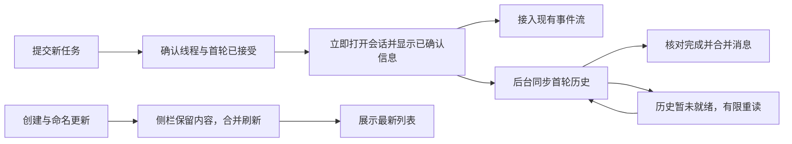

# 新任务创建后的同步与恢复设计

日期：2026-10-11。状态：已授权实施，独立审查修复round1完成受影响故障注入验收；待复核和最终冻结全套，未部署。

用户报告新会话 `125b6b67-ddb5-47f3-abc7-d2f5452d2119` 同时出现“Native Codex runtime is unavailable”和“最近会话同步失败：共享状态读取暂不可用”。本设计补充 [官方项目融合方案](2026-10-11-native-project-integration.md)，解决创建成功后进入会话和更新侧栏的交接问题。

## 1. 本次失败发生在哪

这次会话和首轮任务已经创建。故障分别发生在首次历史读取和侧栏列表刷新，不能据此重新创建任务或重发首条消息。

下表时间为北京时间；来自 `.local/web/diagnostics.jsonl`、原生会话数据库及指定 rollout：

| 时间 | 证据 |
| --- | --- |
| 11:07:57.627 | 原生线程记录创建，cwd 为 `work\sample-project` |
| 11:07:58.006 | 新线程事件使列表缓存失效，版本变为 10 |
| 11:07:58.115 | 列表共享读取 189 开始 |
| 11:07:58.345 | 保存 Web 元数据再次失效，版本变为 11 |
| 11:07:58.644 / .727 | 两次 `thread/read` 返回 `-32603` |
| 11:07:58.813 / .814 | rollout 写入会话元数据和首轮 `task_started` |
| 11:07:58.869 / .883 | `thread/turns/list`、完整 `thread/read` 返回 `-32601` |
| 11:07:58.934 | 会话 GET `req-k9` 返回 503，前端显示通用运行时错误 |
| 11:08:02.302 | rollout 首次出现 user 类型的消息记录；此处包含上下文，不能等同于实际任务提示词的写入时间 |
| 11:08:02.603 / .604 | 连续两个命名事件将列表版本变为 12、13 |
| 11:08:05.664 | 列表读取 189 两次尝试都读到变更中的版本，以 `version-conflict` 结束，耗时 7550ms |
| 11:08:05.665 | 列表 GET `req-k4` 返回 `SHARED_STATE_UNAVAILABLE` |
| 11:08:08、11:08:21 | 后续列表请求复用失败缓存，仍然 503 |
| 11:08:23.992 | 后台列表读取 192 成功恢复 |

原生 PID 在前后保持为 9436，继续成功回答其它请求；没有这一时间段的退出或运行时 epoch 切换证据。后续对该会话进行只读协议探测，在 `experimentalApi` 为 false 和 true 时，元数据读取、轮次分页和完整历史读取都成功。因此不能把本次问题归因于“程序崩溃”或简单归因于实验能力开关。

第一个错误的确定结论是：**新线程的首次历史读取失败，被错误映射成通用运行时不可用。** 失败发生在原生首轮记录写入前后，很符合历史尚未完成落盘/物化的窗口。现有 RPC 诊断只保存数值错误码，缺少当时原生错误的 message/data，具体 `-32603`、`-32601` 的内部原因仍需下一次受控验证，不能仅按数字断言。

第二个错误已经定位：**列表在创建、保存元数据和命名事件期间多次失效，成功读取的结果因版本变化被丢弃，两次尝试耗尽后被缓存成读取失败。** 同期多个 `thread/list` 实际成功，这不是 30 秒超时，也不是原生列表不可读。

一次性历史归属写入于 11:06:07—11:06:08 完成，早于本会话创建；清单没有包含该新会话。无需回滚已成功的历史归属操作来处理本次同步问题。

## 2. 修复前链路的问题

`Runtime.create` 已从 `thread/start` 得到真实线程，并由 `turn/start` 确认首轮任务，返回 `threadId`、`turnId` 和状态。前端保存“已发送”的消息后进入会话，再从头请求完整的会话快照。

`Runtime.loadThread` 先读 header，再取轮次分页；不支持分页时回退完整历史。旧错误分类覆盖少数具体消息，其余统一变为 `RUNTIME_UNAVAILABLE`。新会话带初始提示词时没有空线程保护，首轮历史尚未就绪也会进入该读取链路。

`SessionView` 需要成功快照才能连接会话事件流。首次读取失败时没有 baseline，已确认的任务信息留在发送占位中，标题却显示“会话暂不可用”，页面也持续显示重连提示。打开占用检查成功但历史失败时，不会使用打开失败的短周期重试，恢复主要依赖后续焦点、手动同步或 watchdog。

`SharedClientState.invalidateSessions` 清掉已读取的数据并增加版本。进行中的列表任务最多重读一次，再发生版本变化就抛出 503；这个“仍在更新”结果随后又进入最长 60 秒的失败缓存。新任务创建和自动命名恰好集中触发这些事件。

## 3. 推荐流程

### 3.1 创建成功立即交接

扩充现有创建响应，附带来自同次创建的已确认信息：线程 header、首轮 ID/状态、项目关联、已核对的权限，以及当前 runtime epoch/revision/syncCursor。复用现有线程转换和实时轮次状态，不为这个响应额外读取完整历史。

前端把它作为该新会话的初始显示状态，明确标记 `historyPending`。同步未完成时显示真实项目与任务标题；已接受的首条消息显示“已发送，正在同步”，顶部显示“任务已启动 · 同步中”。这份状态只证明创建和首轮接受，不能宣称历史已保存完整或任务已成功完成。

沿用现有占用检查、release-on-leave 取消和发送约束。初始状态使事件流能够尽早接入，按照既有 cursor 回放后再与持久历史合并，避免等待首轮落盘时漏掉实时更新。此过程不重新创建、不调用 `turn/start` 重发消息、不绕过占用或权限核对。

同一创建请求的 `clientRequestId` 和幂等结果继续复用。网络超时而结果未知时先核对原请求；若只确认了线程 ID，展示“会话已创建，首条任务待核实”，不能用新的请求 ID再创建一个。

### 3.2 历史尚未就绪与真实故障分开

保留创建时已知的首轮状态，直到成功读取并核对该轮次，或收到可靠的终止/失败事件。空的历史页不能把已接受的活动轮次改成空闲；合并继续使用现有 revision、activityRevision 和消息 ID 去重。

历史就绪期间，针对明确的未物化/空记录错误进行有限的只读重试，采用间隔 200ms、500ms、1s、2s、4s，单轮总预算不超过 15 秒。每个会话共享一个在途读取；有成功读取或就绪事件时取消剩余计时。切换会话、退出页面、暂停或 runtime epoch 改变时取消旧读取和计时。

这个重试条件必须由新创建窗口和核实后的原生错误种类共同限定，不能把所有 `-32601`、`-32603` 或 503 都视为可重试。预算耗尽后保留已确认的显示信息，提供“重新同步”；停止自动历史/status读取，SSE resync 不启动新的15秒周期，手动同步可重新读取并清除 pending。退避中预算取消也保留正确的public恢复错误码，确保停止自动恢复。不会自动重发任务。

原生进程退出、协议断开或初始化失败才显示“Codex 运行时暂不可用”；能力不支持、历史未就绪、另一客户端占用、操作结果未知各自保留现有独立处理。补充有限、脱敏的原生错误分类和 method/threadId 关联诊断，禁止把提示词、工具输出或凭证写进错误日志。

### 3.3 列表变更冲突只表示更新中

继续共用现有共享读取任务和 30 秒总预算。短时间的创建、元数据和命名失效合并为一次后续刷新；保留已有的 hard/soft 区别和真实版本校验，不发布已经确认过时的数据作为最新结果。

两次读取期间版本持续变化时，返回明确的“更新中”结果并安排一次合并后的后台读取，不作为 `SHARED_STATE_UNAVAILABLE` 缓存 60 秒。已有列表保留最近一次成功内容并显示轻量更新状态；首次进入且无列表时显示占位。具体响应需有独立 pending 状态，调用方不能把它当成一个成功的空列表。

命名已知更新可以针对对应线程更新标题，再触发共享读取；去除本地命名成功与同一个原生通知引起的重复失效。归档、隐藏、删除等操作仍立即移除不应显示的条目，搜索/排序/分页变化按各自查询更新，不能拿另一种查询的缓存充数。

真正的读取失败、权限失效和运行时不可用继续显示错误，并沿用已有的后台更新限频。终止失败清除pending与旧followup截止，不能用pending遮住error/stale，也不能把过期预算带入新的显式恢复；同一活动更新周期仍保持原30秒截止。列表刷新失败只影响列表，不把已确认正在运行的会话连带标成不可用。

## 4. 与项目融合一致

创建响应同时携带已注册的原生项目身份和 Web 工作目录身份，后端 `thread/start` 直接传原生 `projectId`。已确认的任务项目可以先显示，不依赖侧栏刷新成功；原生注册未完成时复用在途注册，失败则在发送任务前明确反馈。

这个新会话的 Web 关联为 `sample-project`，但事故调查时原生 `project_id` 为空，符合修复前创建链路未传项目 ID 的行为。本分支已接入 Task2 原生项目身份与首轮前验证。历史同步不能代替新建链路的接入。本次没有更改这个活动会话的归属、工作目录或运行状态。

## 5. 必要影响面

| 位置 | 变化 |
| --- | --- |
| `src/codex/runtime.ts` | 复用确认后的创建状态、历史就绪生命周期、错误分类和有限读取恢复；保留 revision 及消息合并保护 |
| `src/codex/app-server.ts` | 为现有诊断补充安全的原生错误种类，保留 method/threadId 关联 |
| `src/server/api.ts` | 创建响应与项目关联，列表 pending 契约，沿用现有 SSE 和授权检查 |
| `src/server/shared-client-state.ts` | 合并失效、区分版本变化与真实读取失败，保持有界共享任务 |
| `src/web/main.tsx`、`src/web/SessionView.tsx` | 交接初始状态、尽早订阅、同步中提示及有限恢复，侧栏接收 pending 状态 |
| 现有 runtime、共享状态、创建幂等、消息去重和浏览器 fixture | 加入首轮记录延迟、连续命名和真实故障验证 |

不增加依赖、设置项、另一套任务队列或页面全局轮询；复用既有幂等、SSE、共享状态和缓存结构。

## 6. 验收与执行顺序

先补足原生错误分类的只读证据，再修正共享列表版本冲突的处理；随后接入创建状态交接和首轮历史就绪恢复，与原生项目创建接入一起核对。产品实施仍按仓库要求交给 `gpt-6.1-sol`、medium 子 agent。

1. 模拟原生创建已确认但记录延迟 5—10 秒：任务只创建一次、首条消息只发送一次，项目与已发送信息立即可见，历史就绪后合并为一条消息。
2. 精确回放本次“线程→元数据→两次命名”的失效顺序：列表保持内容、标记更新中并最终收敛，不出现 503 或 60 秒失败缓存；多个标签页共用一次在途读取。
3. 模拟占用冲突、真正进程退出、原生功能不支持、创建结果未知和只创建成功的部分结果，提示及可执行操作分别正确。
4. 创建后切换会话、刷新页面、后台/前台切换及重连：旧请求被取消，cursor 回放和历史合并无重复、无丢失；未就绪状态不解除活动任务的发送保护。
5. 保留搜索、排序、隐藏、归档、分页、空任务、附件任务和原有发送幂等行为；新任务的两端项目归属正确。
6. 检查小屏和键盘使用；就绪前只执行有界的只读恢复，不增加每 token 的列表读取或高频全历史拉取。

设计阶段只读证据保存在 `.local/design-new-task-20261011/`。Task4 已实现 flattened initialSnapshot、同 epoch 交接、共享历史恢复和 pending 列表，并完成 fake API 浏览器与 Node 故障注入。独立空 home 探针核实 turns/list -32600 精确 threadId/message 的未物化契约；full read -32601 精确 unsupported 不重试，真正 -32603/退出不泛重试。15秒绝对截止传入每次 native timeoutMs；response close 且未 writableEnded 将取消 waiter，全部等待者离开/epoch改变忽略迟到响应，已经发送的 native 只读请求不能撤回。事故原 message/data 仍缺失，不能宣称该探针证明事故 -32603 原因。未发送真实模型 turn、重跑历史迁移、重启或部署。验收原始日志与限制见[持久验收记录](../superpowers/reports/2026-10-11-preview-project-recovery.md)。

独立Task4 review的3个Important已按真实RED/GREEN修复；受影响Node60/60、既有浏览器预算/手动恢复组合与build通过。此前完整suite704/699/0fail/5skip属于修复前6c1a96d，该阶段当前修复树最终完整复验待review clean；现已完成下方最终验收，见持久验收记录。

### Whole-branch fix wave 实施状态

新线程15秒absolute deadline独立保留，all-reader取消不使自动周期重开；仅显式用户restartHistory=true可在旧周期终止后新预算。shared exact deadline冲突仍pending并清旧deadline；expired active manual可立即新有界预算。 当时ff55240产品代码focused Node166/166、两组fake browser、tsc/build通过；该阶段最终完整suite待运行，现已完成下方最终验收。旧full #2 704/699属于此前6c1a96d代码。尚未部署/重启，真实App/手机/model与跨浏览器边界保持。详见持久报告whole-branch final fix wave。

### 最终验收状态

全部Task1..4及whole-branch/scoped review已CLEAN，所有原Important已处理，无新breakage/OutOfScope。最终冻结HEAD `91ebe81f88f7cb84043bdc59caa9d24a7ebe1d2f` / tree `dcdb411b3c119171f12cd3cb9ddec27eb8832179` 完整Node **714 total /709 pass /0 fail /0 cancelled /5 skipped，439191.3749ms，EXIT_CODE=0**。日志 `wholefix-node-final-frozen.log`，这是第三轮完整suite、此最终产品树首次完整复验；没有把先前full #2当成最终代码证据。产品未部署、重启或推送；feature本地squash已实际完成，保留12个原完整提交消息；main FF真实结果以后续主目录integration-result.json为准。

本次最终验收后仅更新design/plan/report文字；产品与测试源树保持冻结标识。跨浏览器/真实手机/官方App双端UI/真实model与部署运行边界仍未检，不以fake fixture代替。
