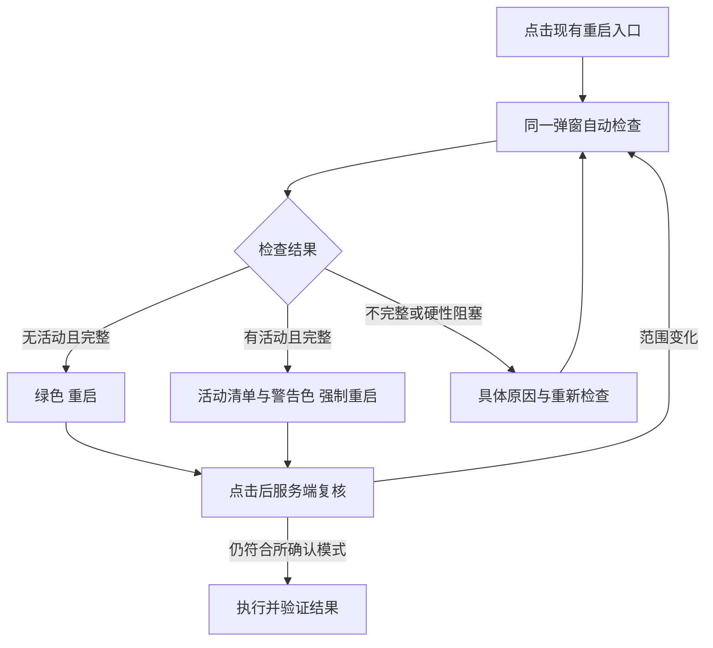

# 重启前活动检查与强制重启

> Created At：2026-10-22 14:55:15 +08:00（Asia/Shanghai）
>
> Status：IMPLEMENTED（代码及隔离验收完成，真实后端尚未重启）。用户确认“落 plan 然后实施”后按[实施计划](../superpowers/plans/2026-10-22-restart-activity-and-force.md)完成，见[验收记录](../verification/2026-10-22-restart-activity-and-force.md)。
>
> Architecture Pattern：复用现有 Runtime、设置入口与原生 dialog，不新增服务或依赖。
>
> 设计方法：codex-architecture、Product Design audit／get-context、superpowers brainstorming；按用户最新要求简化交互。

## 1. 确认的交互

**点击现有重启入口就自动检查，在同一个弹窗中直接确认：没有活动时显示绿色「重启」，有活动时列出会话并显示警告色「强制重启」。**

该按钮本身就是本次操作的确认。不增加第二个弹窗、下一步、风险勾选、口令输入、模式选择或任务勾选。用户 2026-10-22 的这条明确要求优先于此前“两步确认”的讨论。

覆盖「重启 Codex」和「重启 Web 服务」两个已有入口，标题始终明确目标。普通重启保留任务保护；强制重启允许中断已列明的本服务任务。检查失败不能伪装成“没有活动”。

## 2. 当前问题与证据

- 用户提供的弹窗只显示“无法可靠查询活动状态”，没有会话清单、具体原因或可用的强制操作。
- 本次日志确认会话曾在 14:37:45 释放成功，随后检查仍返回 503。后来新一轮对话执行时返回 409，属于另一条正常的活动保护；不能混为同一个原因。
- `Runtime.assertNativeIdle()` 遇到第一个活动或未知状态就退出，无法收集全部受影响会话；其 catch 丢掉原始原因。
- 已做隔离断言：同一个没有活动轮次、所有轮次均已结束的 `systemError` 样本，可以通过现有 `canUnload()`，却被重启检查判为 `RUNTIME_UNAVAILABLE`。这是已复现的判定不一致；现场 503 的具体原始状态尚未记录，不能声称已经定位到某个真实会话。
- 当前普通会话列表会过滤子 Agent 和临时会话，因此“列表里只有一个活动会话”不能作为整个受管后台已经空闲的证明。

### Product Design 现状审查

审查范围为现有维护入口和用户提供的失败弹窗。保留现有暗色、控件和设置位置，不重做设置页。

| 步骤 | 已看到的证据 | 判断与设计要求 |
| --- | --- | --- |
| 1. 桌面维护入口 | 本次浏览器截图，1280×900 | 两种重启目标明确，继续复用入口 |
| 2. 手机维护入口 | 本次浏览器截图，390×844 | 现有按钮可换行；新弹窗也必须保证操作文字完整 |
| 3. 检查失败 | 用户提供的弹窗截图 | 两块红色提示重复，主按钮禁用，却没有说明哪个会话或哪个查询阻塞；改为一条状态摘要、清单和必要详情 |
| 4. 新弹窗执行与键盘操作 | 尚未实现 | 本轮不宣称已通过交互、可访问性或实机验收，验收要求见第 8 节 |

（本地审查截图不随公开版本提供。）

（本地审查截图不随公开版本提供。）

（本地审查截图不随公开版本提供。）

截图已逐张查看，只截维护入口和弹窗，不含会话正文、项目路径、凭据或私网地址。Product Design 本地上下文预检未发现保存的设计资料，采用当前产品及用户截图。打开重启弹窗的点击被自动审批拒绝，理由是可能触发服务重启、超出本轮授权；本轮没有重试或绕过该操作，失败弹窗仅引用用户提供的截图，不冒充本次现场捕获。

## 3. 单弹窗 UI 与 UX

### 层级与布局

同一 dialog 依次包含：**目标标题 → 简短影响说明 → 检查摘要 → 活动会话清单或检查异常 → 底部操作**。

| 区域 | 设计 |
| --- | --- |
| 标题 | 「重启 Codex」或「重启 Web 服务」，不使用笼统的“确认操作” |
| 说明 | Codex：重启后台并重新读取模型列表，不升级 CLI。Web：重启此 Web 服务及其管理的 Codex 后台，连接会暂时断开 |
| 摘要 | 显示检查时间与活动数量；只有检查完整时才能说“没有活动会话” |
| 会话行 | 会话名称、项目名（可用时）、运行／待审批／待输入／状态待确认；无名称用短 ID。子 Agent 和临时任务注明类别与所属会话，不因普通列表隐藏规则而遗漏 |
| 当前会话 | 与当前路由 ID 相符时标注“当前会话”。释放成功后又开始新轮次，应展示新的活动轮次，不能沿用“已释放”的旧结论 |
| 会话入口 | 复用已有会话链接，仅用户主动点击时打开；检查本身不打开、接续或发送消息。离开弹窗再返回时重新检查 |
| 错误详情 | 默认一行具体原因，如“1 个会话的状态无法读取”；展开后显示阶段、相关会话和原始错误，不显示整份历史或快照 |
| 底部 | 左侧「取消」「重新检查」，右侧唯一执行按钮。检查完成后始终可重新检查；不加常驻轮询 |

桌面沿用现有圆角和边框，宽度约 640px，最大高度为视口减去上下留白。手机宽度为视口减去左右各 12px，内边距 16px；正文单一滚动区，标题和底部操作保留可见。长会话名与错误换行。窄屏执行按钮独占一行，次要操作并排，不通过缩小字号塞下三个按钮。

### 状态与执行按钮

| 检查结果 | 主要内容 | 执行按钮 |
| --- | --- | --- |
| 检查中 | 「正在检查活动会话…」；重查时原清单可保留但注明正在更新 | 禁用，显示「检查中…」 |
| 完整，确认无活动／无阻塞写入 | 「没有活动会话，可以重启。」 | **绿色「重启」** |
| 完整，有受管活动会话 | 列出所有会话；一条警告「将中断以上会话的当前任务，已发生的修改不会回滚。」 | **警告色「强制重启」**，直接确认执行 |
| 不完整或查询失败 | 保留已查到的会话，明确还有状态未确认，并显示具体原因 | 禁用执行，保留「重新检查」，不能显示绿色或据此强制执行 |
| 无法确认目标进程归属、更新或配置提交未结束 | 显示对应原因，不伪装成某个活动会话 | 禁用执行；强制也不绕过这些保护 |

绿色复用产品既有成功／主操作色，强制操作使用警告色。两者均有明确文字，不能仅靠颜色区分。只有真实异常才使用错误底色，正常限制不再重复堆叠大块红色提示。

首次进入焦点落在取消按钮，不落在执行按钮。保留 `dialog.showModal()`、焦点约束、Esc 取消及关闭后返回原入口。检查完成由一个 `role=status` 简短播报；失败由一个 `role=alert` 播报。切换语言不重复请求，不重新播报整份列表。触控目标至少 44px，正文对比度目标 4.5:1，焦点可见。

### 核心中英文文案

| 中文 | English |
| --- | --- |
| 正在检查活动会话… | Checking active sessions… |
| 没有活动会话，可以重启。 | No active sessions. Ready to restart. |
| 有 {n} 个活动会话 | {n} active sessions |
| 当前会话 | Current session |
| 重启 | Restart |
| 强制重启 | Force restart |
| 重新检查 | Check again |
| 部分会话状态未确认，请重新检查。 | Some session states could not be verified. Check again. |
| 将中断以上会话的当前任务，已发生的修改不会回滚。 | Current tasks in these sessions will be interrupted. Changes already made will not be undone. |

## 4. 检查范围与判定修复

检查范围明确为**本 Web 服务管理的 Codex App Server**，不是扫描整台电脑所有 Codex App／CLI。检查结果合并本地正在提交、审批、输入、释放等状态与原生已加载会话的实时证据。

1. 复用原生 `thread/loaded/list` 的完整分页，对每个已加载会话读取状态。不能先被本地 `assertIdle()` 拦住而失去清单，也不能只返回第一个阻塞项。
2. 不使用普通侧栏列表代替原生扫描，不过滤临时任务或子 Agent。完整活动集合先得到，再补已有名称和项目元信息；元信息失败可回退短 ID，不把它当活动查询失败。
3. `active`、本地活动轮次、待审批、待输入和正在提交的会话写入均要列明。只读历史／模型／列表读取不阻碍重启。
4. `idle`／`notLoaded` 只有在没有冲突活动或写入证据时才算空闲；不得用旧的释放状态覆盖新轮次。
5. `systemError` 不能一律阻塞，也不能一律放行。按现有 `canUnload()`／`reconcile()` 的保守条件复核：当前可靠证据确认所有轮次均结束、无活动轮次／未决交互、归属明确后，按空闲错误标记处理，保留历史错误。历史缺失、归属不明或证据冲突仍归为未确认。
6. 单个会话无法读取时记录该会话与原因，继续收集其余结果；受现有有界超时与取消控制约束。分页不完整、游标异常、查询期间后台实例变化均使检查不完整，不能推断剩余部分没有任务。
7. 不启动新 App Server 来检查旧实例，不打开／接续会话、不卸载会话来清除错误，不触发自动重试发送。

## 5. 最小接口与并发边界

复用 `GET /api/runtime/restart-check`，返回结构化检查报告：目标、检查时间、完整性、活动会话清单、非会话阻塞项、具体查询异常、普通／强制是否可用，以及受影响集合版本。发现活动属于正常检查结果，不再只以一个 409 文本代替列表；部分查询失败也保留已取得的结果。

普通重启和强制重启共用既有执行入口，以显式模式区分；旧调用默认仍为普通模式。`assertNativeIdle()` 可消费共享检查结果，保留维护脚本和其他调用方的安全默认值，不另写互相矛盾的判定。

**点击执行后，服务端仍重新检查。** 如果绿色“重启”之后发现活动，不自动升级成强制操作；如果确认的活动会话／轮次发生变化，返回新报告，更新同一弹窗，让用户对新清单再点击。正常进度输出不能导致反复失效。相同请求去重，不能重复安排重启。

## 6. 强制重启与结果边界

- 强制权限只允许结束本服务明确持有的 Codex 子进程；Web 目标另包括已验证归属的受管 Web 进程。不得按进程名称批量杀 Node／Codex，不接管手动启动服务，不停止独立 Codex App／CLI。
- 先冻结新的执行提交，按已有原生中止能力处理受影响任务，再有界关闭受管进程；超时后的强制结束必须再次校验进程身份。不能仅删除空闲检查便声称实现了强制重启。
- 已确认空闲的正常重启继续采用现有关闭路径。Windows Web 保留受管进程校验、交互式桌面预检、90 秒安排及结果文件验证。强制模式必须贯穿执行端，不能只改前端颜色或省略 `-RequireIdle`。
- 延迟执行前重新核对实例和影响范围；出现未经确认的新活动会话／轮次应取消并说明原因，已结束的任务不阻碍执行。没有可靠强制能力的平台／启动方式要明确说明，不能展示可点击但无效的强制按钮。
- 使用现有重启记录与结果检查，区分已安排、成功、取消／失败和待核实；安排成功不等于重启成功，失去响应不自动重发。
- 不删除历史、草稿和已送达消息，不将被中断任务伪装成成功；重连后按原生证据同步，不自动恢复执行。已写文件、外部操作不回滚，已脱离受管进程的工具任务可能继续运行。

## 7. 实现落点

| 位置 | 必要变更 |
| --- | --- |
| `src/codex/runtime.ts` | 共享活动检查报告、完整会话收集、终态 `systemError` 核验、普通／强制执行边界 |
| `src/codex/app-server.ts` | 复用已有关闭与超时能力，核验强制结束对象；不另造进程管理框架 |
| `src/server/app.ts`、`restart.ts` | 报告与模式参数校验、确认时复核、受管 Web 调度与结果一致性 |
| `scripts/server-control.ts`、Windows 重启脚本 | 显式强制模式、延迟执行复核、受管进程身份保护；现有调用默认保持不变 |
| `src/web/WebSettings.tsx`、`style.css` | 复用原弹窗，清单和状态驱动绿色／警告色唯一执行按钮 |
| `src/web/i18n/catalogs/settings.ts` | 类型安全中英文文案，不拼接不可翻译的长句 |
| 既有 runtime／restart／settings 测试与 fixture | 同步新报告契约、直接确认和执行保护，不新建演示应用 |

## 8. 实施验收

- 绿色正常重启、警告色强制重启都在同一个弹窗直接确认，没有额外弹窗或勾选；目标标题和实际执行目标一致。
- 多个活动会话、待审批／输入、临时任务和子 Agent 完整列出；元信息缺失有短 ID 兜底。没有真实任务时不被只读查询阻塞。
- 已释放且无活动的会话通过；释放后出现新轮次必须列出。可靠终态 `systemError` 通过；未知状态、缺历史或归属冲突不误放行。
- 检查失败保留会话、阶段和原始原因，超时／坏游标／后台更换等均不显示绿色。日志记录阶段、相关会话、原生状态和错误码，不记录提示词、凭据或整份快照。
- 确认与执行之间新增任务时更新原弹窗或取消延迟执行，不偷偷扩大强制范围。重复点击、请求断开和结果未知不重复安排。
- 强制测试使用可控 fixture，验证本服务任务中断及受管目标退出／重新启动，外部 App／CLI 和其他进程保持不受影响。真实任务上不进行破坏性验收。
- 浏览器覆盖桌面 1280／1440px、360／390px、中英文、Tab／Enter／Space／Esc、焦点返回、长清单／长错误／多行按钮，并逐张查看截图。保留现有暗色主题，不新增主题系统。
- 记录类型、相关单测、现有重启回归和构建结果；模拟浏览器与受管进程 fixture 不替代真实 Windows／Linux 启停或手机实机验收。

本 spec 先保存并经用户确认，随后落计划及实施。实现使用隔离 fixture 和演示数据验收，未执行真实服务重启／强制重启，未推送。新报告协议和前端必须一并部署，不能向旧后端单独交付新前端。

关联：[语言控件与任务空闲重启](2026-10-14-language-control-and-restart.md) · [重启记录反馈](../superpowers/plans/2026-10-15-operation-feedback.md) · [权限核对提示](2026-10-14-session-ownership-notice.md)。部署新版后本 spec 取代旧弹窗“只允许空闲重启”的产品交互；旧运行实例继续遵守原有规则。
