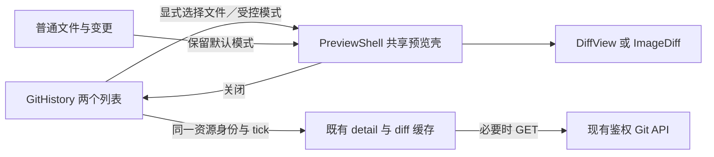

# Git 日志两区布局与文件预览弹窗

> Created At：2026-10-23 10:00:47 +08:00（Asia/Shanghai）
> Status：IMPLEMENTED，用户已批准实施；代码与演示数据浏览器验收完成后记录于下方验证文档。运行服务的 dist 尚未更新。
> Architecture Pattern：复用现有 React 状态、原生 dialog 与只读 Git 接口。

## 1. 目标与范围

解决 Git 日志中提交、文件、预览三段竞争高度，以及尚未选择提交时仍预留大块空白的问题。提交和文件负责定位，较大的弹窗负责阅读。

用户截图显示：提交列表只使用面板上部，下面仍提示选择提交并留有大块空白。核对当前实现，选中提交后的三段默认比例为 35%／20%／剩余空间；未选提交时只有不超过 700px 的视口才放开列表高度。这轮将所有宽度统一处理。

- Git 日志内部只保留“提交列表＋提交文件”两个上下区域，不改变应用最外层的会话列表、对话、项目面板。
- 点击文件直接打开一个预览 dialog；桌面宽预览，手机全屏；上一／下一文件在同一个 dialog 内切换。
- 普通“文件”和“变更”标签的列表、内嵌预览及原有全屏交互保持现状，共享预览壳的改动需要覆盖它们的回归。
- 不增加拖动分隔条、比例存储、预览模式选择、新后端接口或依赖。不执行 Git 写操作、原生任务或自动 fetch。

设计依据是本会话用户提供的截图和已确认方案；不将含真实项目与提交内容的截图复制进仓库。

## 2. 布局与主要流程

| 状态 | 页面行为 |
| --- | --- |
| 尚未选提交 | 提交区域占满可用高度；选择提示合并到该区域内，不再占一个大详情区 |
| 已选提交，尚未打开文件 | 上方提交、下方文件；展开时默认高度比例 3:2，各自内部滚动；选择文件提示在文件区内 |
| 点击文件 | 直接进入预览 dialog，不在文件区下方再留第三段预览 |
| 关闭预览 | 回到原提交与文件列表，保留选中项、两个列表的滚动、分页及同一文件阅读位置 |
| 点击同一个已选文件 | 再次打开 dialog，不能因 path 未变化而无响应 |

两个列表复用现有“提交记录”“提交文件”收起按钮与持久化偏好；一组收起后另一组占用剩余空间，两组都收起时保留两个标题。选中另一个提交继续沿用当前行为：展开该提交文件列表，清除旧文件选择。

仓库、分支、部分扫描提示、分页、提交图和提交信息浮层继续保留。分页与提示在列表区域内参与布局，不遮住末行或把整个页面撑高。

## 3. 文件预览 dialog

### 尺寸与内容

- 视口宽度大于 700px：宽 `min(1440px, calc(100vw - 48px))`，高 `calc(100dvh - 48px)`，居中、12px 圆角，复用现有暗色与边框，背景遮罩可见。
- 视口宽度不超过 700px：宽 `100vw`、高 `100dvh`，无外部边距与圆角，内边距包含 safe-area。
- 上述是正常缩放下的目标尺寸；CSS 使用等效的固定定位包含块百分比，避免继承 200% CSS zoom 后 viewport 单位再次放大、使关闭按钮越界。工具栏允许换行。
- 顶部工具栏固定。第一行显示路径／文件名、现有复制路径按钮及明确的关闭按钮；路径可截断，完整路径保留可访问名称或提示。
- 第二行提供短提交 ID、文件序号、上一／下一文件。导航可使用箭头图标，必须有中英文可访问名称；关闭与导航点击目标至少 44×44px。
- 正文是唯一纵向阅读滚动区；源码差异保留自己的横向滚动，不把 dialog 或背后的页面撑宽。加载、错误、空差异、二进制、图片前后对比和截断提示沿用当前渲染。
- Git 文本差异继续展示源码 diff，不新增 Markdown 原文／渲染模式；图片继续从目标提交／父提交读取，不回退为工作区版本。

### 连续阅读

- 顺序严格使用当前提交、当前比较父提交的文件列表顺序，包含可展示状态的文本、图片、二进制和重命名条目。
- 第一项禁用上一文件，最后一项禁用下一文件，不循环；仅一个文件时两者均禁用。加载差异时仍可关闭和继续切换。
- 切换文件从正文顶部开始，更新路径、序号和错误归属，不关闭重开 dialog、不跳回列表。原按钮在边界禁用时，焦点落到仍可用的导航按钮或关闭按钮。
- 已成功读取的同一资源，关闭后再次打开不重复请求或重新创建内容 DOM，保留阅读位置。切到其他文件再返回不承诺保留每个文件的独立阅读位置，不新增永久阅读历史。

### 关闭与焦点

- 关闭按钮或 Esc 关闭预览，页面恢复可操作。背后区域在 modal 打开时不可交互，不新增页面遮罩层实现。
- 打开时首焦点为关闭按钮，Tab／Shift+Tab 在 dialog 内循环。关闭后聚焦打开它的文件按钮并避免滚动跳变；触发按钮已消失时回退到当前文件区域标题。
- Esc 优先关闭 dialog 内已有的子浮层，再关闭预览；手机抽屉保持打开，再次 Esc 才沿现有行为关闭抽屉。普通文件里的 Mermaid 等嵌套浮层也须保持原有层级。
- 点击遮罩不关闭，避免拖动选择或横向阅读误退出。不新增浏览器历史项或全局方向键快捷键。

## 4. 状态、资源身份与异常

持久化继续使用 `PanelState.history` 的仓库、ref、commit、parent、path、scroll、listScroll、filesScroll、pages 及收起字段，不增加存储格式版本。dialog 的打开状态和触发按钮仅保存在当前组件内。

| 事件 | 预览状态 |
| --- | --- |
| 点击文件／上一下一文件 | 明确打开或保持打开，资源身份随文件变化 |
| 关闭后同文件重开 | 使用有效缓存，恢复当前文件阅读位置 |
| 刷新页面、重新挂载、恢复项目状态 | 恢复列表与选中项，dialog 默认关闭，不因保存的 path 自动弹窗或读取 diff |
| 切换标签、隐藏右栏、会话／项目／仓库／分支／提交／比较父提交变化 | 关闭 dialog；过期响应不能重新打开或混入新上下文 |
| 同上下文显式刷新 | 保留 dialog；沿既有 tick 更新，只有同一资源可保留旧内容并显示更新失败 |
| 刷新后当前文件消失 | 显示该文件已不可用，保留关闭能力；不自动改看另一个文件 |

资源身份由 `id + repository + commit + parent + path` 决定，缓存新鲜度继续包含 `tick`。沿用 `detailCache`／`diffCache` 与 20 项缓存上限。只在明确打开预览时按需读取差异；关闭时取消未完成读取，成功缓存不随关闭清空。

快速切换 A→B、会话切换和关闭后的迟到响应必须被取消或忽略。B 加载失败时不能显示 A 的内容；同一 B 刷新失败才可保留 B 的旧内容。失败不能触发 Git 写入、自动重发或自动打开 dialog。

预览不变更认证、路径边界、提交／父提交合法性、图片限制。预览相关行为只使用既有 GET；统一刷新已有的显式 fetch 行为不因本需求新增或改变。

## 5. 实现边界

- `GitHistory.tsx`：两区、局部打开状态、连续切换、读取与焦点；不拆出新的通用预览框架。
- `PreviewShell.tsx`：增加可选 `modal?: {open: boolean; onClose: () => void}`。未传参沿用“内嵌＋全屏查看／收起”；传参时关闭即隐藏，不调用 `show()` 回到内嵌，不保留第二个全屏按钮。
- `controls` 继续承载导航行，不增加相同用途的 toolbar API。受控模式与普通模式尽量保持同一份 children DOM；`onClose` 不能形成关闭后重新打开的事件循环。
- `GitPanel.tsx`、`PaneLayout.tsx`、`panelState.ts` 作为兼容边界；除经测试证明必需，不改外层布局和状态协议。
- `style.css`：移除历史预览第三行和仅手机利用空白的特例；仅对新 dialog 模式覆盖尺寸，普通全屏样式保持现状。
- 中英文目录新增关闭预览、上一文件、下一文件及序号文案，Git 原始路径／提交消息不翻译。

## 6. 验收

1. 1280／1440px 与 360／390px，中英文：未选提交占满、选中后只有两区，默认 3:2，两个列表和分页正常，长路径与错误不造成全页横向溢出。
2. 从真实 GitPanel 的 Git 日志入口操作，点击文件直接出现一个 native modal；桌面和窄屏尺寸、工具栏、Tab、Enter、Esc、返回焦点均有浏览器证据并查看截图。
3. 同文件关闭重开保持 DOM、阅读位置、列表位置和请求数；上一／下一在同一 dialog 内工作，首尾禁用准确，单文件、空列表、图片、二进制、重命名、截断及无文本差异可读。
4. 持久化旧 path 不自动弹窗或请求 diff；上下文变化、A→B 延迟与错误、关闭时迟到响应、父提交变化、刷新文件消失均不串内容或抢焦点。
5. 普通文件／变更的内嵌及全屏、复制反馈、Markdown／Mermaid 层级、图片版本与路径边界、折叠／分页／阅读性能回归通过；记录所有失败、跳过及未验证范围。
6. 先 RED 再 GREEN，完成相关浏览器、Node、类型与独立构建检查。只使用演示 API／隔离 fixture，不在真实会话执行 Git 写入或重启。发布、dist 更新及真实重启需另有用户指示。

实施见[plan](../superpowers/plans/2026-10-23-git-history-two-sections-dialog.md)与[验收记录](../verification/2026-10-23-git-history-two-sections-dialog.md)。关联：[工作区面板](workspace-panels.md) · [既有文件全屏](2026-10-11-file-preview-fullscreen.md) · [预览头部](2026-10-13-preview-header-and-copy-path.md)。本方案取代 Git 日志的三段比例与内嵌历史预览规则；普通文件／变更的内嵌预览仍沿用原规则。
