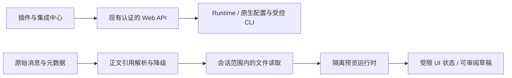

# 插件与集成管理、富内容展示统一规格

> Created At：2026-10-28 15:19:24 +08:00（Asia/Shanghai）
> Updated At：2026-10-30 09:35:07 +08:00（Asia/Shanghai）；补充目录加载、Apps、Cloudflare 处理与会话终态一致性方案。
> Status：LIVING_DOC；第 10、11 节记录既有实施结果；第 12、13 节为本次待实施修订。本轮仅授权修改 spec 和 plan，尚未授权实施这些新修订。
> Architecture Pattern：复用现有 Fastify、Runtime、React 设置和会话文件读取；扩展管理与消息展示分别实现、共同验收，不增加独立服务或通用插件执行平台。

## 1. 原始需求与目标

用户要求：

1. 调研原生桌面 App 的设置—插件/MCP，改善左侧入口与右侧分类重复的问题；插件页应包含插件、应用、MCP、技能、市场的原生功能，支持浏览市场、添加插件/市场/MCP 等操作。
2. 默认打开“已安装管理”，而非市场发现。
3. 将“插件”和目前不支持的展示标记写入同一个 spec。
4. “再看看除了 visualize 还有什么 codex-app-server 输出标记我们不支持的，也补充进这个 spec”。本次补充调研与规格，不实施渲染或管理操作。
5. 后续明确要求“落 plan 然后实施吧”，并以“retry”要求从现有进度继续。实施计划为 `docs/superpowers/plans/2026-10-28-extensions-and-rich-content.md`。

本规格交付两个相互独立的能力：

- **插件与集成中心**：统一入口与实体详情，提供原生能力范围内的发现、配置、安装、连接及管理操作。
- **富内容展示**：识别消息正文中的已知展示引用，首先支持 `visualize`，并为缺失、损坏和未知标记提供明确降级，避免原样出现不可读控制字符。

两者共用现有认证、项目范围、国际化、弹窗和文件访问规则；插件安装不授予 HTML 预览更多权限，展示引用也不能触发安装、授权或执行 MCP 工具。

## 2. 已核实的现状与证据边界

### 2.1 原生能力

- 本机桌面包为 `OpenAI.Codex 26.1021.3705.0`；其调用的 Codex 版本为 `0.164.0-alpha.11.1`。独立 CLI 安装入口为 `0.164.0`，不得混称同一个版本。
- 对桌面安装包 `app/resources/app.asar` 的静态核对确认：插件页包含 plugins/apps/mcps/skills/marketplace 五分类；独立 MCP 设置导入同一个插件设置组件并传 `manageOnly: true`。重复的是导航入口，不代表存在两份独立配置。
- 原生包包含市场浏览、添加市场、MCP 添加/编辑、技能创建等界面实现，部分动作受宿主、账号、策略或功能开关限制。市场移除确认明确提示会卸载该市场的已安装插件。
- 桌面 App 已确认运行，但桌面控制通道报 `native pipe unavailable`，没有取得设置页实机截图或逐项点击验收。安装包静态证据不得升级为实机可用结论。

静态证据的资源名包括 `plugins-page-selectors-819dee410088.js`、`plugins-settings-8b6fa40167fa.js`、`mcp-settings-36fc3608f4ad.js`、`add-marketplace-dialog-e25784d20496.js`，均位于包内 `webview/assets/`。不把用户真实项目、账号或截图复制进本规格。

### 2.2 当前 Web

- `/settings?section=plugins` → `InstalledPlugins` → `GET /api/codex/plugins` → `plugin/installed`。目前只有刷新、搜索和已安装详情读取，没有完整管理写操作。
- 会话展示链为 `agentMessage.text` → `MarkdownView` → `Markdown`/Streamdown。现有 Mermaid 代码块、Markdown 图片/链接和 `memoryCitation` 元数据展示须保留。
- `visualize` 原始收据仍是 `assistant message` 的 `output_text`，不是新增 response item；引用写在正文中。当前没有相应解析与交互 HTML 渲染。
- HTML 文件目前走源码预览；不能把新增展示支持等同于关闭 Markdown 的 sanitize、harden 或 `skipHtml`。
- `imageView`、`imageGeneration` 及工具结果的部分图片已经有专门展示；MCP/动态工具/独立工具输出的其他内容主要在详情中显示 JSON。不能把“收到并保留字段”“有图片预览”和“完整支持富内容”视为同一状态。逐项缺口见第 5.6—5.8 节。

代码定位：`src/web/Settings.tsx`、`InstalledPlugins.tsx`、`Conversation.tsx`、`MarkdownView.tsx`、`Markdown.tsx`、`MessageActions.tsx`、`GitPanel.tsx`、`fileLinks.ts`，以及 `src/server/codex-settings.ts`、`api.ts`、`src/projects.ts`、`src/codex/installed-plugins.ts`、`runtime.ts`。

## 3. 边界与数据归属

| 对象 | 含义及归属 | 必须保持的规则 |
| --- | --- | --- |
| 插件 | 可安装的能力包，来源可能为市场、Git、本地或分享 | 包内能力关联到同一 owner；不重复计作独立安装 |
| 应用 | 服务集成与账号连接 | 安装、配置启用、账号授权及实际可调用分别呈现 |
| MCP | 独立配置或插件提供的服务连接 | 插件 MCP 与独立 MCP 共用状态视图；不得复制成另一份配置 |
| 技能 | 用户/项目/系统/受管或插件提供的工作流 | 修改与卸载遵循实际所有者；系统及受管项明确只读 |
| 市场 | 发现与分发来源 | 不是运行时能力；移除影响必须单独列清 |
| 展示引用 | 消息中对文件或结构化内容的描述 | 是不可信输入，不构成文件授权、网络访问或工具执行权限 |

原生配置、安装结果及授权状态是管理数据源；Web 只保存必要 UI 偏好和操作收据，不建立第二套“已安装/已连接”真相。消息原文、历史、工具结果与既有引用元数据保持原样，渲染结果是派生视图。

## 4. 插件与集成中心

### 4.1 导航与布局

1. 设置侧栏将“已安装插件”提升为“插件与集成”。保留旧 URL；如提供 MCP/技能快捷链接，仅深链到同页筛选，不维护另一套列表或表单。
2. 主视图只有 **已安装 / 发现市场**，默认已安装。市场来源管理作为独立操作入口，不与运行时能力混排。
3. 已安装提供“全部 / 插件 / 应用 / MCP / 技能”类型筛选、搜索和状态筛选；类型筛选只改变列表，不叠加第二套页面导航。
4. “全部”按插件包与独立内容展示。类型筛选汇总包内及独立能力，显示其 owner，并能返回所属插件。
5. 详情保留搜索、筛选与滚动上下文，通过返回按钮回到列表，不重复铺设相同分类。桌面沿用现有设置布局；手机使用完整详情页，主要动作不依赖 hover。
6. 顶部显示实际执行宿主及配置范围；只有多个可选项时才提供选择。用户配置、项目配置与账号连接范围不能混为一谈。

### 4.2 功能矩阵

| 类别 | 功能范围 |
| --- | --- |
| 插件 | 目录浏览/搜索、详情、版本/来源/权限/能力清单、安装、安装后设置、启停、检查更新/更新、卸载、创建、导入分享、分享/发布及共享对象管理 |
| 应用 | 可用应用发现、详情、安装关联、连接/重连/断开、账号身份、授权范围、本地工具策略与实际可调用状态 |
| MCP | 独立及插件来源、添加/编辑/移除/启停；STDIO/HTTP、command/args/cwd/env、URL/Headers、超时与工具策略；认证/退出认证、保存/加载状态、工具/资源/模板、最近错误与连接检查 |
| 技能 | 按范围/来源浏览、Markdown/依赖详情、安装/创建/编辑/启停/更新/移除；插件内技能通过 owner 管理，系统/受管项只读 |
| 市场 | 浏览目录、搜索、切换来源、添加 Git/本地来源、ref/稀疏路径、来源详情/错误、刷新目录、Git 同步/升级、移除影响清单 |

插件详情必须容纳宿主支持的内置技能、应用、MCP、Hooks、自动化/计划任务及浏览器扩展等能力。它们不另增一排全局导航；全局策略页面仍保留职责，关联对象共用详情和状态。浏览器扩展、Hooks 等受平台限制时展示限制原因，不标成已经可运行。

“全部原生功能”是覆盖范围，不代表当前账号或版本支持每项操作。实施前须逐项核对真实能力、接口/CLI 路径与验收证据；仅有 schema 字段、入口或示意按钮不能算完成。

### 4.3 主要流程

- **市场安装**：选择来源 → 搜索/浏览 → 查看来源、包含内容、权限及范围 → 安装 → 核对安装结果 → 按需单独连接账户 → 显示启用及可调用状态。需要新会话生效时明确提示。
- **添加 MCP**：填写名称与传输方式 → 填写相应连接字段及范围 → 保存 → 重载/连接发现 → 按需 OAuth → 核对实际状态。连接检查不调用有副作用的业务工具。
- **添加市场**：填写 Git/本地来源、可选 ref/稀疏路径 → 读取并校验目录 → 保存 → 浏览。目录刷新与 Git 来源升级明确区分。
- **创建插件/技能**：选择目标与范围 → 创建模板或明确发起辅助创作任务 → 查看产物 → 安装/启用。不能把模型任务伪装成无需执行的管理 API，也不在后台偷偷发模型请求。
- **移除/断开**：展示具体对象、范围和实际影响，一次明确确认后执行。移除市场必须列出将卸载的插件；卸载插件和断开单独账户连接是不同动作。

### 4.4 状态、失败与原生接口

- 安装状态、enabled、授权状态、连接状态、callable 分别保存/显示，例如“已启用 · 需要连接账户”，而非一个绿色开关代表全部成功。
- 读取失败保留上次成功内容并显示错误时间/来源；部分市场失败、不支持、受管禁止、未授权与真正空列表必须区分。
- 写操作返回成功前核对原生结果；超时/断连后的未知结果保留操作身份和已创建对象 ID，先对账，不自动重复安装/创建/发布。
- 复用 Runtime 与现有配置写入能力，保留来源层级、`expectedVersion` 和受管限制；CLI 使用受控命令和参数数组，不拼接 shell 命令。密钥/环境变量/Headers 脱敏，不写入普通诊断日志。
- STDIO 在实际 Codex 宿主运行。远程网页 OAuth 必须有可达回调；无法完成时明确提供受支持的原生认证路径，不显示虚假成功。
- 不为管理操作中止活动任务、抢占会话或自动重启 Web。保存、已加载、待重载和新会话生效分别说明。
- 官方当前明确将 `plugin/list/read/install/uninstall` 标为开发中并提示生产客户端暂勿调用。继续采用已核实的 CLI 写操作，不新增这些 RPC 作为默认管理通路。第 12 节单独限定已验证实验只读 `plugin/search` 的版本兼容与降级，不由此开放其他开发中方法或私有 HTTP 接口；应用连接、MCP CRUD/logout、技能安装/创建等也不能凭 schema 推断有完整稳定 RPC。

## 5. 展示标记兼容范围

### 5.1 兼容清单

| 内容 | 当前证据 | 本规格要求 |
| --- | --- | --- |
| `visualize` | 本机 visualize 1.0.55 技能合同及本会话实际输出 | 实现引用解析、授权读取、隔离交互预览及状态/资源运行契约 |
| `memoryCitation` | 原生 agentMessage 结构化元数据，现有“引用的记忆”展示 | 保持现有行为与来源核验，不另造一套互相重复的引用来源 |
| Mermaid、Markdown 图片/链接、代码 | 现有渲染链 | 回归保留；普通 raw HTML 不能借此变成执行入口 |
| 其他正文指令、来源引用及结构化工具内容 | 已按本机协议、桌面包解析器及 Web 源码补充有界盘点，见第 5.6—5.8 节 | 分层支持；区分确实缺少展示、已有部分支持和仅静态发现的候选，不能把候选都当作 App Server 已输出 |
| 未知、缺元数据或损坏标记 | 不能推断其私有含义 | 显式降级并保留原文；不猜链接、不执行内容、不让私有控制字符散落正文 |

不凭印象枚举所有原生标记，更不能把 MCP 工具的结构化 content、assistant 文本引用和 Responses API item 当成同一种类型。后续支持项必须登记类型、版本、字段、来源和降级行为。

### 5.2 `visualize` 文本合同

引用为代码之外的独立段落：

```text
visualize{"path":"<执行宿主绝对路径>/preview.html","mode":"wide","title":"可选标题"}
```

- `path` 必填且非空；`mode` 可省略，已确认值为 `wide`；`title` 可选，按纯文本处理。不执行未约定字段。
- 引用载荷上限 8 KiB，路径上限 4096 UTF-8 字节，标题上限 200 字符；HTML 上限 1 MiB。超限、NUL、无效 JSON 或非法字段类型必须明确失败。
- 代码块、行内代码及作为源码展示的引用保持字面值；不将引用示例、用户消息或工具输出自动升级为执行内容。
- 支持同一消息中多个引用；普通 Markdown 段落、引用顺序及其他消息动作保持不变。
- 流式过程中完整闭合前显示准备状态，不提前读取/执行；断流、重连及重复 delta 不重复建立预览实例。最终未闭合时降级，不能吞掉后续正文。

### 5.3 授权读取与文件身份

- 浏览器不能直接读取执行宿主的绝对路径。服务端必须将引用映射到该会话现有授权项目/工作目录，再转为允许的相对路径；映射失败即拒绝，不能自动扩大根目录。
- 路径先做格式与候选授权根检查，再执行必要的文件系统解析；未授权的 UNC/网络位置及非文件协议不能因“检查是否存在”而触发访问。
- 复用 `api.ts` 的会话项目绑定与 `Projects.#safePath` 的 realpath、普通文件、敏感文件、链接/越界规则；完整载荷复用现有有界文件读取能力（如 `readReportFile(maxBytes)`），不能直接执行 `readFile` 可能截断的预览文本。`chatFileUrl` 的前端转换不能代替后端授权。
- 不新增全局“任意绝对路径读取”或免登录 HTML 地址。鉴权、会话范围、编码/目录穿越/符号链接校验必须覆盖新入口。
- 仅经授权、格式及实际读取字节数校验的完整 HTML fragment 可进入预览；截断、二进制、敏感文件或错误页不能执行。读取期间文件增长/变化也要受硬上限保护，不能只信读取前的文件大小。
- 第一次成功读取形成内容快照与摘要；标明它是当前读取快照，不伪称保留了文件生成时版本。文件变化需要明确刷新，不在后台替换正在运行的内容。
- 不同会话、消息、引用序号及内容摘要构成预览身份；同路径后续改写不能错误复用旧状态。历史文件丢失时保留引用卡和说明，不显示空白成功。

### 5.4 隔离预览与运行合同

- 消息中首先展示明确的预览入口及标题，用户打开后才加载可执行内容；不增加重复确认弹窗。提供展开、收起、源码和失败重试，普通 `.html` 文件也只能显式切换到同一受限预览。
- 使用独立 iframe 安全边界，允许其内部脚本；不授予 same-origin、顶层导航、弹窗、表单提交、下载或本机/父页面能力。不得把 HTML 直接插入应用 DOM，也不得关闭 Markdown 的 sanitize/harden/`skipHtml`。
- CSP 默认禁止网络、嵌套 frame、对象、表单和任意资源加载。必要基础运行时、图标及第三方静态资源使用固定、受控的版本/资源表，不为消息中的任意 URL 提供 fetch 代理或宽泛跨域授权。父页面令牌、Cookie、文件/API 权限不能进入子页面。
- 网络边界还必须覆盖 iframe **自身导航、外链与重定向**，包括指向未批准目标或本站认证/管理 API 的导航；需要由浏览器实际强制的父子页面策略共同约束，不能把 `sandbox="allow-scripts"` 加资源 CSP 等同于完整断网，更不能靠覆写 `fetch/location` 宣称隔离。外链只经受控的用户点击流程处理。达不到边界时退回不执行脚本的源码/受限静态展示，明确说明不能交互；该降级不计为交互支持验收通过。
- 至少覆盖当前 visualize 合同所依赖的主题变量/基础样式、静态 Lucide、普通脚本、宽模式、尺寸通知、状态恢复、标签页及变体切换。以本机参考 `scripts/render.py` 和技能合同核验，不能仅塞入 iframe 就宣称完整支持。
- `window.openai.widgetState/setWidgetState` 仅提供按预览身份隔离的 UI 状态，上限 16 KiB；不存密钥、不直接注入模型上下文、不触发新轮次。来源、窗口、预览身份、消息类型和大小都要校验，不能只信任 `postMessage` 的任意载荷或字符串 origin。
- `sendFollowUpMessage` 如支持，只能产生可审阅的会话草稿，由用户发送；不得直接调用工具、安装插件或自动发起模型请求。Tweak 等宿主扩展须列出明确支持/降级状态，未实现不能伪报成功。
- iframe 高度消息有上下限并限频；未知/恶意消息忽略。关闭后释放监听器和执行实例；组件卸载、会话切换和内容摘要变化不能遗留执行或串状态。

### 5.5 降级、复制与历史

| 情况 | 展示行为 |
| --- | --- |
| 文件不存在/无权限/不在范围 | 说明具体类别，保留标题、原始引用、复制/源码入口；不扩大读取范围 |
| 未知类型或缺可信来源元数据 | “暂不支持此内容/来源未解析”，允许查看原始引用；不编造内部 ID 对应的 URL |
| 引用损坏/超限 | 明确格式错误，不执行，不吞后续正文 |
| 静态资源受限/运行时不兼容/加载失败 | 明确失败或部分支持，提供源码与重试；不能用空白 iframe 代替结果 |
| 正常收起/展开/重连 | 保留正确身份内的 UI 状态，不重复发请求或跨会话泄漏状态 |

原始消息与诊断收据不改写。复制 Markdown 时，已解析引用导出为可读的链接/来源或内容说明，不复制 iframe DOM/脚本；未解析内容保留可查看、可复制的原始引用，不能静默丢失。查看原文始终能恢复实际收到的文本。既有复制等待/成功/失败反馈和手机触控保护须回归。

### 5.6 `visualize` 之外的正文指令与引用

本次核对基线为独立 CLI `0.164.0` 的生成协议及桌面包 `26.1021.3705.0` 的静态解析/消费代码。`agentMessage` 的展示正文仍是 `text: string`，增量为 `item/agentMessage/delta.delta`；以下正文指令不是新的 `ThreadItem.type`。Web 目前直接把正文传给 Markdown，没有相应指令适配层。

**Codex 专用或共用正文解析器中有明确证据的缺口：**

| 标记/语法 | 原生静态证据与当前 Web 缺口 | 本规格的支持或降级合同 |
| --- | --- | --- |
| `:codex-file-citation{path="…" purpose="source"}`，或 `purpose="output"` | 文档、表格、演示文稿技能的正式输出合同；Web 不识别这种行内指令。演示文稿还支持 `mode="live" artifact_kind="presentation"` 与可选 `page_id`；表格定位有 `sheet/range` 或 `sheet/object_id`，文档只有 `page_number` 定位 | 按来源/产物展示可读引用，保留已验证定位；本地文件复用会话授权，live artifact/Google 文件按真实宿主连接处理。不能把 artifactRef 当本地路径，也不能声称现有文件预览已支持在线文稿或表格编辑 |
| `【<绝对路径>†L12】`、`【<绝对路径>†L12-L18】` | 原生旧式文件引用解析器转为内部 `codex-file-citation` 节点，带 `path/line_range_start/line_range_end`；Web 只支持既有 Markdown 文件链接，不识别此语法 | 转为现有受授权文件预览与行定位；保留范围，越界/失效引用可读降级。解析成功不等于取得项目外文件权限 |
| `::code-comment{title="…" body="…" file="…" start=12 end=18 priority=1 confidence=0.8}` | 原生从完成消息提取代码审查批注，必填非空 `title/body/file`，其余为可选字段；Web 没有对应审查卡 | 展示标题、正文、优先级及文件/行范围，并复用文件授权；缺字段或行号非法时降级。不得仅凭正文写入远程 PR 或文件 |
| `:::writing{…}` … `:::` | 原生解析写作块正文及 `id/title/variant/recipient/subject/cc/bcc/metadata`；Web 没有写作块 UI | 展示可读正文、标题和适用的草稿元数据，提供复制；不因收件人字段自动发送邮件或发布。具体属性编码按原生解析合同取样，不能自行发明 |
| `task-stub` 容器指令，含 `title` 与正文 | 原生 Suggested task 卡以标题和正文形成 composer 预填建议；Web 没有建议任务卡 | 用户点击后进入可审阅草稿，不自动创建任务或开始模型轮次；原文和普通正文顺序保持可恢复 |
| `::artifact-template{skill_name="…" skill_directory="…" display_name="…" artifact_kind="…"}` | template-creator 正式技能合同和原生模板卡；`skill_name` 以 `artifact-template-` 开头，目录须为绝对路径。image 额外带宿主返回的 `gallery_kind`，Site 明确不支持此卡；Web 无对应模板卡 | 展示模板身份和使用说明，字段来自实际返回值；不因正文路径自动读取任意技能目录、安装技能或打开模板库。无法接入 Gallery 时提供明确降级；不为 Site 伪造模板卡 |
| `:::github-details{summary="…" open="true"}` … `:::` | 原生将 GitHub details 转为容器指令并用 `details/summary` 展示；只有字符串 `"true"` 表示默认展开。Web 无对应指令 | 采用无脚本的可访问折叠块，正文仍走安全 Markdown；缺少 summary 有可读标题。兼容此指令不等于允许任意 raw HTML |
| `::codex-inline-vis{path="…" title="…" mode="wide"}`、`::codex-live-vis{…}` | 原生将 `visualize` 转为 inline/live 指令；同一解析器还接受 `file` 形式和部分 `expandable` 属性。Web 两种指令均未适配 | inline 复用第 5.2—5.5 节；`file` 相对路径只能在既定会话根内解析。live 必须有独立宿主合同与实例生命周期证据，不能用普通 iframe 冒充；未实现时明确显示不支持实时模式 |
| `::page-preview{page_id="…" block_id="…"}` | 共用解析器校验 Pages 预览及 `page://<page_id>#<block_id>` 身份；仅静态证据，未取得 Codex App Server 实际消息样例。Web 无 Pages 预览宿主 | 有可信目标及受支持连接时提供预览/打开入口；否则保留页面与块身份并明确不支持，不猜公开 URL、不把页面 ID 当文件路径 |
| `<oai-mem-citation>…</oai-mem-citation>`，以及原生兼容的 `[oai-mem-citation]` 开头形式 | 原生在可见正文中单独清理记忆收据；Web 的 `memoryCitation` popover 读取结构化字段，没有正文收据的专门解析。通用 HTML 过滤不等于收据适配 | 有效收据从阅读视图中隔离，原文仍可查看/复制；结构化 `memoryCitation` 优先且去重。流式未闭合、示例和损坏载荷不能吞掉后续正文或伪造记忆来源 |
| `inbox-item`、`archive-thread`、`thread-purpose-changed`、`created-thread`，以及 `git-stage/git-commit/git-create-branch/git-push/git-create-pr/pr-auto-fix-progress` 指令族 | 原生注册为隐藏指令；部分另有宿主消费逻辑，例如完成消息中的 `archive-thread` 可触发原生归档。Web 无语义适配，可能露出控制文本 | 登记为控制/状态信息，不作为可执行 HTML。安全提取有合同的状态并提供原文查看；没有结构化收据时只降级。**不得通过正文解析自动归档、修改 Git、推送或创建 PR** |

`code-comment` 同时参与原生隐藏指令与审查批注提取，不是“看不见所以可以丢弃”；`confidence` 虽被解析器接受，未证实进入实际批注展示。展示与宿主副作用必须分离。上述静态解析或技能合同证据不证明每种指令已在本项目实测到达，也不授权实现所有原生副作用。`automation-update` 此次只在动态工具结果转换中得到确认，`proposal` 只在内部建议状态中出现，不能把它们列成已经核实的正文标记。

**带私有来源元数据的候选另列，不冒充已确认的 Codex App Server 输出：**

桌面包包含 ChatGPT 与 Codex 共用代码。通用解析器能识别 `U+E200 + 名称 + [U+E202 + 载荷] + U+E201`，并不代表任意名称都有 renderer。来源卡通常还需按数字索引或完整 `marker_text` 匹配消息的 `contentReferences`；当前 `agentMessage` 协议没有声明该字段，不能从文本 ID 反推出 URL。

| 名称/类型 | 本次能证明的范围 | Web 缺口与本规格要求 |
| --- | --- | --- |
| `entity`、`link_title` | 正文载荷解析存在；前者读 JSON 数组的类别/名称，后者读文本；富卡仍依赖来源元数据 | 可验证的文字作可读降级；不虚构实体详情或外链 |
| `image_group`、`map`、`genui` | 有明确正文匹配；`genui` 只确认 `map_widget_v2` schema 片段，不能推广为任意生成 UI | 当前无对应画廊/地图卡；先核实真实消息和元数据，再实现专用展示，不能直接执行 JSON/HTML |
| `memcite` | 有效形式示例为 `memciteUM1`；类别为 UM、GM、PC 三选一，十进制正整数槽位减 1 映射到零基来源索引，槽位 0 无效。另依赖记忆来源，区别于上表记忆收据和结构化 `memoryCitation` | 不把索引当文件/URL，不重复生成记忆引用；无来源时明确未解析 |
| `cite`、`i`、`filecite` | 此次定向静态检查仅确认 `cite/i` 清洗正则及 `filecite` 标签保护，未确认完整展示合同；不能据此扩写成所有搜索引用格式 | 当前无专门来源解析；需补真实正文、引用元数据及解析合同。缺来源保留原文并降级，不生成假引用 |
| `nav_list/file_navlist`、`webpage/grouped_webpages`、`image_v2/codex_sandbox_image`、`video`、`calculator/stock/forecast/sports_*`、`products/product_*`、`client_defined_widget` 等 | 只确认来源类型分派或 ChatGPT renderer；这些 **类型名不自动等于同名正文标记**，也不证明 `filenav/navlist/finance/weather` 等别名可用 | 当前无这些专用卡；登记为待取得 App Server 实际载荷的候选。真实来源及合同确认前只提供明确降级，不承诺重建整套 ChatGPT 卡片 |

### 5.7 App Server 结构化输出与工具内容缺口

这一层独立于正文解析。协议使用 camelCase 的 `ThreadItem`/动态工具字段、snake_case 的兼容工具输出内容，以及 MCP 自身的 content 格式，不能互相替换拼写。

| 输出入口及字段 | 当前支持状态 | 本规格要求 |
| --- | --- | --- |
| `imageView.path` | 已有会话项目内本地图片预览；远程/项目外路径降级 | 保留现有权限与按需加载，不列为完全未支持 |
| `imageGeneration.result`、`failure/revisedPrompt` | 已支持受限 Base64/data-image 预览及生成失败/缺图说明；HTTP(S) `result` 仅显示路径文字。协议的 `fileId` 与 `result` 是联合分支，另有可选 `savedPath/inputImages`；不能由此宣称这些形态都已渲染 | 明确按载荷形态验收；缺预览给出原因，不擅自抓取远程图或扩展文件根 |
| MCP `mcpToolCall.result.content[]` 的 `{type:"image",data,mimeType}`；动态工具 `contentItems[]` 的 `{type:"inputImage",imageUrl}`；`functionCallOutput.output[]` 的 `{type:"input_image",image_url}` 或 `{type:"input_image",file_id}` | 已有部分支持：Runtime 递归提取 Base64/data-image、MCP `image.data` 等生成认证的 `imagePreviews`，单图上限 10 MiB；`file_id` 等引用没有通用解析 | 保留已实现路径；逐类验证，不能用一张图片证明所有内容入口可用 |
| MCP `text`、`structuredContent`、`_meta`；`functionCallOutput.output` 的字符串或数组 | 通用工具详情主要显示 JSON/纯文本 `<pre>`，不是专用富内容视图；MCP 结构化字段本身保留 | 有界展示可读文本和结构化数据、保留原始详情；工具文本中的控制标记不自动获得 assistant 正文的执行/读取能力 |
| MCP `{type:"audio",data,mimeType}`；动态工具 `{type:"inputAudio",audioUrl}`；兼容工具内容 `{type:"input_audio",audio_url}` | 没有音频播放器；当前 JSON 降级不能算可播放 | 登记音频展示缺口；有已验证 MIME/大小/授权来源时提供显式播放，不能自动播放、录音或联网；缺合同显示不支持，不能把音频 Base64 全量铺进正文 |
| MCP `resource_link{uri,name,…}`、`resource{resource:{uri,mimeType,text/blob,…}}` | 没有资源卡、嵌入资源阅读或通用下载入口；可见 JSON 不等于可打开资源 | 只按受支持的 URI/权限/格式提供入口；`ui://`、内部资源 ID 不能当 HTTP 地址或本地路径。文本/二进制分开处理，未知资源保留名称、类型和失败原因 |
| MCP App UI：`mcpToolCall.mcpAppUi{resourceUri,preferredModelDisplayMode}`、`appContext`；旧历史可有 `mcpAppResourceUri` | 本机 `0.164.0` schema 存在，`preferredModelDisplayMode` 为 `inline/fullscreen`；Web 没有 UI 模板资源加载、widget 宿主或消息桥，仅保留通用详情 | 独立登记为工具 UI 缺口，不能与 `visualize` 路径预览混用。按匹配版本的 descriptor 与资源合同解析；未实现时显示应用/资源身份和不支持说明，不能因插件已安装就执行模板或授予工具权限 |
| `thread/realtime/outputAudio/delta` 及 realtime transcript/item 事件 | 本机协议有实验性流式音频通知；当前会话 UI 无对应音频流展示。它不是普通消息里的 `audio` 标记，也没有据此确认独立 `video/audio` ThreadItem | 记录为协议能力缺口；本规格不顺带建设语音通话系统。不能以支持静态音频文件冒充支持 realtime，未接入时明确边界 |

`window.openai`/MCP App 消息桥、工具调用和账号能力必须按各自宿主协议单独核验；第 5.4 节的受限 visualize 桥不自动成为完整 Apps SDK/MCP Apps 宿主。`rawResponseItem/completed` 或 Responses API 的 `annotations` 存在，也不能代替 `ThreadItem` 中已验证的来源数据；不为显示卡片默认开启原始响应订阅或存储更多用户内容。

### 5.8 实施时必须保留的支持矩阵

- 先覆盖第 5.6 节有明确解析合同的文件/产物引用、审查/写作/任务建议、模板卡、折叠正文展示及隐藏收据隔离，和既定 visualize 预览；每项登记“原生静态或技能合同 / 实际 App Server 样例 / Web 实现 / 浏览器验收”，四者分开。
- 工具资源、音频及 MCP App UI 列入适配矩阵；实施计划需明确哪些提供专用展示、哪些暂按上述合同降级。实时语音和仅 ChatGPT 静态分派的卡片先保留缺口记录，不无依据扩建产品范围。
- 识别只在适用消息来源、代码区域之外进行；不把用户文本、工具日志、代码示例或半截流式指令升级为宿主操作。属性值、行号、标记嵌套、大小和 URI 均视为不可信输入。
- 不对所有私用区字符做全局正则删除。已知完整指令、未闭合/未知指令、合法正文和原始收据必须分别保留可恢复的显示行为；阅读视图降级不能破坏复制或历史定位。
- 元数据未提供时，“来源未解析/宿主暂不支持”是合法且必须可见的结果；不根据 `turn…search…`、资源名或市场安装状态猜链接、伪造成功或自动重试有副作用操作。

## 6. 组件关系与集成边界



- 管理页复用设置、列表、搜索、dialog、配置版本和错误组件，不建立独立后台/数据库/通用任务平台。
- 正文引用处理在会话富内容层与现有 Markdown 之间组合，避免修改 Runtime 原始消息传输或让所有 Markdown 文件获得执行能力。
- HTML 预览复用现有文件权限、预览壳及焦点逻辑；基础运行时和消息桥是新增受限能力，不能误称当前已有实现。
- 两部分共享的是 UI 与安全基础，不是互相调用的权限。预览没有扩展管理 API，扩展也不能通过安装绕过预览策略。

## 7. 验收标准

### 插件与集成

- [ ] 单入口、默认已安装、类型筛选、市场发现/来源及详情返回上下文全部可操作；原入口兼容且状态一致。
- [ ] 第 4.2 节逐项有真实接口/CLI/原生流程与验收记录，包含插件创建/共享、应用连接、MCP 添加与认证、技能管理、市场添加/同步/移除；策略禁止或宿主不支持的项有确切原因，不冒充成功。
- [ ] 安装/启用/授权/连接/callable 分别验证；至少一个待授权、连接失败、部分目录失败、受管只读和版本冲突案例。
- [ ] 验证卸载插件、断开独立账户及移除市场的不同影响；未知结果不重复创建或安装，不停止真实活动任务。

### 展示标记

- [ ] 本地插件页草图通过消息中的 `visualize` 入口实际交互，普通/宽模式、多引用、重载/收起/重连和历史查看正常；不是仅校验脚本语法。
- [ ] 流式分片、未闭合/损坏 JSON、代码中的示例、未知类型、缺元数据、文件丢失/变化、大小上限和资源加载失败均有可读降级。
- [ ] 未授权绝对路径、目录穿越、链接越界及敏感文件读取被拒绝；不执行截断 HTML、错误页或普通消息 raw HTML。
- [ ] 父页面访问、未批准网络/认证 API、iframe 自导航/外链/重定向、顶层导航、弹窗/表单/下载及伪造跨 iframe 消息被实际阻断；不能仅检查 CSP 字符串或 JS 封装存在。关闭实例释放资源，跨会话状态不串。
- [ ] 样式/主题、图标、状态、尺寸及宿主桥支持矩阵有实际证据；未实现的扩展明确降级。复制/源码查看保留内容与失败反馈。
- [ ] 原有 Markdown、Mermaid、图片、链接、代码、memoryCitation、消息操作及工具原始结果回归通过。
- [ ] 第 5.6 节文件/产物引用、审查批注、writing、任务建议、artifact-template、github-details、inline/live、Pages 与隐藏收据逐项有解析/可读降级样例；代码中的同文示例保持原样，控制指令不能自动触发归档、Git、技能安装或发布。
- [ ] 来源卡缺少 `contentReferences`、只有标记/内部 ID 或类型名不匹配时明确未解析；没有真实 App Server 样例的静态候选不能记为兼容成功。
- [ ] 第 5.7 节按入口与载荷形态验证：已有图片通路回归，音频/资源/工具 UI 的专用展示或降级均明确；camelCase、snake_case、MCP 格式、旧历史缺字段及未知 item 不互相误识别。实时事件单独记录未接入范围。

### 共同交付

- [ ] 每次 UI 变更在真实浏览器走入口与操作并检查截图；桌面与窄屏、中英文、键盘焦点、Esc、触控区、长名称/路径和相邻控件间距均记录通过项及未测项。
- [ ] 单元/集成测试覆盖协议、权限和失败行为；浏览器验证不能由类型检查或构建代替。安装/授权/脚本运行用隔离样例，不拿用户任务当成功分母。
- [ ] 保留失败、跳过、未知与不支持项；注明代码完成、服务重启生效和实际验收的区别。

## 8. 实施与发布约束

规格形成阶段仅提交文档；用户随后已批准落计划并实施。计划拆分管理能力接入、展示解析/安全读取、预览运行时与共同验收，全部仍从属于本规格，不删减其中一个需求。先核对原生能力和展示清单，再写测试和实现，不增加无关重构或依赖。当前落地范围与仍未通过的门槛必须按第 10 节报告，不能将源码降级当成交互完成。

服务重启另按仓库 `scripts/windows/restart-server.ps1 -RequireIdle` 及其结果文件规则执行，不能因新增页面自行终止服务。需求提交最终整理为一个中文 commit，并保留原提交说明；不推送或发布。

## 9. 来源与后续证据

- [官方插件目录、安装与卸载](https://learn.chatgpt.com/docs/plugins)
- [官方 MCP 配置与认证](https://learn.chatgpt.com/docs/extend/mcp?surface=app)
- [官方 App Server 能力与开发中接口限制](https://learn.chatgpt.com/docs/app-server)
- [插件打包、市场及生命周期](https://developers.openai.com/plugins/build/plugins)
- [技能范围与创作/安装](https://learn.chatgpt.com/docs/build-skills)
- [CSP frame-src 标准](https://www.w3.org/TR/CSP3/#directive-frame-src) 与 [HTML iframe sandbox 标准](https://html.spec.whatwg.org/multipage/iframe-embed-object.html#attr-iframe-sandbox)：预览实施需实测导航与资源策略，不能将单项配置当完整隔离证明。
- 本机 `visualize/1.0.55/skills/visualize/SKILL.md` 与 `scripts/render.py`；版本升级须重核合同，不能默认完全兼容。
- 本机调研笔记及交互草图位于 `.local/designs/plugin-hub-research.md`、`.local/designs/plugin-hub.html`，仅作可选设计参考。本规格已独立记录要求，不依赖这些未跟踪文件或真实安装包路径才能理解。
- 本次输出盘点使用独立 CLI `codex-cli 0.164.0` 与 `.local/native-capabilities-0.164.0-stable/` 的生成类型：`v2/` 下的 `ThreadItem.ts`、`AgentMessageDeltaNotification.ts`、`McpToolCallResult.ts`、`McpAppUi.ts`、`McpAppDisplayMode.ts`、`DynamicToolCallOutputContentItem.ts`，以及根目录的 `FunctionCallOutputBody.ts`、`FunctionCallOutputContentItem.ts`、`ImageGenerationItem.ts`、`ServerNotification.ts`。`.local/protocol-version.json` 仍记为 `0.156.1`，不能用该旧目录代表本次版本；当前官方 App Server 页面和本机 schema 的字段差异也必须按版本核对。
- 当前 Web 的直接证据：`src/web/Conversation.tsx:80` 的消息分派、`:91` 的生成图、`:100` 的查看图、`:118` 的工具 Step；`src/web/Markdown.tsx:98` 的渲染链；`src/codex/runtime.ts:100` 的图片提取；`src/web/MessageActions.tsx:16` 的结构化记忆来源读取。图谱定位后核对了实际源码；不以索引无匹配证明全仓不存在能力。

本次原生静态证据均来自第 2.1 节同一 `app.asar` 的 `webview/assets/`；下表偏移是 **UTF-8 解码后的字符串字符索引**，不是归档字节偏移，按该包版本复核：

| 资源 | SHA-256 / 定位 | 支持的结论 |
| --- | --- | --- |
| `app-initial-438d1df57f70.js` | `d7b10b8bc54277eb3cb3a7a742c5b4c054a640530bbb7c1878e17097c0fc6d01`；2626425/2627242、2695515、3591291/3592947、3916615、4366124、7391545、9480888 附近 | 记忆收据、writing、旧文件引用、code-comment、Pages、inline/live 归一化、隐藏控制指令 |
| 同上 | 4361830/4363600、9462339/9464210、9480230/9482455/9482641、9500729 附近 | 文件/产物引用、模板卡 schema、github-details、任务建议与指令注册 |
| 同上 | 4217281、4222464/4229030、4230028、4372595、4428409/4430579 附近 | 通用 PUA 解析与来源类型分派、entity/link_title、map/genui、memcite；不能推出 Codex 可达性 |
| `app-shared-955d52676f9c.js` | `3eb5925f7520a16687b9ccd687c9e80488d5e4e8707ad3b3cdf36486c1e9c98d`；1795483 附近 | visualize 载荷解析；不是全部来源卡的合同 |
| `content-reference-directive-match-8e8e64050614.js` | `29880ab07a4d32a186978b1a890c804d4b608fe06aa45b1d55a24e9ec9de378d`；622 附近 | 内容引用按索引/marker_text 关联元数据 |
| `chatgpt-markdown-view-27fab5a6730d.js` | `afa5a6440725822e43573814a9c8bd9d72c50f5315587f6a02400543aa64adf1`；35005、77168 附近 | image_group 匹配和 ChatGPT 来源卡 renderer，仅作候选证据 |

辅助收据为 `.local/designs/display-marker-native-inventory.json`、`display-marker-contract-inventory.json`。其中既有会话扫描只覆盖四个指定会话，不是全量 App Server 收据；本次未扩大扫描用户历史。以上表格已保留必要结论与定位，不要求读者访问未跟踪收据才理解支持边界。

正文指令的本机正式合同另见 `openai-primary-runtime` 缓存中 `presentations/26.1017.22136/skills/presentations/SKILL.md:265`、`spreadsheets/26.1017.22136/skills/spreadsheets/SKILL.md:429`、`documents/26.1017.22136/skills/documents/SKILL.md:527` 的 Final Response Citations 段，以及 `template-creator/26.1017.22136/skills/template-creator/SKILL.md:179` 与 `:185`。代码审查合同位于同包 `code-review-924077061946.js` 字符偏移 848/1080 附近。升级技能/桌面包或 App Server 时须复核，不能沿用版本外推结论。

以上第 2、9 节保留规格形成时的基线与调研来源；实施状态另记如下，不将静态证据升级为实际功能验收。

## 10. 本次实施与验收边界

实施分支为 `feature/extensions-rich-content-20261028`，起点 `b20533d`；详细命令和结果见 `docs/superpowers/reports/2026-10-28-extensions-and-rich-content.md`。

| 领域 | 已实现及验证的范围 | 仍不能宣称完成的范围 |
| --- | --- | --- |
| 插件与集成中心 | 旧插件入口兼容；默认已安装、类型/状态/搜索、owner、详情返回、市场发现/来源、MCP 表单。稳定 CLI 的插件/市场操作，原生 CAS 配置、MCP 认证/退出/重载、技能及应用启停、用户/项目技能 SKILL.md 新建/编辑/本地导入/非递归移除、MCP 独立及插件所属审批策略；使用隔离 fixture 验证状态、冲突、秘密保留与未知结果 | 未用真实账号/市场执行安装、卸载、授权或发布。插件创建/分享/发布和完整账户连接/断开没有被猜成虚构 API；明确交接原生工作流。真实用户技能目录未作验收操作 |
| 正文与工具内容 | 已实现第 5.6 节有合同标记的被动卡片/降级、代码示例保护、流式容错和原文复制；任务建议仅追加到可审阅草稿。工具文本/结构化数据、资源描述及受限音频展示；既有图片回归 | Pages、模板 Gallery、MCP App/widget 宿主与仅静态发现的 ChatGPT 来源卡仍明确降级；静态音频不代表 realtime 或真实声卡验收 |
| HTML 引用与读取 | 用户点开后，经会话项目授权读取完整有界 UTF-8 快照，显示源码、摘要和读取时间；支持关闭、复制、失败重试；没有执行脚本或 iframe | **交互预览未通过。** 候选双 iframe/CSP 的常规网络与导航实验通过，但 Chrome `156.0.8078.48` 的 Connection-Allowlist 与活动 WebRTC 组合复现测试页面崩溃，无法形成可靠能力探针；DNS 未完成独立捕获，固定 Lucide 资源亦未就绪。按第 5.4 节只交付源码降级，未实现 widget 状态/尺寸/交互宿主桥 |
| 验收 | 组件和实际 SessionView/Conversation 入口，中英文、桌面与 390px，草稿/复制/源码/重试/键盘/间距/截图；修复代码块默认 flex 导致的三列窄排，并回归既有 Markdown/图片/链接 | 尚未重启正在运行的 Web，未验证真实客户端重连后生效或其他浏览器平台；第 7 节整体交互验收框仍不勾选 |

首次直接技能文件补丁曾被自动审批拒绝。用户随后明确追加授权：“自动审批拒绝了直接创建、覆盖和删除本地技能文件的能力，我授权”。按该明确范围继续接入受限用户/项目技能文件操作；用户根为 configurationHome()/skills，项目根为授权 cwd/.agents/skills，legacy 项目路径只在原生元数据明确时兼容。具体测试与最终状态见实施收据，不再把首次审批阻塞当作仍未授权。

## 11. 后续输入体验与布局补充

### 11.1 1280px抽屉边界（已实施）

双侧栏抽屉断点已通过 `269c689`（调整双侧栏抽屉断点为1280像素）合入 `master`。左右侧栏统一按**浏览器视口的 CSS 像素宽度**切换：`≤1280px` 使用抽屉，`≥1281px` 使用桌面分栏；判断依据不是中间会话容器的宽度。`PaneLayout.mobile` 与 `style.css` 中成对的媒体查询同步调整，避免左右侧栏或布局状态使用不同边界。

布局与输入行为分别判断：`mobileInput` 保留原有 `≤1000px` 边界，继续控制输入快捷键、`enterKeyHint` 和恢复聚焦。设置页的 `680/1000px` 断点，以及 split diff 的 `1000/1001px` 断点保持原样。

验证已完成：`tests/panes.spec.ts` 覆盖 `390/1001/1279/1280/1281/1440px` 的中英文布局边界共 12 例，以及 `390/1280px` 的输入行为 2 例；真实 App 的 anchors、questionMarkdown、sidebarSessions 共 12 个定向用例通过。部分浏览器测试初次遇到编译超时，重跑后通过，不记为首次全绿。layout/preferences 共 9 个单元测试及 `npm run build` 通过，相关截图已查看。

主目录 `dist` 已于 2026-10-29 05:36 重建，包含插件富内容提交 `d00c7b3` 与上述布局源码；没有重启正在运行的后端，也未验证真实服务重连后生效。此补充不改变第 10 节仍未完成的交互预览与整体验收边界。

### 11.2 长文本粘贴自动生成 Markdown 附件（2026-10-29 授权实施）

用户选择“真正的附件”，指定 `.md` 格式、字符阈值参考官方 App，并要求落文档实施。采用真实上传文件方案；没有采用仅在 UI 折叠、发送时继续拼入正文的方案。

- **阈值来源**：本机官方 Windows Codex Desktop 包 `26.1023.6123.0`，内部 `openai-codex-electron` 版本 `26.1023.50603`；`app/resources/app.asar` 内 `webview/assets/app-initial-b0cd131b9dba.js` 第 1340 行、JS 字符索引 `9531267` 附近的粘贴处理使用 `Math.max(c.length,g?.length??0)>=5e3`，其中 `c` 来自 `text/plain`；`composer-content-a151cc8dbbb3.js` 第 47 行另拒绝有 Markdown 但纯文本不足 `5e3` 的转换。普通纯文本据此采用 **`text.length >= 5000`**，包含 5000，按 UTF-16 code units 计数，CRLF 在计数时未归一化，不 trim。此为已安装版本的实现证据，官方文档未给出稳定跨版本阈值承诺；升级时应复核，不能称为 ChatGPT 网页或 CLI 的统一阈值。
- **范围**：新建任务与会话页共用附件组件；普通、紧凑输入及桌面/窄屏、中英文均生效。仅对主任务 textarea 的单次 `text/plain` 粘贴判断，不累计键入字符，不拦截其他输入控件；图片粘贴保持原通路，HTML clipboard 不主动解析或执行。
- **内容与发送**：大于等于阈值时生成带时间的 `pasted-text-*.md`、MIME `text/markdown`，UTF-8 内容保留原文、换行及 Markdown，不增加标题、围栏或改写。输入框已有正文和选择保持不变；短文本继续使用浏览器普通粘贴。复用 `/api/uploads`、`attachmentIds` 和现有 claim/turn start/steer，不新增后端接口，不把附件全文重复拼进正文。模型收到既有按需读取文件提示，实际读取仍受原权限限制，读取内容会使用上下文。
- **失败与限制**：沿用单件 15 MiB、每次发送最多 5 个文件、合计 75 MiB、服务端配额与内容校验。上传失败保留本地 File 和完整原文，可预览、下载、重试及移除；预检拒绝的自动粘贴也保留为失败草稿占位，修正数量/大小条件后方可重试，不能把超过正文长度的文本悄悄退回 textarea 后截断。失败占位不代表已上传或可发送的第六个文件，任一待传/失败项都会阻止发送。手动文件与图片的既有拒绝规则不变。
- **安全查看**：自动粘贴的 `.md` 提供受控源码预览及完整文件下载，不执行 HTML/脚本；大文件源码预览有界并标记截断，下载仍为完整 File。复用既有预览控件、焦点与 Esc 规则。草稿沿用当前进程内缓存，不新增刷新后的持久化承诺。
- **验收**：4999/5000/5001、中文/emoji、CRLF、短文本默认行为、保留现有草稿、其他控件不截获、图片优先、失败/超限/重试/取消/跨会话、紧凑输入、源码预览/Esc/完整下载，以及真实 multipart 保存/claim 内容与 MIME 都须有证据。浏览器检查桌面与 390px、中英文、键盘焦点和截图；更新主目录 dist，不自行重启运行服务。

本节功能已实现；38 个定向 Node 用例通过，浏览器最终有 12 个用例，按初版 11/11、相关增强与 UTF-8 修复后 6/6、新增超限 1/1 分批通过。源码预览截断保留完整 UTF-8 字符前缀，真实 multipart 测试证明保存与下载原文字节一致；相邻控件间距、键盘、Esc、桌面与窄屏中英截图已检查。生产构建及独立审查通过；交付状态和具体未测边界见 `docs/superpowers/reports/2026-10-29-long-paste-markdown.md`，不把合成 ClipboardEvent 或 fixture 上传升级为系统剪贴板、真实手机或模型读取验收。

### 11.3 文件粘贴与拒绝提示（2026-10-29 补充）

用户要求移除附件入口中的长文本说明、支持粘贴文件，并在危险类型被拒绝后显示错误。共用附件提示改为“拖入或粘贴文件” / “Drop or paste files”；5000 UTF-16 单位自动生成 Markdown 的行为保持。

- 接收浏览器通过 `ClipboardEvent.clipboardData.files` 提供的全部文件，不再过滤为图片。同次粘贴含文件与文本时优先文件，保留已有正文与选择；HTML clipboard 不执行。系统剪贴板若未向网页提供 File，不能仅凭路径或文件名读取本地文件。
- 文件继续走 `/api/uploads`，不改变 MIME、扩展名、内容、数量与大小校验；`.exe` 等危险类型仍拒绝。上传校验 HTTP 400 显示包含文件名、支持类型及内容须匹配要求的双语提示，不暴露服务端原始错误。
- 收起输入区同样显示失败附件的错误通知；展开后可查看失败项、重试或移除。移除最后一个失败项后清除传播错误；上传中或失败项仍阻止发送。

验证：新增浏览器 4/4（1440/390px × 中英文）通过，覆盖会话展开/收起、新建任务、Markdown/PDF 文件、多文件与文本共存、危险文件拒绝、禁发、键盘移除、已有正文/选择及页面溢出；桌面和窄屏截图已查看。旧粘贴用例 11 个在回归批次通过，超大文本用例初次遇启动/滚动超时，单独保持原断言与超时重跑 1/1 通过，不记为首次全绿。上传/真实 multipart/长文本 Node 15/15、国际化 Node 7/7、生产构建通过，独立只读审查无重要或中等问题。主目录 dist 入口更新为 `/assets/index-BXnv8t2_.js`；未重启服务。剪贴板事件与上传响应使用浏览器 fixture，服务端危险类型拒绝另由真实上传测试覆盖；未验证系统资源管理器剪贴板、真实手机或模型读取。

### 11.4 Apps 与 discovery 只读调查（2026-10-29）

本轮仅调查两个目录来源，尚未实施来源切换或网络配置修改。

- **Apps**：本机 `codex-cli 0.164.0`、相同 exe / Codex home / cwd 的独立原生子进程，两次 `app/list {cursor:null,limit:100}` 均返回 `-32603`。原始错误前缀为 `failed to list apps: Request failed with status 403 Forbidden: `，后接 Cloudflare managed challenge 页面，含 `Enable JavaScript and cookies to continue`；请求目录为 `/backend-api/connectors/directory/list`。原生错误到达 `AppServer.receive` 时仍完整，`extensions.load` 的来源兜底将其替换为通用错误。这定位了上游目录请求被挑战拦截，不能据此断言账号权限不足或登录过期；具体触发条件尚未定位。独立探针继承诊断 shell 环境，不保证与运行中 Web 的所有环境变量相同。
- **全目录 discovery**：当前 `codex plugin list --available --json` 仅支持 marketplace 筛选，没有 cursor/limit/offset；原生 `plugin/list` 同样没有分页。Web 目前完整读 CLI 后才映射 available/targets，仍有 stdout 2 MiB 与 5000 项限制；前端切片不能解决初次全量读取。
- **关键词原生分页可行**：当前实验协议 `plugin/search` 接受 `{searchTerm,scope:'global',limit,cursor}`，返回 `{data,nextCursor}`。实际 `github`、limit=1 的两页各一条，游标有效且无重复；空词在 global/workspace/personal 都返回空列表，`*` 也不是全目录通配。`a`、limit=2 首屏实际 12 条（远端 2 加本地 10），第二页 2 条，不能把 limit 当成严格整页长度。workspace 搜索还受活动 workspace 状态限制。
- **接入边界**：若改成关键词发现，可通过原生 RPC 分页，传递不透明 cursor、处理本地合并条目与去重；搜索摘要可用于列表，能力详情仍需 `plugin/read`。搜索不提供总数、featured IDs 或 marketplace load errors，不能冒充完整目录状态。当前 `plugin/search` 需要实验握手，未来实施须提供版本不支持分支；不直接调用上述私有 HTTP 路径。若保留空词浏览全部，只能继续全读缓存后由 Web API 分页，另行解决读取上限。

以上保留调查当时的选项；本次采用第 12 节的按需读取方案，不选择全量 CLI 清单后切片，也不默认启用开发中的 `plugin/read`。

## 12. 目录读取与局部失败修订（2026-10-30，已实施）

### 12.1 需求、依据与本次选择

用户先反馈列表首次需十几至二十秒、再次仍需 7.32 秒，两个来源读取失败，详情间距和字段呈现不合理；后续要求对照原生 App、VS Code、T3、Orca，并询问能否将 Cloudflare 验证页交给用户点击。用户现要求“按你的思路出修改 spec 和 plan”。

本节替代第 4 节中涉及读取编排和第 11.4 节中待选择的目录方案；安装、受管限制、配置 CAS、技能文件边界及富内容安全规则继续适用。

| 已核实的事实 | 本次设计决定 |
| --- | --- |
| 当前 `extensions.load` 等待配置及六类来源；进入已安装页也运行全量 discovery CLI、Apps 目录和 MCP 状态读取；`skill.read` 与写前/写后亦复用此全量加载 | 分开已安装配置、Apps、MCP 状态、市场来源和插件搜索；一个慢来源不能阻塞其他来源或无关写操作 |
| 本机官方客户端的已安装 Apps 链路优先 `app/installed` + `app/read`；旧方法是兼容回退 | 已安装页采用原生运行时库存与按 ID 元数据；不为展示已安装对象先读整个可用 Apps 目录 |
| 当前实验 `plugin/search` 有游标；空词返回空，首屏可能附加本地条目 | 远端发现采用非空关键词分页；空词显示搜索引导和已配置来源，不伪造推荐首页、全目录结果或总数 |
| 全量 CLI 样本约 4.34 MB / 9,793 条，超过当前 2 MiB 与 5,000 项限制 | 不靠调大上限或浏览器切片解决默认加载；默认路径不再调用 `plugin list --available --json` 全目录 |
| T3 主要继承 harness 配置；Orca 自有 Git catalog 有快照缓存，但不是 Codex 官方市场 | 借鉴按需读取、保留旧成功数据及局部失败；不引入第二套插件生态、Orca 插件格式或私有目录 HTTP |

方案取舍：未选“只给旧全量快照加缓存”，因为首次读取和写前读取仍慢；未选“复制原生 App 的私有精选/分类 HTTP”，因为没有受支持的公共合同。选择原生已安装读取、实验关键词 RPC、现有 CLI 写操作及内存缓存的组合。

### 12.2 读取分组与接口合同

保留 `GET /api/codex/extensions`、`POST /api/codex/extensions/action` 与旧 `GET /api/codex/plugins` 路径；不增加独立服务。扩展读取 query：`projectId?`、`section=installed|apps|mcp|marketplaces`（默认 `installed`）、`refresh=true?`。项目与 cwd 继续由服务端 `Projects.resolve` 决定，不接受客户端任意路径。

| section | 返回内容与触发时机 | 不应等待的来源 |
| --- | --- | --- |
| `installed` | 页面进入时读配置、`plugin/installed`、`skills/list`，并生成 MCP 配置定义行；普通读取不强制 skills reload | Apps 远端目录、MCP 工具发现、discovery CLI、市场 CLI |
| `apps` | 首次已安装列表呈现后独立补齐已安装 Apps；切换应用筛选可复用结果 | 插件搜索、MCP 状态、市场来源 |
| `mcp` | 列表呈现后独立加载已配置/插件所属服务器状态；工具、资源和模板只在详情展开或显式检查时读取 | Apps 与插件发现 |
| `marketplaces` | 打开“市场来源”时才读来源清单；移除影响校验另按写前新鲜路径执行 | Apps、MCP 工具、远端全目录 |

读取响应保留 `ExtensionsSnapshot` 的基础字段以便迁移，并新增 `section`、不透明 `contextKey` 和 `cache:{fetchedAt:number|null,lastSuccessAt:number|null,stale:boolean}`，组成 `ExtensionSectionSnapshot`。`sources` 新增 `notLoaded` 状态，`count` 在未知时为 `null`，可携带安全的 `code/rpcCode/httpStatus/failedAt/lastSuccessAt`；“尚未读取”与“读取失败”均不能计成零项成功。`updatedAt` 只能解释为本次 section 的更新时间。Apps 库存和 metadata、installed 的配置/插件/技能分别保留来源结果与成功时间；section 允许 partial，某子来源失败不得丢掉本次其他来源已成功的新数据。

前端按 section 合并，不能用 Apps 响应覆盖插件/技能列表；MCP enrichment 与配置定义合并时保留配置、owner 和受管状态。不同 `contextKey` 或配置版本不匹配的旧响应不得合并，清空旧上下文并重读。`mcp` 详情额外使用 `key` 选择服务端已核实目标，按本机支持的 `serverName/detail` 参数读取该对象；不支持细粒度参数时允许详情内有界旧读，不回退为页面进入时全量工具发现。

读取 busy、写操作 busy 和技能文档读取分别保存。读取慢时可以切换页签、筛选或返回；实际写操作及结果不确定的禁用规则保留。

实施核实：当前 0.164.0 的 MCP schema 仅有 `toolsAndAuthOnly/full`，没有保证免工具发现的纯状态 RPC。基本 section 独立后台读取，适配层不向其输出完整工具目录；原生读取仍可能初始化 MCP 连接和返回工具，详情按目标读取。不能把后台隔离解释为原生完全没有发现成本。

### 12.3 已安装 Apps 的证据与兼容

1. 请求 `app/installed {}`；显式刷新传 `forceRefresh:true`。`apps:[]` 成功返回即表示已安装为空，不再请求全目录证明为空。
2. 将去重后的已安装 ID 按最多 100 个一批请求 `app/read {appIds}`，最多并发两批。某批元数据失败仍保留运行时库存：名称回退 `runtimeName/id`，元数据来源显示局部错误。
3. `installed=true`、`enabled`、`callable` 来自明确的运行时字段。不能把 `callable` 当作已授权/已连接；没有证据的 `authorization/connected` 保留未知或不适用。`app/read` 的 `missingAppIds` 不删除已安装库存，也不伪报卸载。
4. 只有明确的方法不支持（`-32601` 或经核实的 method-not-found 错误）才回退 `app/list`；403、超时、格式错误和权限错误不触发另一路重试。旧读每页 100，按 `nextCursor` 顺序读取、检测重复游标并保留总量上限；成功后仅保留有 `isAccessible===true` 证据的对象并标记为旧版可访问列表，`installed` 不冒充已证实。
5. 同一次原生进程/身份的“不支持新方法”可缓存；升级、重启、账号变化后清除。接收 `app/list/updated` 时只使 Apps section 失效并按需重读，不直接用目录数据覆盖已安装库存。

### 12.4 发现市场与安装身份

新增 `GET /api/codex/extensions/search?projectId?&q=<非空关键词>&cursor?&refresh=true?`。默认只支持 `scope:'global'`，本轮不新增 workspace/personal 范围选择器。输入 trim 后 1—200 UTF-16 单位；200ms 防抖；原生请求固定 `limit:50`，其余参数为 `searchTerm`、授权 cwd 的 `cwds`、不透明 `cursor`。使用当前已核实的实验握手；方法/实验能力不支持时显示明确降级，不偷偷改走全量 CLI 或私有 HTTP。

响应 `ExtensionSearchPage={contextKey,query,items,nextCursor,source,cache}`；items 复用 `ExtensionItem`。只根据 `nextCursor` 判断后续页，不以本页少于/多于 50 项判断结束，不提供虚构总数。服务端逐页校验字段与数量（每页最多 1,000 条，超过则明确失败）；合并附加本地条目时按 marketplace 身份与 plugin 身份去重，不能只按显示名去重。检测游标不前进、游标循环；后续页失败保留前页和该页重试位置。搜索换词、切项目或账号后丢弃旧请求结果；首版使用明确“加载更多”按钮，保留键盘入口。

空词页只展示搜索引导、当前已配置来源与明确标注的已安装信息，不把 `search('')` 或 `search('*')` 当浏览全部。要完整官方推荐/分类页是后续独立需求，本轮不实现私有 `/ps/plugins/home` 等接口。

搜索摘要足以展示名称、简介、来源及已证实的策略。详情不默认调用开发中的 `plugin/read`；未知包内能力标记“尚未读取/当前接口未提供”。已有安装的 owner/能力可按现有本地来源关联。

搜索结果不自动获得安装权限。服务端保留短期结果目标登记（仅内存，绑定 context/query/page），点击安装时重新读配置与同条件搜索页，核对 marketplace、插件身份、策略和可用 CLI 标识；游标失效、对象不再出现或身份不明确时返回 `EXTENSION_STALE`/只读，要求重新搜索。不信任客户端给出的 ID/路径/可写标记，不为验证一条搜索结果扫描完整市场。保留现有 `plugin add <verified-id> --json`、配置 `expectedVersion`、回执核对及未知结果不自动重放规则。

实施收紧：搜索与已安装采用同一市场名称/路径/插件 ID 的 opaque key。写前还须 fresh `plugin/installed` 的完整市场身份（含空插件市场）证明 CLI 市场名唯一且路径匹配；缺失、重复、目录不完整均在 CLI 写前拒绝。跨已见页相同 CLI ID 的不同身份拒绝安装，写后按完整 key 核对，不能只比较 ID。

### 12.5 缓存、身份与失效

Runtime 拥有缓存，不落磁盘、不保存原始 HTML 或凭据；同 key single-flight，单个 HTTP/组件取消不取消其他订阅者的共享读取。缓存 key 为 `(runtime epoch, normalized Codex home, normalized authorized cwd, auth revision, config generation, section/query/cursor)`；MCP 另含 `mode=status|detail` 和服务端验证后的目标 key，基本状态、A/B 详情分别缓存。账号更新/退出、原生进程更换、关闭以及配置 home 改变时全部失效，旧代 in-flight 结果不得回填。

任何新鲜配置读取或写后核对发现共享 `userVersion` 变化时，推进配置 generation，清除该上下文所有旧版 section envelope、搜索页与目标登记；这比逐来源失效优先。配置版本是 opaque token，不作大小排序；以读取发起时的 generation/序号防止迟到 V1 结果把已确认 V2 回滚。版本冲突恢复必须绕过旧缓存重读，禁止循环命中旧 Apps envelope。首版不另建远端 metadata 复用缓存。

普通读取 TTL：installed 30 秒、Apps 5 分钟、MCP 状态 15 秒、市场来源 30 秒、搜索页 60 秒；显式刷新绕过 TTL 和失败退避，同一刷新仍合并并发。失败结果短暂退避 5 秒，不覆盖失败来源的旧成功时间。partial 是可用 section：例如旧库存 A、本次库存 A+B 且 metadata 403，仍返回 A+B 及 metadata 错误，不能退回整份旧 Apps 数据。只有该 section 的库存/定义完全不可用时才失败并回退旧 section。最多 32 个上下文、64 个搜索页，旧成功服务器缓存最多保留 15 分钟，LRU 淘汰；页面可继续显示本次已收到的旧数据，但必须标明时间与错误。

跨页去重/循环证据另外有界：64 个查询、全局 64,000 identity 与 4,096 cursor 记录，15 分钟无成功读取过期；超限明确 `CATALOG_LIMIT` 并要求缩小关键词，不静默丢链继续。缓存 64 页不限制普通 196 页 × 50 条的连续浏览。Apps 的不支持能力按库存/metadata 方法分别记忆，metadata 不支持不会让下次库存读取退回全目录。

Runtime 委托内存 `ExtensionService` 统一管理以上身份与缓存。首次版本确认也推进 generation，只将本次已核实成功结果迁入新代，其他旧代读取重读；写后快照若落后于并发确认的新配置则返回未知结果，不能用新序号回滚旧版本。服务端按 epoch/home/cwd/auth 保留未知写 required/remaining 集合，独立于展示缓存 LRU；响应可选 `writePendingSections`，重挂载仍禁写，只有相关 section 在同配置代显式新鲜对账后解锁。该锁是 Runtime 内存状态，不保证跨进程事务日志。

前端复用现有 `shared-state` 的 `usage-invalidated` 作为保守的身份缓存清理信号，并处理 auth-lost、项目切换与返回页面；不把普通 usage/rate-limit 刷新当作账号变化。原生 `account/updated` 使 Runtime auth revision 递增；`account/rateLimits/updated` 不递增。身份未知或上下文已经变更时不能借旧缓存恢复内容。

写前总是重新读取相关配置、策略和目标身份，继续执行 `expectedVersion/impactVersion` 等检查；缓存不是写权限证据。写后核对仅影响的来源，返回 `contextKey/invalidatedSections` 并按需刷新；若配置 generation 改变则全部 section 失效，回复携带新 contextKey，前端不得把旧代动作 snapshot 直接覆盖新页面。插件或市场变更同时清除相关搜索页与安装目标登记。不再因为 discovery/Apps 失败使保存 MCP 或编辑技能卡住。市场移除仍须新鲜、完整地核对该来源的已安装影响，不能为了提速绕过检查。未知写结果保留锁定，单次普通缓存命中不能解除，必须完成相关来源的新鲜对账。

### 12.6 Cloudflare 与诊断

只把有明确挑战证据的上游 403 分类为 `UPSTREAM_CHALLENGE`：优先已暴露的 `cf-mitigated:challenge`，否则在错误文本前 16 KiB 内同时匹配 HTTP 403 与 Cloudflare 挑战特征。普通 403、401、不支持、超时、格式/数量错误及其他不可用分别使用 `UPSTREAM_FORBIDDEN/UNAUTHENTICATED/UNSUPPORTED/TIMEOUT/INVALID_RESPONSE/CATALOG_LIMIT/UNAVAILABLE`，组成 `ExtensionReadErrorCode`；不能统一提示重登或账号无权限。

UI 显示“Apps 来源被 Cloudflare 拦截”、发生时间、是否显示旧缓存及“重试 / 查看诊断”。可提供固定受信地址 `https://chatgpt.com/` 的“打开官方站点”辅助链接；必须说明它打开的是用户当前设备的浏览器，不代表开发机 Codex 已获得验证通过。重试仅重读失败来源，不重新提交任何写操作。

不执行或嵌入 RPC 错误中的 HTML，不从 HTML 抽出动态挑战 URL，不收集/复制浏览器 Cookie，不设置“我已验证”即宣告成功。Cloudflare 不支持跨域 iframe/异域重放挑战，验证请求还受原始 IP 与设备约束；当前 Web 没有 Cloudflare 验证交接/回调链路，MCP OAuth 与账号登录 URL 不能替代它。真正的浏览器会话复用属于另行评估的上游能力，本轮不实施。

对用户和诊断日志只提供 allowlist 字段：来源、方法、错误类别、RPC code、HTTP status（可确定时）、时间、耗时、cache 状态与关联 ID；不保存或返回原始错误 HTML、查询参数、Authorization、Cookie、环境变量、挑战 token。保留内部异常供当次分类，不再让通用 catch 擦掉错误类别。

### 12.7 界面与性能验收

- 读取、写入和详情读取有各自反馈；普通 refresh 保留当前列表，显示局部刷新/错误；尚未请求、真正空、失败无缓存、失败有旧缓存及不支持分别展示。
- 事实字段按 kind 显示适用项；不适用的“所属插件/授权/连接/可调用”不强行铺“未知”。真正未知的状态不能改成“未连接”。能力按 skills/apps/MCP 分组并保留完整身份。
- 修正共用 `.settings dl/dd` 与 `.extension-facts`、全局 label/input 间距的优先级冲突；只在 `.extensions-hub` 范围覆盖。使用 16/24px 的区块节奏，检查标签、搜索框、下拉框及相邻按钮对齐。
- 进入已安装页不触发全量 discovery CLI、市场 CLI、`app/list` 或完整 MCP 工具读取（旧宿主回退仅由独立 Apps section 触发）；阻塞 Apps/MCP 20 秒仍可操作已有插件/技能列表。
- 受控热缓存下目标：后端成功缓存请求 p95 ≤200ms，页面已安装列表呈现 ≤500ms；真实环境记录至少 2 次冷读、5 次热读及逐来源耗时，不以 fixture 或 HTTP 200 冒充真实性能。冷读没有达标时如实记录，不静默放宽阈值。
- 浏览器检查 1440px 与 390px、中英文、200% zoom、键盘焦点/弹窗/返回/加载更多及截图。既有全局顶栏 zoom 问题单列，不能用本页面无水平溢出宣称全部视觉通过。

### 12.8 计划与证据边界

实施计划及完整证据：`docs/superpowers/plans/2026-10-30-extension-catalog-loading.md`。接口、缓存、分页、写前核对和 UI 已实施，未重启用户服务：

- [x] 分组读取、原生已安装 Apps、新旧方法兼容、按需 MCP 元数据（原生限制见 12.2）。
- [x] 关键词分页、无全量兜底、安装身份与策略新鲜校验。
- [x] 作用域缓存、single-flight、失效与未知写对账。
- [x] 挑战分类/脱敏、局部错误、UI 状态/间距；1440/390、中英文、200%、键盘和截图。
- [ ] 重启后实际 Web 入口的冷/热 HTTP 与列表呈现性能；真实账号写操作未执行。

两组独立 Runtime 的真实原生只读核验完成 18/18 槽位：installed 冷读 6314/724 ms，Apps 864/869 ms，MCP 4429/1734 ms，marketplaces 491/343 ms；10 个预期热读中 9 次命中（0.24—11.04 ms），1 次重取 514.82 ms。两组内容 124/51 项不同，不据此计算等价加速比，不冒充旧 Web 已更新或页面 ≤500 ms 验收。首轮沙箱启动失败、测试初始失败及未测范围均保留在计划。

最终全量 Node：987 项，982 通过、5 跳过、0 失败；相关浏览器最终按文件覆盖 104 个不同用例通过；联合首轮 102/104 的两项相邻指令页 busy 竞态已最小修复，完整 settings 52/52 及精确重复回归通过，首轮分母保留在计划。构建和 diff 检查通过。已查看截图，390px/200% 全局顶栏品牌/用量拥挤及桌面 200% 侧栏文字挤压仍保留，未以局部页面通过代替全局验收。

依据：[官方 App Server](https://learn.chatgpt.com/docs/app-server)、[Cloudflare 挑战限制](https://developers.cloudflare.com/cloudflare-challenges/concepts/how-challenges-work/)、[clearance 设备绑定](https://developers.cloudflare.com/cloudflare-challenges/concepts/clearance/)。本机 VS Code `26.1021.22027`、桌面包 `26.1023.6123.0` 的静态路径及 T3 `37fbefd147197fab9d88f9c120560c3f21b52cfc` / Orca `ba7b9405d73207d2608e15b3efd4f43018776a7c` 调研只作为设计依据，不代表当前用户实验开关或实机验收。Orca 官网“Integrations → MCP”与该提交代码不符；已核实的是仓库 JSON 配置查看/编辑，不能据文档声称它完整解决 Codex 集成管理。

## 13. 会话终态一致性修订（2026-10-30，已实施）

### 13.1 用户问题与本次只读取证

用户指出“那就按你的思路出修改 spec 和 plan 吧”这一轮下面出现“本轮已中止”，认为状态仍未处理正确。截图只包含时间线，不包含顶部状态。

指定线程的只读证据：北京时间 09:13:26.772 有对应 `task_started`，09:13:28.481 的用户消息与截图问题相符；截至 09:16:31.583 未见该轮 `task_complete/turn_aborted` 或错误，仍有后续活动。Web diagnostics 同期至 09:16:27.484 仍为 `RUNNING`。因此不能用该横幅证明原生任务已中止。

已确认代码路径：

- `Conversation.tsx` 只以 turn 的 `status==='inProgress'` 判断运行；`turnFeedback.ts` 遇 `interrupted` 就给出中止文案，时间线没有核对当前 active turn。头部 `SessionView` 另有更严格条件，二者不是同一判断。
- `sessionSync.applyChange` 先应用全局 state，却禁止旧 terminal turn 被非 terminal turn 覆盖，随后同 turn 的 item/delta 也可能被丢弃；revision 仍能前进且不触发完整重同步。可构成“全局 RUNNING、当前 turn interrupted”的明确冲突路径。
- Runtime 的 `mergeThread/reconcile/completedTurns` 也会保留历史终态，可能放大来源冲突；但 Runtime 没有直接凭空赋值 `interrupted`。

现有诊断未保存首次异常时的 RPC 状态载荷，故**尚不能证明本次最初的 interrupted 来自哪次原生历史读取、旧快照或前端缓存**。本节不把可复现风险写成已经确认的唯一生产根因，不回写/修补用户历史。

### 13.2 状态身份与不变量

状态判断须绑定 `(runtime epoch, threadId, turnId, revision/activity generation, source)`，区分历史页、完整快照、连续增量事件与本地操作意图。保留原生状态字段和来源证据，不用 UI 文案反推原生结果。

1. 当前 `activeTurnId=T` 且有同 epoch 的更新运行证据时，T 的历史终态与之冲突必须进入核对，不能同时对外宣告“本轮已中止/失败/完成”和继续丢弃活动消息。
2. 本地点击停止、HTTP abort 被接受、连接断开、release、空闲线程状态或 elapsed 时间本身均不是“该 turn 已中止”的终态证据。
3. 真正 terminal turn 不能被迟到的旧 `turn/started` 或 delta 复活；不同 turn 的“旧轮已中止、新轮运行”是合法状态，旧结果保留。
4. 历史分页补内容，不覆写更新的 active turn 状态、增量 cursor 或已确认的完成记录；完整快照也须检查内部一致性，不能因标为 full 就接受“activeTurnId=T 且 T 终态”的矛盾。
5. 发生同 turn 终态/活动冲突时，不推进为一个假装同步成功的 baseline；前端复用 `applyChange` 的 `null → force resync` 通道，Runtime 执行一次最多 10 秒、single-flight 的只读核对。完整读取及其期间缓存增量的回放是一笔接受操作：任一回放要求 resync，不得通过 `applyChange(...) ?? baseline` 回退旧快照后宣告读取成功；保持待核对状态并受同一重试预算约束。保持冲突可见，不能仅删除 terminal 守卫或隐藏横幅。
6. 核对成功后，头部、时间线、composer 和后续 delta 必须收敛于同一状态；核对失败显示“状态待核对/重新同步失败”，不能变成空闲并允许重复发送。禁止自动 abort、resume、重启、抢占会话或重发用户请求来修复显示。

实施裁定：无读取期间更新活动，且完整历史自身一致为 idle+terminal 时仍作为原生终态证据；更新活动或 active/terminal 冲突才进行只读核对。release 也复用此核对，失败/真实活动时不卸载。成功核对结果再次复用仍须检查 epoch/generation 并恢复一致状态。前端自动重试预算只由同 epoch 严格新 revision 的状态证据更新，旧 journal A/B 重放及每条附 state 的 delta 均不增加预算。

### 13.3 修复顺序、观测与验收

先用隔离 fixture 复现“同 ID 的 interrupted baseline → 更高连续 revision 的 inProgress/active state → item/delta”及 Runtime 历史/live 冲突。增加必要的有界状态诊断：epoch、匿名关联 ID、turn 状态、来源、前后 revision/activity generation、是否 resync；不记录正文、工具参数、文件内容、凭据或完整 RPC payload。若仍不能确定首次引入异常的层，只能报告缺口，不凭猜测改写历史。

随后在 Runtime 合并/对账与前端同步层解决冲突并恢复消息应用，最后让时间线/头部共用有效状态判定。终态文案由已确认数据产生；核对中可显示独立同步提示，历史详情继续可审阅。

验收包含：同 ID 冲突触发完整重同步并恢复后续 delta；重复冲突不产生 resync 风暴；重同步失败不放行重复发送；正常真实 completed/interrupted/failed 及其乱序迟到事件；不同 ID 旧中止与新运行共存；历史分页、重连、epoch 更换、release、停止请求失败、长任务/compaction 期间无终态证据时保持运行/待核对；桌面/窄屏、中英文、键盘结果定位与截图。

计划与证据：`docs/superpowers/plans/2026-10-30-turn-terminal-consistency.md`。Runtime、增量/full 接受及渲染保护已实施，未改用户历史或重启服务。前端 Node 18/18；SessionView/SSE 浏览器共 37 个不同用例通过，覆盖 1440/390、中英文、核对中/恢复、后续 delta、历史中止、失败重试、停止拒绝、epoch/重连、阅读位置/展开/附件/草稿保留与键盘焦点，截图已查看。独立审查补齐 A/B journal 风暴、成功核对二次复用、release 缓冲消息竞争等 RED→GREEN 回归。

统一 Node 最终 987 项：982 通过、5 跳过、0 失败，构建与 diff 检查通过。首轮全量 985 项的 2 项失败未删除：Git 辅助进程启动超时单独重跑通过；release 的真实时序缺口已修并补确定性回归。首次 interrupted 生产来源仍未知，新实现对原目标线程的实际入口复核待用户重启后进行。

## 14. 新任务文件侧栏与按标签刷新（2026-10-30，已实施）

### 14.1 用户需求与范围

用户补充：新任务/无项目也可以使用右侧栏，并澄清“只能用‘文件’”；随后要求“变更、文件、git，分开刷新”。不新增文件编辑模式，沿用现有只读目录、文本/Markdown/图片预览、链接导航、前进/后退/最近文件与复制路径。

- 新任务：所选现有项目可核实时从其根目录开始；未选项目或尚未创建/克隆的项目从服务 `WORK_ROOT` 开始。右栏仅显示“文件”，不加载 Git 变更/日志，不创建会话或模型任务。
- 无项目会话：真实 native cwd 精确为 `WORK_ROOT` 才提供根目录文件视图。项目会话保持三标签；外部 cwd、未确认或加载中的上下文不回退为另一目录，旧预览/在途结果必须清除。
- 目录起点由服务器解析的项目 ID 或固定 `WORK_ROOT` 决定，不接收客户端绝对根路径；`/` 表示当前文件上下文根，不能上行越界。

文件浏览只依赖已核实的本地目录或所选 native project 的可用本地 root，不依赖原生项目关联同步状态；任务创建仍使用原有 `selectionReady` 与提交保护。未知/外部选择不回退另一目录。文件模式导航状态按独立上下文复用，根目录指相对路径的边界，不清除已有阅读历史。

### 14.2 接口与复用

新增不依赖会话的 GET `/api/files`、`/api/files/entry`、`/api/files/content`、`/api/files/image`（固定 `WORK_ROOT`），以及对应 `/api/projects/:workspaceId/files...`（受信项目 ID）。复用 `Projects` 的真实路径、敏感路径、大小/解码、图片栅格化及目录链接策略；仅文件方法支持明确的根 target，不放宽通用 `Projects.resolve` 或 Git API。新图片接口不接受 revision/repository。

现有会话文件接口按服务器真实 thread cwd 选择已核实项目或 `WORK_ROOT`；Git 接口继续要求绑定项目。前端复用 `GitPanel`，增加文件模式与文件 API 前缀，图片/Markdown/entry 一起切换。文件模式强制有效标签为 files、不挂载 GitHistory；以独立存储身份保留文件导航，不覆盖项目原有 Git 标签选择。切换项目/根时重挂载并取消旧请求。

### 14.3 刷新语义

| 当前标签 | 刷新行为 | 不触发 |
| --- | --- | --- |
| 变更 | 重读当前工作区或暂存区状态、差异和当前图片 | git fetch、文件目录、Git 日志 |
| 文件 | 重读当前目录、当前正文/图片，保留选择与阅读位置 | 所有 Git API、会话创建/打开 |
| Git 日志 | 对当前选中仓库执行既有手动 fetch，完成后重读该仓库日志/图谱/详情 | 文件目录、另一仓库 fetch |

刷新结果和请求预算属于发起标签及仓库。切换标签/项目后不把旧结果显示到当前上下文；重复点击合并，旧上下文的迟到响应不回填。原有 fetch 错误、部分成功及安全清理保留，不自动定时拉取。

### 14.4 验收

覆盖新任务无项目/选项目/新建或克隆未完成、无项目根会话、正常项目会话和外部 cwd；验证所有文件入口、Markdown 相对链接/图片/锚点、导航/复制路径与根切换迟到响应。按标签统计 API：文件和变更刷新不得 POST fetch，文件模式不得请求任何 Git API或创建会话。服务端测试越界、绝对路径、敏感路径、目录链接、无权限 ID、未知查询、图片 revision/repository 拒绝。浏览器检查桌面/390、中英文、键盘/抽屉与截图，保留未验证项。

计划：`docs/superpowers/plans/2026-10-30-projectless-files-panel.md`。实现基线 `19abe46`；不重启用户服务，不更改真实文件或仓库。

### 14.5 实施证据与边界

- 代码与隔离界面验收完成：全量 Node 992 项，987 通过、5 项平台/发布包检查跳过、0 失败；最终浏览器 5 文件共 41/41 通过。原新任务/无项目入口禁用、filesOnly 恢复 Git tab、同步状态错误阻塞文件、刷新焦点等边界均有 RED→GREEN 记录。
- 浏览器覆盖 root/project、新建/克隆未完成、scope/cwd/epoch 变化、外部/空 cwd 拒绝、旧响应隔离、Markdown 链接/图片、预览/路径/导航及按标签请求预算；已查看 1440/390 中英文入口与组件截图，键盘开关、Esc 回焦点与刷新焦点通过。
- Git history/repository/workspace/image、fetch 结果提示与 Markdown 图片专项 fixture 通过；既有 native 项目完整及外部 cwd 专项通过。旧 native fixture 将 1280 当桌面，与已实施的抽屉断点冲突，桌面初始化改为 1440，保留 1280/390 检查及首次失败记录。
- 独立审查未发现已确认的高/中优先级问题。标准前端 TypeScript、构建与 diff 检查通过；额外服务端临时编译命令在未修改的旧位置有诊断，未声明服务端全量类型检查通过。后端由完整 Node/API 安全回归验证。
- 生成入口 `index-DzWWTZNt.js`、CSS `index-DRkyA5s8.css`。主目录合入后按同源码重建；未重启用户服务，真实在线目录/原生服务验收不在本轮通过范围，未改变文件写入或 Git 操作授权。

## 15. 手动重启、导航链接与官方插件布局（2026-10-30）

### 15.1 用户要求与重启时间线

用户要求核对“确认重启后立即弹出终端”与 90 秒的关系，并允许取消不必要等待、必要时缩短到 5 秒；新任务/设置改为链接，退出保持按钮；核实两次 MCP 失败；插件页仿照官方 App 截图，并隐藏 openai-bundled 插件/集成。

确认按钮先执行活动授权、受管服务及交互式桌面预检。立即启动的 `-Worker -CheckOnly` 计划任务只返回 ready，不停止服务。预检完成后才计算 scheduledAt；到期 worker 再检查桌面、服务进程与监听身份，经控制接口二次检查活动后才停止和启动。故弹窗本身不能证明已经重启，也不能证明 90 秒已开始。

手动 Web launcher 显式传 `-DelaySeconds 5`；脚本允许最短 5 秒，默认仍为 90 秒，保留 Codex 回合需要先完成回复时的缓冲。前端中英文说明采用“预检通过后 5 秒”，保留停止前二次活动检查。正常/强制模式均沿用原权限、身份和失败关闭约束；不增设跳过预检或不受管进程强杀。Web helper 显式 Hidden；原 worker/background host 已有隐藏参数，静态检查不能证明此前闪窗的具体来源或实际已消失。本轮不真正重启用户服务。

### 15.2 导航语义

左侧新任务为 `href="/"`，设置为 `href="/settings"`；普通主键单击沿用站内导航与未保存内容保护。Ctrl/Meta/Shift/Alt、中键以及浏览器上下文菜单保留原生链接行为。退出继续是按钮。抽屉初始焦点、关闭和回焦点兼容链接；不能因改为 a 元素丢失键盘入口或改变相邻控件间距。

### 15.3 插件布局与 bundled 呈现规则

按用户提供的官方 App 截图实现标题/副标题、右上“浏览目录 / 添加”、插件/应用/MCP/技能/市场分类数量标签、搜索，以及统一圆角容器内的紧凑横向列表：图标、名称和简介、真实状态开关与详情箭头。桌面和窄屏沿用相同层级，窄屏自然换行；不另创新的卡片或大型筛选表单。保留现有按 section 读取、缓存、分页、挑战提示、诊断、详情、写前身份核对及未知结果锁定。

有明确 enabled 且具有写权限的条目才提供开关；未知/只读保留实际状态及原因，不为贴图伪造可操作性。图标只读取原生明确提供、真实路径位于当前 Codex `plugins/cache` 内的常规 PNG，单图最多 256 KiB、单次最多 32 个候选且总原始字节不超过 1 MiB；通过句柄定长读取及身份核对后转为内嵌 data PNG。未知、越界、非 PNG、超限或读取失败使用占位，不开放任意文件读取或外站图像代理，保留现有 CSP。

openai-bundled 是展示过滤，不删除插件、配置、技能或 MCP 能力。精确过滤插件 source、已核实 owner 与 `@openai-bundled` 身份，以及对应市场来源；数量、搜索和详情使用相同可见库存。Apps 的本机 schema 仅提供 pluginDisplayNames，没有来源 ID，故保留结构化 ownerNames：仅当所有声明名称都唯一对应当前已读取的 bundled 插件时隐藏；未知、同名冲突或混合来源保留，不能靠显示名包含 bundled 或模糊匹配隐藏第三方内容。异步补齐归属后，已隐藏对象不得继续留在详情。

### 15.4 MCP 失败核对与证据边界

图中两次 cua_repl/js 原始结果均为 `status=failed`、`result.isError=true`。北京时间 12:40:43—12:41:17 的调用执行 34.1165 秒后超时并重置内核；12:41:48—12:42:14 的调用执行 26.6606 秒后返回 Debugger unattached。后者附带两块文本：错误与约 30KB 的工具说明文档；它们属于同一次失败，不是额外的一条失败。

Runtime 透传状态，itemTimes 只补时间，turnActivity 正确识别 failed/isError，ToolContent 按文本块展示。未发现本次 Web 假报失败的证据，不为减少红色状态篡改原始结果。另一次点击报告 Input.dispatchMouseEvent 超时，后验 DOM 却显示“变更”已选中，说明失败调用可能有部分效果：保留失败及后验事实，不能直接自动重放。

当前健康检查逐项区分工具发现、真正执行与截图。代码索引、Node REPL、Context7、GitHub 的代表性只读调用成功；CUA 与独立 Playwright 均在专用临时页读取现有 Web 的“新任务”成功，CUA 截图成功。CUA 旧 browser id 失效后使用库存中当前连接；本地预览 HTTP 在该通路超时，不据此宣称所有网络地址正常。原生桌面通路报告 pipe unavailable，不算浏览器读取失败，也不算桌面控制通过。所有结果仅代表这次 smoke，不保证间歇性超时已消失，不测试有副作用的全部工具。

### 15.5 实施与验收

计划与执行证据：`docs/superpowers/plans/2026-10-30-restart-navigation-plugin-layout.md`。验收覆盖正常/强制手动 5 秒参数、脚本默认 90 秒、二次活动保护；链接新标签/修饰键/键盘/脏配置及抽屉；bundled 来源/owner/重名/混合归属、迟到详情与真实开关；桌面/390、中英文、200% 及截图。真实服务重启、真实账号写操作与间歇性浏览器故障的长期稳定性不包含在通过声明中。

已实施。最终 Node 1002 项：997 通过、5 跳过、0 失败；联合浏览器 126/126，生产图片 CSP 下加载通过，三个真实缓存图标复核通过，构建及 diff 检查通过。补齐未知/partial 来源不误报空列表及 200% 极窄内容区可读性。前期沙箱、fixture/旧文案和回归失败均保留在计划中，不以最终通过覆盖原分母。新入口 `index-BOuZoQRa.js`、样式 `index-C4JGJXDC.css`；后端行为须重启加载新代码，本轮未执行真实重启。

## 16. 本机原生分类口径及真实图标修正（2026-10-31）

用户纠正：参考图来自本机原生 App，五类数量应一致，并要求排查图标。重启后 Web 实际显示插件 20、应用 12、MCP 7、技能 92，图标全为 null；上一节的 fixture/直接 PNG 读取不代表真实 native 元数据链路已验收。本节修正分类和图标规则。

### 16.1 用户管理列表

以该本机快照的 10/11/4/1/2 为验收，计数随实际安装配置改变，不写死数字。原始库存仍保留供身份核对和插件能力详情使用：

- 插件：排除用户明确要求不展示的 bundled、系统 primary-runtime，以及 `installPolicySource=IMPLICIT_CANONICAL_APP` 的隐式 App 包装。当前 26−6−5−5＝10，与截图用户管理插件逐项一致；不使用显示名黑名单。
- 应用：采用 app/installed 的 callable（官方管理页对应 isAccessible）选择可用 App；enabled、授权和连接仍为独立状态。当前 12 条剔除不可调用 Pets 后为 11。旧 app/list 只在明确方法不支持时回退，其 isAccessible 作为该兼容口径的可用性证据。
- MCP：计数 config/read 的 mcp_servers/mcpServers 定义，不把插件运行时服务器和内建桥混进管理列表；配置定义当前为 4。状态读取仍可补充，缺少连接证据不冒充断开。
- 技能：仅独立 scope=user，按 name 去重，排除推荐目录匹配的技能。推荐匹配 ID/name/路径目录/interface.displayName，trim/lower 并提供去非 ASCII 字母数字的辅助键，空键不参与。当前独立 2 个用户技能中 Playwright 命中本机推荐缓存，剩 codex-architecture 1 个。
- 市场：采用配置 marketplace 定义，排除 openai-bundled、openai-primary-runtime、openai-curated、openai-curated-remote 内建来源；当前 4 个定义剩 2。缺少 CLI 元数据时保留只读定义，不虚构写身份。首屏后台独立读取市场，不能用目录数猜配置数。

列表、数量、搜索和迟到详情使用同一选择规则。可见插件的技能/MCP仍在所属插件详情可访问；只是独立类别不重复计数，不删除配置或执行能力。未知、未读、首读失败、不支持不能显示已确认 0；成功空库存才是 0。推荐目录失败仅影响技能呈现，不阻塞无关原生写结果对账。

官方 26.1027 renderer 还使用按 remotePluginId 去重及账号内存态动态隐藏列表；后者不持久化，本轮没有读进程内存或调用私有 flags 服务。因此本节明确实现用户指定的管理口径，不宣称克隆全部未来私有 gate。安装、账号、App 版本变化后应重新对照实际数据。

### 16.2 图标实际来源和边界

真实 plugin/installed 中，13 remote 插件仅返回带签名的 files.openai.com logoUrl；只读取本地 logo 会全部丢失。其余本地图标存在 SVG、临时已核实包路径及 567655 字节 Ponytail PNG，旧限制同样不足。

当前深色管理页按 logoDark/logoUrlDark/logo/logoUrl 顺序取原生图标。远程仅接受精确 HTTPS files.openai.com、默认端口、无 userinfo 的原生 URL，保留其有效签名 query；不记录或持久化 URL/签名。CSP 仅在图片来源增加该精确主机，其余策略不变，图片使用 no-referrer。实际远程 URL 仍可能被 Cloudflare 拦截，不能据此宣称授权或签名过期。

已安装远程插件优先使用可核实的本地包品牌资产：market/name/version 来自 native，组件校验且真实路径须在 Codex plugins/cache 内；有明确版本只读该版本，否则仅接受唯一候选，manifest.name/version 必须匹配。多版本歧义不猜最新，缓存版本不回填为安装版本证据。manifest 的 logo 仍须在包内，不能通过链接/绝对路径逃逸。

原生 local source 提供的已核实包根也可读取包内图标。所有本地输入有界，单图 ≤1 MiB、32 候选、总输入 ≤4 MiB、总 data PNG 输出 ≤1 MiB，并保留文件 identity/mtime 复核。受支持 PNG/JPEG/WebP/GIF/SVG 栅格化为最多 96px PNG、去元数据；SVG拒绝脚本、DTD/实体与外部引用。失败保留占位；src 更新并成功加载后恢复图片显示。

计划及最终证据：`docs/superpowers/plans/2026-10-31-native-extension-categories-and-icons.md`。不改真实插件安装配置，不重启正式服务。

### 16.3 实施与验收

已实施。本机最终只读 adapter 得到 **插件 10、应用 11、MCP 4、技能 1、市场 2**；十个目标插件均成功生成品牌 PNG。MCP 仅在完整定义被实际回填后发布 `mcp-definitions:ok`，其他分节单独读到 configuration 不冒充已读；成功空定义清除旧 membership，运行时状态失败仍保留已知定义数量。

最终 Node 1025 项：1020 通过、5 跳过、0 失败；设置相关浏览器 79/79、生产插件回归 24/24、生产 CSP 下的脱敏本机快照 4/4。覆盖桌面/390、中英、五类键盘操作、详情回焦点、十个真实图标 naturalWidth 和截图，以及坏 URL→新 HTTPS/data 图片恢复。构建通过，dist 入口 `index-DDoynYJO.js`、样式 `index-C4JGJXDC.css`；后端规则需重启加载，本轮未重启正式服务。早期失败、独立审查修复和证据位置详见计划，不把模拟账号操作视为真实账号写入验收。

## 17. 应用品牌图标遗漏补齐（2026-10-31）

用户指出原生应用列表也有品牌图标。第 16 节仅修了插件；Apps 适配仍写死 `iconUrl:null`，真实应用图标未接通。本节补齐，不改变分类、开关或账号状态。

现代 `app/read` 使用 `iconUrlDark/iconUrl`，旧版 `app/list` 使用 `logoUrlDark/logoUrl`，当前深色页优先有效的深色图并回退浅色。仅接受精确 HTTPS files.openai.com，以及 chatgpt.com 的 `/images/ecosystem/apps/(安全组件/)+icon[_dark].png` 路径；保留原生签名 query，拒绝 userinfo、显式端口、控制符、反斜线和其他来源。CSP 只在 img-src 增加精确 chatgpt.com，插件图标来源规则不扩大；无远端代理或新依赖。

本机 11 个可用 App 中 6 个原生有品牌图。Hugging Face/Context7 在独立浏览器返回 PNG 200；其余四个 chatgpt.com 静态图被 Cloudflare challenge/CORP 拦截，不因字段接通就宣称图片可显示。原生图失败时，仅在 `ownerNames` 恰好一个且原始库存中存在同 displayName 的唯一已安装插件、该插件有后端规范化 data PNG 时复用其品牌资产；包括隐藏的所属插件，不新增目录读取或名称品牌表。OpenAI Platform 的兜底沿用 OpenAI Developers 自带图片，可能与远端主题图片背景不同。原生无图、无归属、多归属及重名不猜品牌，保持既有占位。

图片仅尝试原生 URL→归属 PNG→占位，兜底失败不循环。原生源或兜底源变化重建图片节点，允许迟到资产和归属歧义变化重新判断；不替换行与按钮，保留键盘焦点。

计划与最终证据：`docs/superpowers/plans/2026-10-31-native-app-icons.md`。不修改真实账号或插件配置，不重启正式服务。

已实施。真实原生库存和实际图片在生产代码的临时服务验收四组 4/4：桌面/390、中英文均六个品牌图可见，两个原生远端 200、四个可信归属 PNG；五类数量仍 10/11/4/1/2。生产浏览器回归 26/26；最终全仓 Node 1029 项中 1024 通过、5 跳过、0 失败。首次全仓的一个既有关闭超时及其隔离复测记录在计划中，没有修改或跳过该用例。dist 入口 `index-hvRJl-Ge.js`、样式 `index-C4JGJXDC.css`；当前正式后端尚未重启加载本轮 App 字段和图片 CSP，构建验收不代替正式服务重启后验收。
